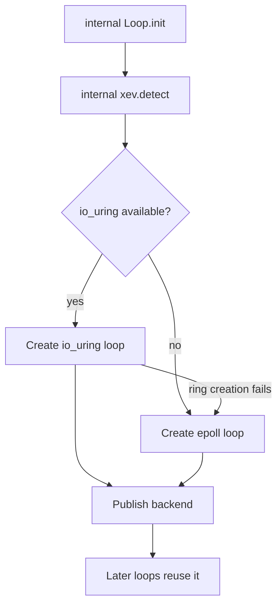

Every worker drives one libxev event loop. The backend under that loop is a
process-level property: io_uring where it is available, epoll, kqueue, or IOCP
elsewhere. Applications do not select it, and the public API exposes no getter
for it. This page explains the selection rules and the consequences.

## Backend map

| Target        | Backend              | Selection                |
| ------------- | -------------------- | ------------------------ |
| Linux         | io_uring, then epoll | Runtime, first loop only |
| macOS and BSD | kqueue               | Static for the target    |
| Windows       | IOCP                 | Static for the target    |

The loop is created with 4,096 completion entries and runs `.until_done`, so it
exits only after every I/O, timer, and cancellation completion has been
processed. All completions are inline fields of the connection, server,
transport, or engine that owns them. None is heap-allocated, and none outlives
the storage it borrows.

## Selection is process-global

Linux builds probe for a backend when the first loop is created.

The selected backend is stored in one process-global value. A later loop reuses
that selection instead of probing again. If a caller tries to force a different
backend after selection, the internal loop wrapper fails with
`error.BackendChanged` rather than mixing io_uring and epoll loops in one
process. The io_uring-to-epoll fallback is therefore available only while the
first loop is being created.

## io_uring retry rule

An established io_uring backend retries loop creation at most 32 times with a
1 ms delay between attempts. The retry is for the transient
`error.SystemResources` that the kernel reports while it uncharges a closed
ring. Any other error, any other backend, or an exhausted attempt bound returns
the original error. It never switches backends after the process selection is
established.

## Blocking file work

io_uring runs blocking file operations in the ring. epoll, kqueue, and IOCP use
an owned thread pool instead. The loop creates that pool with the loop and tears
it down before releasing loop storage, because a worker may still deliver a
completion into the loop.

This is why blocking file work is scheduled differently by backend without
changing its application contract: the completion still arrives on the worker
loop, but the blocking work happens off that loop.

## Windows IOCP

IOCP already multiplexes completions across threads and has no
`SO_REUSEPORT`. A Windows cluster binds the shared address with `SO_REUSEADDR`
instead, and the kernel distribution across listeners is unspecified. The
Windows cluster is a graceful fallback, not a load-balancing path. Each accepted
connection still lands wholly inside the accepting worker's slab.

Windows affinity uses `SetThreadAffinityMask`. Native Windows coverage compiles
the test and C ABI graph and runs `zig build test` on a Windows runner; official
support follows a green runtime job for the release commit, and no Windows
binaries are published.

## What an application controls

`ServerConfig` has no backend field. The `transport` field is the AF_XDP
request mode described in [kTLS and AF_XDP](/docs/architecture/ktls-and-xdp),
not the event-loop backend. Applications choose capacities, worker counts, TLS,
and listener addresses. The loop backend follows the host.

The `xev` module stays internal: the package exports no backend type, selector,
or loop handle. Adding backend introspection to the public API requires an ADR
first. A deployment that needs a specific backend must control the host kernel,
seccomp policy, and target triple, and then verify the chosen backend through
its own observability rather than a framework getter.

## Related

- [Transports](/docs/architecture/transports) maps the I/O that runs on the
  loop.
- [Event loop and completions](/docs/architecture/event-loop) follows a
  completion from registration to release.
- [Cluster internals](/docs/architecture/cluster-internals) shows one loop per
  worker and the lifecycle around it.
