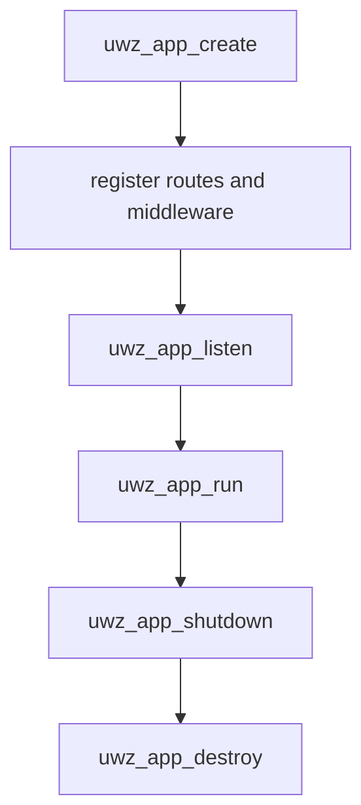

The C ABI is a separate, fixed-capacity server surface. It exposes one opaque
application handle, borrowed byte views, and copyable completion tokens, and it
deliberately does not project Zig's compile-time configuration. This page
explains the architecture behind the header. The field-by-field reference is
[C ABI types and enums](/docs/type-safety/c-abi-types).

## One opaque application

| Handle               | Meaning                                          |
| -------------------- | ------------------------------------------------ |
| `uwz_app`            | Application, listener, event loop, and C storage |
| `uwz_request`        | Callback-local request view                      |
| `uwz_response`       | Response writer for the current request          |
| `uwz_websocket`      | One upgraded WebSocket connection                |
| `uwz_async_response` | Copyable one-shot completion token               |

Treat every handle as opaque. Its layout, size, and internal fields are not part
of the ABI. The application owns the router, the fixed route table, and the
native `App` behind the handle.

## Ownership sequence

`uwz_app_create` requires `*out_app` to be `NULL` and rejects a non-`NULL`
value, so a live handle is never overwritten. The TLS and HTTP/3 create variants
follow the same rule. The ephemeral variants build an in-memory self-signed
certificate for local development.

`uwz_app_shutdown` stops listeners, drains completions, and invalidates
outstanding async tokens. Calling it from a callback requests shutdown without
re-entering the event loop; the active `uwz_app_run` drains before it returns.

`uwz_app_destroy` shuts down, releases the application, and writes `NULL`
through the caller's handle. Calling it from a callback returns
`UWZ_ERROR_INVALID_STATE` and leaves the handle valid, so the caller destroys it
after `uwz_app_run` returns. Destroying a running application is rejected for
the same reason.

## Error mapping

`uwz_error` is the single return type for a fallible entry point. `UWZ_OK` is
zero, and every failure is a stable negative code from `UWZ_ERROR_INVALID_ARGUMENT`
to `UWZ_ERROR_INTERNAL`. `uwz_error_name` returns the printable name for a code.
The negative values are part of the ABI.

## Fixed capacities

| Macro                       |  Value | Meaning                      |
| --------------------------- | -----: | ---------------------------- |
| `UWZ_MAX_ROUTES`            |   `64` | Copied route paths           |
| `UWZ_MAX_MIDDLEWARE`        |   `32` | Ordered middleware callbacks |
| `UWZ_MAX_ROUTE_PARAMETERS`  |   `16` | Inline route captures        |
| `UWZ_MAX_ROUTE_PATH_LENGTH` | `2048` | One route path               |

The C application is created with 1,024 connections. The header has no entry
point to change that capacity, and the compile-time `ServerConfig` capacities
have no C projection. Use the Zig API when the deployment needs a different
slab or a larger route table.

Route strings are copied into fixed C storage at registration. Registration
fails with `UWZ_ERROR_CAPACITY` after 64 routes or 32 middleware entries rather
than growing.

## Borrowed slices

`uwz_slice` is a pointer and a length. A zero-length slice may use `NULL` data.
Every non-empty slice passed into the API is borrowed only for that call unless
the registration function explicitly copies it.

| Value             | Lifetime                                           |
| ----------------- | -------------------------------------------------- |
| `uwz_slice`       | The call, unless a registration function copies it |
| Route path        | Copied at registration                             |
| `user_data`       | Caller-owned; keep it alive until callbacks drain  |
| Request view      | Until the callback returns                         |
| WebSocket message | The callback that receives it                      |

A request field or route parameter needed after the callback returns must be
copied into caller-owned storage. The same rule applies to a WebSocket message
slice.

## Async tokens

`uwz_async_response` has two fields: a private state pointer and a generation.
The pointer supplied to an async callback is callback-local. A callback that
returns `UWZ_HANDLER_PENDING` must copy the entire struct into caller-owned
storage.

The copy remains usable on the owning event loop until completion or app
shutdown. It must not be used after `uwz_app_destroy`. Completion checks the
generation, so a stale or duplicate token returns `UWZ_ERROR_INVALID_STATE`
instead of completing a reused slot. Completion happens exactly once on the
owning loop; cross-thread work must marshal back to that loop first.

## What the C ABI does not project

| Zig surface                                    | C ABI status |
| ---------------------------------------------- | ------------ |
| `ServerConfig` and compile-time capacities     | Not exposed  |
| `uz.schema`, `uz.json_rpc`, `uz.client`        | Not exposed  |
| HTTP/2, HPACK, HTTP/3 extensions, WebTransport | Not exposed  |
| mTLS                                           | Not exposed  |
| Async HTTP routes, WebSocket compression       | Exposed      |

The C ABI is a high-level server binding, not a one-to-one translation of every
Zig module. A C application that needs one of the missing surfaces links the Zig
API instead.

## Related

- [C ABI types and enums](/docs/type-safety/c-abi-types) lists every handle,
  enum, macro, and function group.
- [Ownership and lifetimes](/docs/concepts/ownership-and-lifetimes) explains the
  borrowed-view model shared with the Zig API.
- [Dependencies](/docs/architecture/dependencies) covers the static archives a
  C consumer links.
