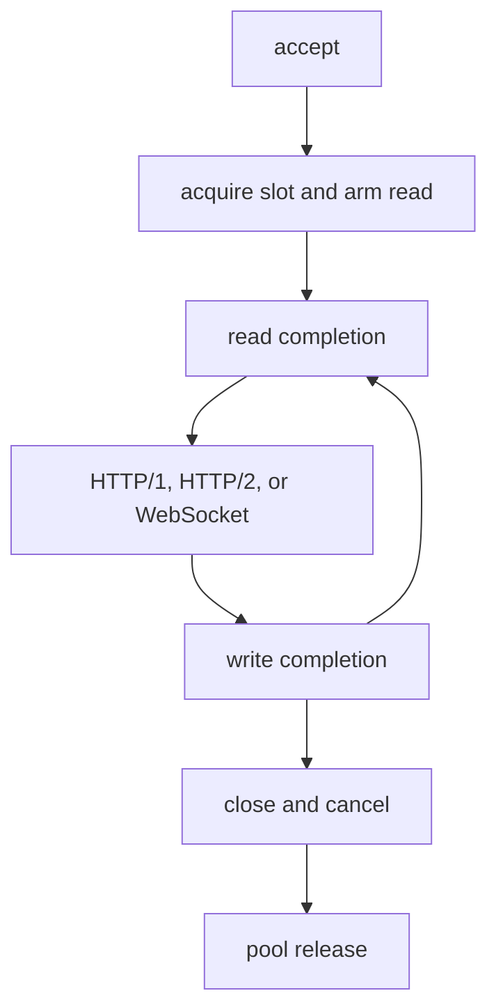

This page maps each native asynchronous entry point to the handler it invokes.
The names below are internal runtime symbols except the public request,
response, async, timer, and cluster types. Line references are intentionally
absent because they drift; the upstream
[callback lifecycle map](https://github.com/farbenbuilds/uWebZockets/blob/main/docs/callback_lifecycle.md)
tracks the current tree.

## Completion conventions

Native libxev callbacks return the internal `xev.CallbackAction` type. Callbacks
registered with a C interface or invoked directly by a handler keep their own
signatures.

| Term               | Meaning                                                                          |
| ------------------ | -------------------------------------------------------------------------------- |
| `.rearm`           | Keeps the operation registered for the next event                                |
| `.disarm`          | Stops re-arming; the handler owns any later cancellation                         |
| `core_loop.cancel` | Internal backend-aware cancel that synthesizes the completion on kqueue and IOCP |

Every cancellation goes through the internal shim rather than calling the
backend directly.

## Registration-to-handler map

| Stage            | Internal entry point                                | Registered by          | Driven by                               |
| ---------------- | --------------------------------------------------- | ---------------------- | --------------------------------------- |
| Listener accept  | `on_accept_complete`                                | `accept_start`         | A completed accept; returns `.rearm`    |
| New connection   | `on_new_connection`                                 | Accept callback        | Acquires a slot and arms the first read |
| Read             | `on_read_complete`                                  | `arm_read`             | A readable socket                       |
| TLS handshake    | `process_tls_data`                                  | Read callback          | TLS bytes on the connection             |
| HTTP/1 dispatch  | `route_http_data`                                   | Decrypted data         | Parse, middleware, and handler          |
| HTTP/2 dispatch  | `route_http2_data`                                  | Decrypted data         | `h2.receive` inside the read callback   |
| WebSocket data   | `WebSocket.on_data`                                 | Decrypted data         | One complete frame or message           |
| Write            | `on_write_complete`                                 | `start_write`          | A writable socket                       |
| File body        | `pump_file_body`                                    | Write callback         | Each write completion                   |
| Close            | `close_connection`                                  | Handler or shutdown    | Idempotent teardown                     |
| Read cancel      | `on_read_cancel_complete`                           | `close_connection`     | Cancellation completion                 |
| Write cancel     | `on_write_cancel_complete`                          | `close_connection`     | Cancellation completion                 |
| Listener close   | `on_server_close_complete`                          | `close_server`         | Listener close completion               |
| Pool release     | `release_closed_connection`                         | Close and cancel paths | All four release flags are clear        |
| Timer tick       | `on_tick`                                           | Timer scheduler        | Bounded 5 ms tick                       |
| Idle expiry      | `on_idle_timeout`                                   | Timer wheel            | The connection's idle deadline          |
| Async HTTP/1     | `complete_async_response` and `wake_async_dispatch` | `invoke_handler`       | `AsyncResponse.complete`                |
| Async HTTP/2     | `complete_http2_async_response`                     | `arm_http2_async`      | `AsyncResponse.complete`                |
| Cluster wakeup   | `on_cluster_wakeup`                                 | `arm_cluster_wakeup`   | `xev.Async` notification                |
| UDP receive      | `on_read`                                           | `quic_transport.start` | A readable UDP socket                   |
| UDP engine timer | `on_timer`                                          | `start_timer`          | The lsquic earliest timeout             |

## Ordering for one connection

1. The listener accept callback receives a socket and returns `.rearm`.
2. `on_new_connection` acquires one pool slot, resets protocol state, attaches
   TLS when configured, and arms the first read.
3. The read callback decrypts TLS data or routes plaintext bytes. It returns
   `.rearm` unless dispatch is suspended or the connection is closing.
4. HTTP/1 parses and dispatches synchronously. HTTP/2 runs `h2.receive` inside
   the read callback. WebSocket data enters the frame state machine.
5. A write completion advances the bounded ring, flushes TLS or HTTP/2 output,
   notifies WebSocket drain waiters, pumps a file body, and starts the next
   write.
6. A complete response leaves the connection available for the next request
   unless the response asked to close it.
7. Closing cancels the read and write, submits a socket close, and waits for
   close and cancellation completions.
8. `release_closed_connection` returns the slot to the pool only after the
   release gate is clear.

## The release gate

`release_closed_connection` is the only path back to the freelist. It runs when
the close completion, read cancellation, write cancellation, and active flag
are all clear. Until then the slot stays out of the pool, so a stale completion
cannot observe storage that a new connection has reused.

The client applies the same rule to its request slots: a slot returns only
after every cancellation and the socket close have drained.

## Async token generation

`AsyncResponse` is a copyable, generation-checked token. `complete_with_headers`
checks the generation, invokes the completion function, and then invokes the
wake function. A stale token fails the generation check instead of completing a
reused slot.

| Event        | Slot action                                                    |
| ------------ | -------------------------------------------------------------- |
| HTTP/1 close | Cancel the HTTP/1 async slot                                   |
| HTTP/2 close | Cancel every HTTP/2 stream slot                                |
| HTTP/2 reset | Reset the stream slots                                         |
| Pool acquire | Cancel the HTTP/1 slot before the new request uses the storage |

Cross-thread completion must be marshalled onto the owning event loop first. The
token is event-loop confined even though its value can be copied.

## Timers

`src/core/timer_wheel.zig` owns intrusive `TimerNode` entries that live inside
the connection slab. Scheduling, cancellation, and expiry never allocate. Four
levels cover fine to multi-hour deadlines, and a longer deadline waits in an
overflow list until it is in range.

`src/core/timer.zig` owns one persistent libxev timer per worker loop. It wakes
on a bounded 5 ms tick while deadlines exist, advances the wheel, and cascades
nodes. A tick disarms the completed timer and arms a fresh relative tick; it
does not return `.rearm`. `stop` does not cancel, so shutdown waits at most one
tick. Keep-alive, incomplete-header, and deferred-response deadlines share this
timer.

## QUIC callbacks

The UDP transport arms a receive completion and an engine timer. lsquic
interface callbacks are registered once by the engine and invoked synchronously
from `process_datagram` and `process`, never from a completion. Stream, header,
and packet hooks therefore run on the same loop thread as the UDP read.

The transmit path calls a synchronous non-blocking send and queues no
completion. Closing the UDP socket cancels the receive and closes the socket;
Windows closes synchronously.

## Related

- [Event loop and completions](/docs/architecture/event-loop) covers the loop
  and the release gate in more detail.
- [Asynchronous responses](/docs/concepts/async-responses) shows the public
  token workflow.
- [Shutdown ordering](/docs/architecture/shutdown) explains how every
  completion is drained.
