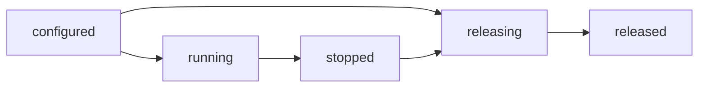

The cluster API is small on purpose: `configure`, TLS setup, `listen`, `run`,
`publish`, and shutdown. Behind it, a worker group owns lifecycle transitions,
failure capture, and release claiming, while each worker owns a slab, a loop,
and an inbox. This page maps those internals. The public contract stays in
[Cluster model](/docs/concepts/cluster-model).

## Worker group boundary

| Piece                             | Layer                                      |
| --------------------------------- | ------------------------------------------ |
| `Cluster` methods                 | Public API exported through `uz`           |
| Worker slabs, loops, TLS contexts | Per worker, owned by the cluster           |
| `src/router/worker_group.zig`     | Internal lifecycle and thread coordination |
| `ClusterState`, `WorkerFailure`   | Public types exported through `uz`         |
| `begin_release`                   | Internal release claim on the worker group |

The group borrows the cluster's thread slice and never allocates. It does not
own slabs, inboxes, TLS state, or loops. Zig has no private fields, so
`Cluster.group` is reachable, but direct access is unsupported and can break the
lifecycle invariants. Use the cluster methods.

## Lifecycle state machine

`ClusterState` is an atomic value, because a supervisor may read it while
`run` is active.

| State        | Meaning                                             |
| ------------ | --------------------------------------------------- |
| `configured` | Workers are allocated; no worker thread has started |
| `running`    | Worker threads are running or draining              |
| `stopped`    | `run` returned after every worker joined            |
| `releasing`  | One `deinit` owner is freeing worker storage        |
| `released`   | Worker and thread storage is free                   |

`run` claims the configured-to-running transition with a compare-and-swap, so a
second concurrent `run` returns `error.ClusterRunning`. Configuration calls fail
by state: `ClusterRunning` during a run, `ClusterStopped` after it, and
`ClusterDeinitialized` after release. A drained group cannot be restarted; build
a new one.

## Worker count resolution

`ClusterOptions.worker_count` selects fewer active workers than the compiled
capacity. A null value keeps the compile-time count. Zero, or a value above the
capacity, fails with `error.InvalidWorkerCount` before any worker slab is
allocated.

`build_cluster_from_environment` resolves the count in this order:

1. `ClusterOptions.worker_count`.
2. `UWEBZOCKETS_WORKERS`.
3. The platform CPU count, capped by the compiled capacity.

Only active workers allocate a slab, an inbox, and a thread handle.
`worker_count()` returns the active count, `worker_capacity()` the compiled
ceiling, and `worker(index)` returns null outside the active set.

## First failure wins

| Field   | Meaning                        |
| ------- | ------------------------------ |
| `index` | Zero-based worker index        |
| `phase` | `spawn`, `run`, or `cleanup`   |
| `err`   | Original error from that phase |

A worker failure records its detail before requesting shutdown, so a later
shutdown cascade cannot overwrite the root cause. An event-loop or cleanup
failure makes `run` return `error.ClusterWorkerFailed`; a spawn failure returns
the original OS error. In both cases `first_failure()` returns the record, and
`failure_count()` reports the total recorded since the run started. The failure
lock is cold-path only; the steady-state request path stays lock-free.

## Bounded inbox ring

Each worker owns one inbox. `uz.cluster.message_queue` is an internal Vyukov
sequence ring with 64 slots, structure-of-arrays storage, and enqueue and
dequeue cursors on separate cache lines. Any worker may publish; only the owning
worker consumes on its loop.

- A full inbox returns `error.ClusterQueueFull` instead of blocking.
- Validation runs once before any inbox is mutated, so `EmptyTopic`,
  `TopicTooLong`, and `ClusterMessageTooLarge` cannot partially deliver.
- The topic bound is 127 bytes; the payload bound is the application's
  configured `max_ws_message_size`.
- The enqueue copies both topic and payload into the ring, so the sender can
  reuse its buffers immediately.

`pop_scratch` is an internal method that copies the oldest message into
queue-owned scratch. The returned slices stay valid until the next `pop_scratch`
call, which keeps a cluster publish from overwriting a connection's fragmented
WebSocket assembly buffer. `pop_copy` writes into caller buffers instead.

## Publish report

`publish_report` returns a `PublishReport` after offering one message to every
active inbox.

| Field                  | Meaning                                    |
| ---------------------- | ------------------------------------------ |
| `queued`               | Inboxes that accepted the message          |
| `dropped`              | Inboxes that were full                     |
| `notify_failed`        | Accepted messages whose loop wakeup failed |
| `first_dropped_worker` | First full inbox index, when any           |

`attempted()` returns `queued + dropped`. `all_delivered()` is true only when
both `dropped` and `notify_failed` are zero. It describes queue and wakeup
delivery, not application subscriber delivery: a worker can still drop the
message after dispatch. `publish` keeps the `!usize` shape and returns
`report.queued`; after `run` it returns `error.ClusterStopped`.

## Release claim

`deinit_checked` calls the internal `begin_release`, which compare-and-swaps
`configured` or `stopped` to `releasing`. A running group returns
`error.ClusterRunning`. A second caller observes `releasing` or `released`,
waits for the winner, and returns without touching worker storage.

The release owner waits for in-flight supervisor calls that entered before the
claim, drives every worker loop to a drained state, frees the thread, inbox, and
worker arrays through the original allocator, and publishes `released`. `deinit`
keeps the panicking signature and delegates to the same path.

## Related

- [Cluster model](/docs/concepts/cluster-model) covers the supported startup
  order and publish contract.
- [Shared-nothing workers](/docs/architecture/shared-nothing) explains why no
  connection state crosses a worker boundary.
- [Transports](/docs/architecture/transports) maps the sockets and completions
  inside each worker.
