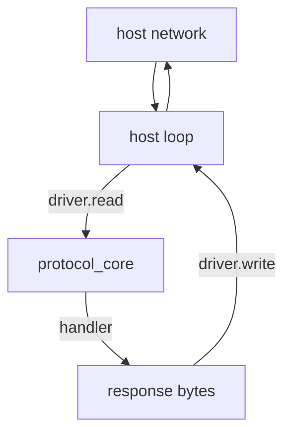

The WASM builds do not run a socket loop. They compile a platform-neutral
protocol core and expose a small host bridge: linear memory, bounded allocation,
generation-checked handles, and a driver that the host calls for reads and
writes. The host owns the network and the clock.

## What the edge build contains

`src/edge/root.zig` re-exports the platform-neutral modules: `abort`, `streams`,
`transport`, WebSocket backpressure, WebSocket streams, shared memory, SIMD, and
JSON-RPC. It does not include the native TCP, TLS, QUIC, or libxev loop modules.
There is no socket to create and no completion to arm.

## The protocol core

`uz.transport.protocol_core(capacity)` is the same bounded HTTP/1.1 parser used
on the native path. It owns a fixed request buffer, parser state, and one
`uz.Request`. `ingest` copies borrowed bytes, dispatches every complete request,
and returns the count. It reports `InputBufferFull`, `InvalidRequest`,
`HeadersTooLarge`, or `BodyTooLarge`; it never allocates.

`uz.transport.driver(Adapter)` is the host seam. The adapter supplies `read`,
`write`, `set_read_enabled`, and `close`; the driver forwards to them. The host
loop calls `driver.read` and `driver.write` directly, so these builds register
no libxev completions at all.

## Exported surface

Both WASM artifacts are built from the same root and export the bounded bridge.
The freestanding artifact also exports linear memory for a V8 isolate host.

| Export           | Contract                                                                            |
| ---------------- | ----------------------------------------------------------------------------------- |
| `alloc`          | Leases one 64 KiB block and returns its pointer, or zero                            |
| `free`           | Validates a pointer and length, then releases that block                            |
| `shared_acquire` | Returns a generation-checked handle, or zero                                        |
| `shared_pointer` | Returns the base pointer for a live handle, or zero                                 |
| `shared_commit`  | Records a committed length within the block and returns the updated handle, or zero |
| `shared_release` | Returns `0` on a valid release, `-1` for a stale or bad handle                      |

The bridge is a fixed 64-block region of 64 KiB blocks. `alloc` fails rather
than growing when the region is full. `free` ignores an invalid pointer, while
`shared_release` reports the failure to the host. A handle carries a generation,
so a released block cannot be reached through the old token.

## Host responsibilities

| Responsibility        | Owner                                                         |
| --------------------- | ------------------------------------------------------------- |
| Sockets and TLS       | Host; the edge build has no network stack                     |
| Read and write timing | Host loop                                                     |
| Memory lifetime       | Host keeps exported memory stable while a view is live        |
| Handle release        | Host releases exactly once after the view is no longer needed |
| Timers                | Host                                                          |
| Request parsing       | `protocol_core`                                               |
| Response bytes        | Application handler through the driver                        |

The host must retain each handle while its shared-memory view is live and
release it exactly once. A duplicate or stale release fails instead of freeing a
block that a later allocation may own.

## Build targets

| Target                | Output                          | Notes                               |
| --------------------- | ------------------------------- | ----------------------------------- |
| `wasm32-freestanding` | `uWebZockets-freestanding.wasm` | Exports memory for V8 isolate hosts |
| `wasm32-wasi`         | `uWebZockets-wasi.wasm`         | Compiled single-threaded            |

Both targets disable the executable entry point and export the bridge. The
freestanding target adds atomics and bulk-memory features; the WASI target uses
the default WASI feature set.

## Limits

- The edge path handles HTTP/1.1 request bytes. HTTP/2 and HTTP/3 framing stay
  on the native transports.
- A request larger than the `protocol_core` capacity fails with
  `InputBufferFull`; choose the capacity for the request line and headers you
  accept.
- Shared-memory payloads are bounded by the block size and by the envelope word
  bound passed to `read_capnp_message`.
- The bridge validates handles and envelope lengths. It does not authenticate
  the peer or validate application payload semantics.

## Related

- [Transports](/docs/architecture/transports) maps the native path this build
  omits.
- [Dependencies](/docs/architecture/dependencies) explains how the WASM build
  gets its pinned packages.
- [Shared-nothing workers](/docs/architecture/shared-nothing) contrasts the
  native worker model with a host-driven loop.
