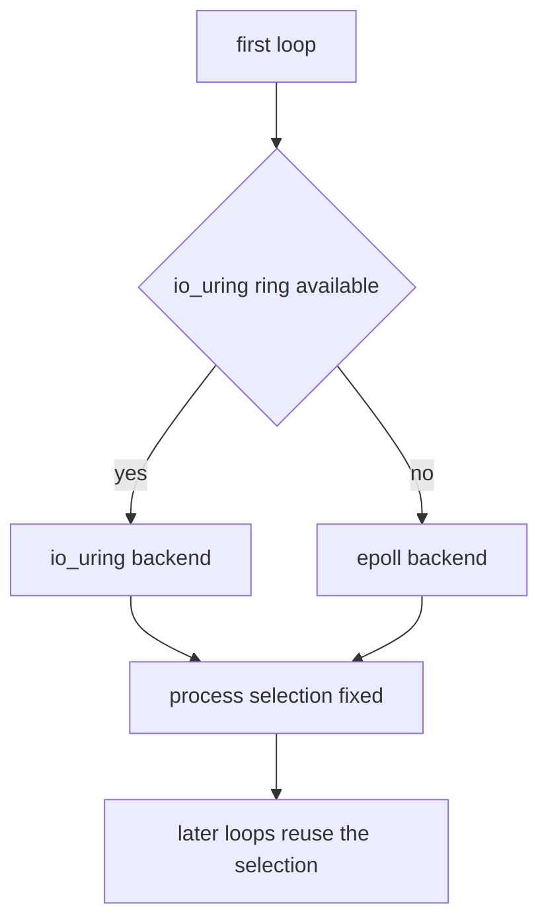

One libxev loop drives one worker. It owns every completion that the worker
submits, selects one process-wide backend, and releases a connection slot only
after all of its completions have drained. This page explains those rules and
the retry and fallback behavior behind them.

## One loop per worker

`src/core/loop.zig` is an internal wrapper around one libxev loop. It allocates
4096 completion entries and runs the loop `.until_done`, so `run` returns only
after every active completion is processed, canceled, or disarmed.

| Property           | Value                                                        |
| ------------------ | ------------------------------------------------------------ |
| Completion entries | 4096                                                         |
| Run mode           | `.until_done`                                                |
| Backend owners     | Only the loop wrapper inspects the libxev backend            |
| Blocking file work | Offloaded to an owned thread pool on epoll, kqueue, and IOCP |
| Loop lifetime      | One per worker, created before listeners accept              |

The loop creates the thread pool around the event loop and tears it down before
the loop storage is released, because a worker thread may still deliver a
completion. On io_uring, file operations stay in the ring and no thread pool is
created.

## Backend selection is process-sticky

On Linux the first loop probes io_uring and degrades to epoll when the kernel or
a container security policy rejects the ring. The fallback keeps the server
usable in Docker Desktop and OrbStack without extra privileges. Other targets
keep libxev's static single-backend API.

Dynamic selection is process-global. The first loop selects the backend exactly
once and later loops reuse that selection. An attempted backend change fails
with the internal `error.BackendChanged` instead of mixing epoll and io_uring
loops, so the io_uring-to-epoll fallback is available only on the first loop.

An established io_uring loop retries loop creation at most 32 times with a 1 ms
delay while the kernel uncharges a closed ring and reports
`error.SystemResources`. Any other error, any other backend, or an exhausted
attempt bound returns the original error instead of switching backends.

The package exports no backend type, selector, or loop handle. `xev` is
internal, and `ServerConfig.transport` selects a transport policy such as
kernel bypass, not the libxev backend. Adding backend introspection to the
public API requires an architecture decision first.

## Completions are owned inline

Every completion is an inline member of its owning connection, server,
transport, or engine. None is heap-allocated, and none outlives the storage it
borrows. A native callback returns `xev.CallbackAction`:

| Action    | Effect                                                   |
| --------- | -------------------------------------------------------- |
| `.rearm`  | Keeps the operation registered for the next event        |
| `.disarm` | Stops re-arming; the handler owns any later cancellation |

Cancellation routes through the internal `core_loop.cancel` shim. The shim
synthesizes the completion on kqueue and IOCP instead of calling the backend
directly, which keeps cancellation correct across backends.

## The release gate

A closed pool slot returns to the freelist only through the internal
`release_closed_connection` path. That path waits until four things are true:

1. The socket close completion has run.
2. Any read cancellation has completed.
3. Any write cancellation has completed.
4. The connection is no longer marked active.

Only then does the slot return to the pool. The gate prevents a stale completion
from observing a reused connection. The client uses the same rule for its
request slots.

## The timer tick

`src/core/timer_wheel.zig` is the per-worker deadline engine. It uses four levels
with intrusive nodes embedded in pooled connections, so scheduling, canceling,
and expiring a deadline never allocates.

| Level | Slots | Resolution | Coverage |
| ----- | ----: | ---------- | -------- |
| 0     |   256 | 1 ms       | 256 ms   |
| 1     |    64 | 256 ms     | 16.4 s   |
| 2     |    64 | 16.4 s     | 17.5 min |
| 3     |    64 | 17.5 min   | 18.64 h  |

`src/core/timer.zig` drives the wheel with one persistent libxev timer. It
wakes on a bounded 5 ms tick while deadlines exist. Each tick disarms the
completed timer and arms a fresh relative tick with the same inline completion;
it does not return `.rearm`, because resetting or reusing an expired timer
completion races queued callbacks on IOCP. Shutdown stops the scheduler without
canceling: the final tick observes the stop flag and disarms.

Keep-alive, incomplete-header, and deferred-response deadlines share this
timer. There is no periodic pool sweep and no file-body timer; each write
completion is the pulse for a streamed file.

## Related

- [Shared-nothing workers](/docs/architecture/shared-nothing) explains why each
  worker owns a loop.
- [Callback lifecycle](/docs/architecture/callback-lifecycle) lists the handlers
  registered against these completions.
- [Shutdown ordering](/docs/architecture/shutdown) shows how the loop drains
  before storage is released.
