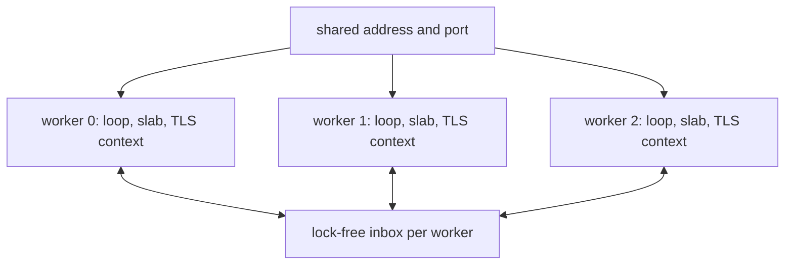

A cluster is a set of workers that share nothing but the listening port. Each
worker owns one event loop, one slab, and its own TLS context, so a connection
is never touched by two threads. This page explains that split, the inbox that
crosses it, and the difference between compiled capacity and active workers.

## What each worker owns

| Resource     | Ownership                                                             |
| ------------ | --------------------------------------------------------------------- |
| Event loop   | One libxev loop on one OS thread, pinned where the platform allows    |
| Startup slab | Pool, request buffers, message regions, write queues, protocol tables |
| TLS context  | One BoringSSL `SSL_CTX` per worker, created before listening          |
| Listener     | The same address and port as every other worker                       |
| Inbox        | One bounded lock-free ring for messages published by other workers    |
| Timer wheel  | One deadline engine per worker for keep-alive and deferred responses  |

None of these resources is reference counted or shared. An accepted connection
lands wholly inside the accepting worker's slab and is only ever touched by that
worker's loop.

Each worker owns its loop, slab, and TLS context. The kernel distributes
accepted connections across their listeners, and each worker drains only its own
inbox. A publish offers the message to every inbox; it never writes into
connection storage.

## One port, no shared connection

Every worker binds the same address and port. On Linux and other platforms with
`SO_REUSEPORT`, the kernel load-balances incoming connections across the
listeners. Because the accepting worker owns the connection for its whole life,
read, write, parse, and timer state never cross a thread boundary. That is what
keeps the steady-state I/O path free of mutexes and spinlocks.

Windows has no `SO_REUSEPORT`. In cluster mode every worker binds the shared
address with `SO_REUSEADDR` instead. Each accepted connection still lands wholly
inside the accepting worker's slab, so routing stays safe, but kernel
distribution across listeners is unspecified. The Windows cluster is a graceful
fallback, not a load-balancing path.

## Affinity is best effort

Pinning is physical-core based. On Linux the runtime reads the allowed CPU set
and skips SMT siblings, then pins worker `i` with `sched_setaffinity`. Windows
uses `SetThreadAffinityMask`. Other platforms report
`error.UnsupportedPlatform` and continue unpinned; macOS has no hard-affinity
API.

A restricted cpuset or a failed syscall logs once and leaves the worker unpinned
rather than refusing startup. Extra workers beyond the physical core count wrap
over the selection, so affinity does not become a startup failure on an
oversubscribed host.

## The inbox is the only cross-worker path

Cross-worker publish uses a bounded Vyukov sequence ring per worker inbox
(`src/router/cluster.zig`). Any worker thread may publish; only the owning
worker consumes on its event loop. The enqueue and dequeue positions sit on
separate cache lines to avoid false sharing, and the ring is allocation-free.

A full inbox does not block and does not grow. The internal queue helper reports
`error.ClusterQueueFull`, and `Cluster.publish_report` exposes the accepted and
dropped counts instead of hiding a full inbox in one aggregate number. A
publisher validates the message before any inbox is mutated, so a bad topic or
an oversized payload cannot partially deliver.

The owning loop copies each message through queue-owned scratch. A publish
therefore cannot overwrite a connection's fragmented WebSocket assembly buffer,
even when the two run on different workers.

## Capacity is not the active worker count

`App.cluster(N)` and `Server.builder(...).build_cluster(allocator, N, options)`
compile a capacity of `N` workers. The runtime may use fewer. `ClusterOptions`
is public and `ClusterOptions.worker_count` selects the active count
explicitly; `build_cluster_from_environment` prefers that option, then
`UWEBZOCKETS_WORKERS`, then the platform CPU count.

Only active workers allocate a slab, an inbox, and a thread handle, so a large
compiled capacity does not reserve memory for workers that never start.
`worker_count()` reports the allocated count, `worker_capacity()` reports the
compiled capacity, `state()` reports the cluster lifecycle, and `worker(i)`
returns null once the group has fewer active workers.

## Why no shared connection state

Sharing a connection would need a lock on every read, write, completion, and
timeout, and it would put two event loops on one buffer. The model avoids that
by giving every connection exactly one owner:

| Connection state | Owner                                              |
| ---------------- | -------------------------------------------------- |
| Slot             | Accepting worker's pool and slab                   |
| Completions      | Inline members of the connection, not heap objects |
| Async token      | Owning event loop only                             |
| Deadlines        | Owning worker's timing wheel                       |
| TLS session      | Accepting worker's `SSL_CTX`                       |

The cost is that memory scales with active workers rather than with connection
count alone: each worker carries a slab, an inbox, and, with TLS, a context. The
benefit is a hot path without cross-thread coordination.

## Related

- [Cluster model](/docs/concepts/cluster-model) covers lifecycle, failure
  reporting, and publish semantics.
- [Slab and memory model](/docs/architecture/memory-model) sizes the per-worker
  slab and inbox.
- [Callback lifecycle](/docs/architecture/callback-lifecycle) maps the loop
  callbacks that keep state inside one worker.
