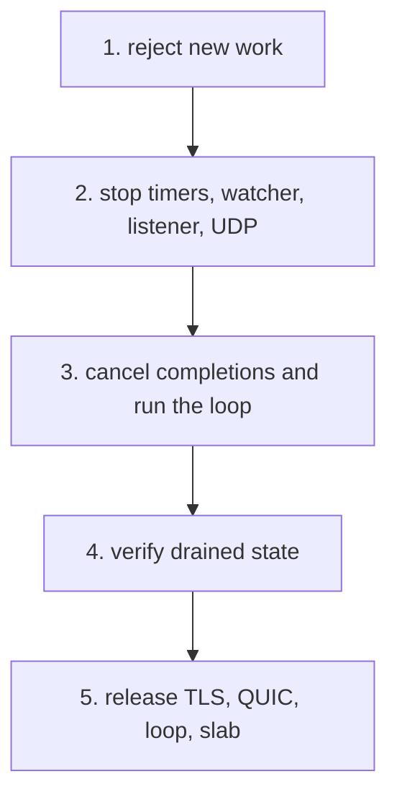

Shutdown reverses the ownership graph in a fixed order. It rejects new work,
stops recurring sources, closes listeners, cancels completions, verifies that
nothing still borrows the slab, and only then releases storage. This page traces
that order and the entry points that trigger it.

## The five steps

| Step | Action                                                                                 |
| ---- | -------------------------------------------------------------------------------------- |
| 1    | Reject new work and mark the application unavailable                                   |
| 2    | Stop the timing wheel and signal watcher, close the listener, and shut down UDP/QUIC   |
| 3    | Cancel every connection completion and run the loop until all completions are disarmed |
| 4    | Verify the drain: empty pool, completed listener close, drained QUIC transport         |
| 5    | Release TLS, QUIC, the loop, and the slab through the original allocator               |

The internal `begin_shutdown` performs the first two steps. It sets the
shutdown flag, stops the scheduler without canceling its timer, stops the
signal watcher, closes each listener, and shuts down the QUIC transport. It then
starts step 3 by calling `close_connection` for every active pool slot. The
internal `drive_shutdown` runs the loop until those cancellations finish and
then verifies the result.

## Entry points

| Call                       | Thread                 | Contract                                                                                    |
| -------------------------- | ---------------------- | ------------------------------------------------------------------------------------------- |
| `request_shutdown()`       | Any thread or callback | Stores the stop flag, wakes the owning loop, returns immediately                            |
| `shutdown()`               | Loop thread            | From a callback it starts shutdown and returns; outside a run it drives the loop and drains |
| `run()`                    | Owning thread          | Blocks until shutdown drains; re-entry returns `error.ApplicationAlreadyRunning`            |
| `deinit()`                 | Owner                  | Idempotent; panics if called from inside the event loop                                     |
| `catch_shutdown_signals()` | Before `run`           | Installs the process-wide SIGINT and SIGTERM watcher                                        |

After shutdown starts or `deinit` runs, `run` and the listen calls return
`error.ApplicationUnavailable`. `shutdown` returns
`error.ApplicationDeinitialized` after release, and `error.ShutdownIncomplete`
when anything has not drained.

## What the drain verifies

The internal `verify_shutdown` rejects an incomplete drain when any of the
following is still true:

- The pool reports an active slot.
- The timer scheduler is still active.
- The timer wheel watcher is not drained.
- The signal watcher is not drained.
- A listener has not reported its close complete.
- The QUIC transport is not drained.

`run` performs the same verification when shutdown was requested during the
loop. `deinit` calls `shutdown` and panics if shutdown fails, because returning
would leave kernel completions pointing at storage the caller is about to
release.

## Signal watcher

Call `try app.catch_shutdown_signals()` before `try app.run()`. On POSIX the
watcher installs SIGINT and SIGTERM handlers that write one byte into a
non-blocking self-pipe. A libxev file poll on the read end wakes the loop,
drains the pipe, and coalesces any number of pending signals into one shutdown
request on the loop thread.

Windows installs a console control handler that sets a process flag and wakes a
libxev async. The loop thread then invokes the same callback.

The watcher is process-wide: a second call returns
`error.SignalWatcherAlreadyInstalled`, and a call after shutdown starts returns
`error.ApplicationUnavailable`. The internal `begin_shutdown` stops the watcher
through the same arm the handler uses instead of canceling a completion. `deinit`
restores the previous signal dispositions and closes the pipe only after the loop
has drained.

## Deinitialization

`deinit` asserts drained state instead of guessing. It releases, in order:

1. The timer scheduler and file watcher.
2. The signal watcher.
3. Listener storage.
4. The QUIC transport and its TLS context.
5. The application TLS context.
6. WebSocket compression state and the HTTP gzip pool.
7. Static-file handlers and the cluster wakeup.
8. The event loop and its thread pool.
9. The connection pool, lazily allocated compression storage, kernel-bypass
   transport state, and the startup slab.

Each object is released once through its owner. A call from inside the event
loop panics with `cannot deinitialize an application from its event loop`,
because the loop still owns completions that point into the application.

## Cluster shutdown

`Cluster.request_shutdown()` asks every worker to stop through its own
asynchronous wakeup. `catch_shutdown_signals()` installs one process-wide
watcher on the first worker, so a single SIGINT or SIGTERM drains the whole
group.

A worker failure records its index, phase, and original error before requesting
shutdown. `run` returns `error.ClusterWorkerFailed`, `first_failure()` keeps
the detail after the join, and `failure_count()` reports the cascade size.
The internal `begin_release` claims the free path once, so a concurrent `deinit`
cannot double-free worker storage.

`deinit` panics if `run` is still active. Supervisors that cannot accept a
panic call `deinit_checked` and handle `error.ClusterRunning` instead.

## Related

- [Event loop and completions](/docs/architecture/event-loop) explains the
  release gate behind the drain.
- [Callback lifecycle](/docs/architecture/callback-lifecycle) lists the
  completions that shutdown cancels.
- [Server lifecycle](/docs/http/server-lifecycle) shows the same calls from an
  application's point of view.
