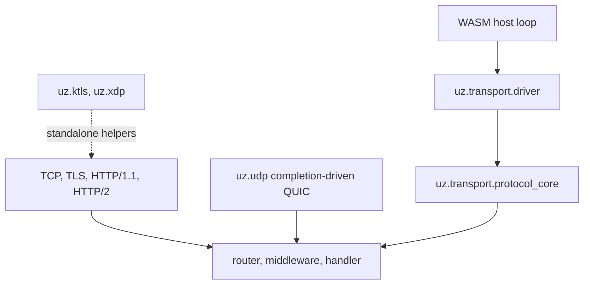

µWebZockets separates protocol state from the mechanism that moves bytes. The
native server, the QUIC listener, and the WASM edge builds reuse the same
protocol core while each transport owns its own sockets, completions, and
buffers. This page maps those pieces and states which one owns what.

## Transport stack

The application layer does not branch on the transport. The framing layer
changes, and each transport reports its own limits and errors.

## Transport families

| Family      | Entry surface                                | Integrated path    |
| ----------- | -------------------------------------------- | ------------------ |
| TCP and TLS | `init`, `init_https`, `init_https_ephemeral` | Yes, native loop   |
| HTTP/1.1    | The same TCP listener                        | Yes, native loop   |
| HTTP/2      | Prior knowledge or ALPN on the TCP listener  | Yes, native loop   |
| HTTP/3      | `init_http3`, `listen_udp`                   | Yes, QUIC listener |
| Client      | `uz.client`                                  | Outbound only      |
| WASM edge   | `uz.transport`                               | Host-driven        |
| kTLS        | `uz.ktls`                                    | Standalone helper  |
| AF_XDP      | `uz.xdp`, `uz.xdp_transport`                 | Standalone helper  |

The HTTP details live in [protocol negotiation](/docs/concepts/protocol-negotiation)
and the QUIC policy in [QUIC transport](/docs/http3/quic-transport). This page
covers the ownership boundary below them.

## The protocol-only core

`uz.transport` is a compile-time separation layer, not a socket library.

| Unit                                   | Owns                                                  | Does not own                   |
| -------------------------------------- | ----------------------------------------------------- | ------------------------------ |
| `uz.transport.protocol_core(capacity)` | A bounded request buffer, parser state, one request   | Sockets, loops, timers, TLS    |
| `uz.transport.driver(Adapter)`         | Forwarding `read`, `write`, `set_read_enabled`, close | Scheduling, buffering, retries |

`protocol_core` copies borrowed bytes into its fixed storage, parses complete
requests, invokes the handler once per request, and returns the dispatched
count. Its failures are `InputBufferFull`, `InvalidRequest`, `HeadersTooLarge`,
and `BodyTooLarge`. The capacity must hold the maximum request line plus four
bytes, or the type refuses to compile.

`driver` is the adapter seam used by WASM hosts. The adapter supplies four
functions and the driver forwards to them. It adds no policy of its own. The
[edge and WASM page](/docs/architecture/edge-and-wasm) covers the host side.

## Completion-driven QUIC

`uz.udp.quic_transport(Engine)` is the QUIC transport, not an HTTP parser. It
owns a bound UDP socket, one in-flight receive completion, a socket-close
completion, and the QUIC deadline timer. `init` binds the socket and constructs
the engine, `start` arms receive and timer work, `shutdown` cancels it, and
`is_drained` gates release.

The engine owns QUIC connections, streams, header sets, and packet pools. The
HTTP/3 adapter above it decodes pseudo-headers into `uz.Request` and writes
QPACK response fields. HTTP/3 uses a separate TLS context from TCP, so a TCP
listener can advertise `h2` and `http/1.1` while the QUIC listener advertises
only `h3`.

## Datagram plumbing

`uz.datagram` and `uz.datagram_ring` are bounded plumbing for WebTransport-style
datagrams. They are not a live WebTransport server.

| Unit                            | Bound                                                   |
| ------------------------------- | ------------------------------------------------------- |
| `uz.datagram.Router`            | 16 session paths, registered at startup, linear scan    |
| `uz.datagram_ring.DatagramRing` | Fixed capacity chosen at init, caller-owned SoA storage |
| `uz.webtransport`               | Draft-16 models, settings, capsules, and varints        |

The router keys on the session `:path` and rejects a path that does not start
with `/`. A handler receives the session id and a payload that is borrowed for
the call. The ring copies each payload into a fixed stride, so a returned view
stays valid only until its slot is reused or the ring is cleared.

The live listener answers a plain `CONNECT` with `501 Not Implemented` and
advertises no datagrams. Read [WebTransport status](/docs/http3/webtransport)
before planning an integration around these helpers.

## Shared-memory bridge

`uz.shared_memory` is a fixed-block bridge for a host you control. A `Handle`
packs a block index, an anti-reuse generation, and a leased length into one
64-bit value. `region(block_size, block_count)` validates both bounds at compile
time.

| Operation             | Guarantee                                           |
| --------------------- | --------------------------------------------------- |
| `acquire`             | Rejects zero or oversized lengths, or a full region |
| `bytes`, `capacity`   | Validate the generation before returning a view     |
| `commit`              | Records a committed length within the block         |
| `release`             | Zeroes the block and advances the generation        |
| `handle_from_pointer` | Recovers a handle only for a leased, aligned block  |

`release` fails with `InvalidHandle` for a stale or duplicate handle, so a view
cannot be freed twice through the same token. Generation wraparound is terminal:
the block is retired instead of reused.

The Cap'n Proto helpers write a single-segment envelope: an eight-byte prefix
with a zero segment count and a word count, followed by the encoded words.
`read_capnp_message` checks the prefix, the word bound, and the exact message
length. Neither the handle nor the envelope authenticates the peer. Use this
module only across a trust boundary you own, keep every handle alive for its
view, and release it exactly once.

## Related

- [Cluster internals](/docs/architecture/cluster-internals) shows the worker
  group above these transports.
- [Edge and WASM](/docs/architecture/edge-and-wasm) covers the host-driven path.
- [kTLS and AF_XDP](/docs/architecture/ktls-and-xdp) states what the standalone
  helpers do and do not wire into the server.
