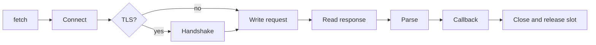

µWebZockets ships a bounded HTTP/1.1 client on the same libxev event loop as the
server. It performs one request per connection, buffers the response in
startup-allocated storage, and closes the connection after the exchange. The
plaintext request path allocates nothing; a TLS fetch allocates its BoringSSL
session and memory BIO once per connection.

The client is deliberately small. It does not resolve DNS, follow redirects,
store cookies, use a proxy, retry, pool connections, or speak HTTP/2, HTTP/3, or
WebSocket.

## Start here

<CardGroup cols={2}>
  <Card title="Client quickstart" href="/docs/client/quickstart" icon="play">
    Fetch a URL from a Zig program and read the status, headers, and body.
  </Card>
  <Card title="fetch_blocking" href="/docs/client/fetch-blocking" icon="square">
    Run one request to completion with caller-owned response storage.
  </Card>
  <Card title="Callback client" href="/docs/client/callback-client" icon="layers">
    Keep multiple requests in flight and drive the loop with `run`.
  </Card>
  <Card title="TLS trust" href="/docs/client/tls-trust" icon="shield-check">
    Verify a server with an explicit CA bundle, SNI, and TLS 1.3 only.
  </Card>
</CardGroup>

## Reference

<CardGroup cols={2}>
  <Card title="Timeouts and errors" href="/docs/client/timeouts-and-errors" icon="clock">
    Read connect and read deadlines, failure kinds, and setup errors.
  </Card>
  <Card title="Client limits" href="/docs/client/limits" icon="ruler">
    Read every buffer, in-flight slot, and response bound.
  </Card>
</CardGroup>

## Request lifecycle



`fetch` only arms the work. Nothing runs until `run` drives the loop, or until
`fetch_blocking` runs its temporary client.

## Smallest fetch

```zig
const std = @import("std");
const uz = @import("uWebZockets");

pub fn main(init: std.process.Init) !void {
    var storage: uz.client.FetchStorage = .{};

    const outcome = try uz.client.fetch_blocking(init.io, .{
        .method = .get,
        .host = "127.0.0.1",
        .path = "/status",
    }, .{
        .port = 8080,
        .connect_timeout_ms = 2_000,
        .read_timeout_ms = 5_000,
    }, &storage);

    switch (outcome) {
        .response => |response| std.log.info("status {d}, {d} bytes", .{
            response.status,
            response.body.len,
        }),
        .failure => |failure| std.log.err("fetch failed ({s}): {s}", .{
            @tagName(failure.kind),
            failure.message,
        }),
    }
}
```

The returned response view borrows `storage`; it is valid while `storage` lives.

## Request fields

| Field     | Type             | Default  | Rule                                    |
| --------- | ---------------- | -------- | --------------------------------------- |
| `method`  | `Method`         | `.get`   | Selects the HTTP method token           |
| `host`    | `[]const u8`     | required | Numeric IPv4 or IPv6 literal            |
| `path`    | `[]const u8`     | `/`      | Origin-form target, including the query |
| `headers` | `[]const Header` | `&.{}`   | Borrowed; reserved names are rejected   |
| `body`    | `[]const u8`     | `""`     | Borrowed; `Content-Length` is generated |

`FetchOptions` adds `port`, optional `tls`, `connect_timeout_ms`,
`read_timeout_ms`, and `response_body_capacity`. The builder emits `Host` and
`Connection: close` on every request.

## Request and response framing

The request builder always emits `Host`, adds `Content-Length` when a body is
present, and sends `Connection: close`. A caller header named `Host`,
`Content-Length`, `Transfer-Encoding`, or `Expect` is rejected with
`error.ReservedHeader` rather than producing a duplicate field. `host` is a
numeric address; IPv6 literals are written without brackets and the builder adds
them to the header.

The response parser accepts these framing rules:

| Response shape              | Behavior                                          |
| --------------------------- | ------------------------------------------------- |
| `Content-Length`            | Body length is taken from the field               |
| `chunked` with trailers     | Chunks are decoded in place; trailers up to 8 KiB |
| Close-delimited             | Body ends when the peer closes                    |
| `HEAD`, `204`, `205`, `304` | Empty body regardless of framing fields           |
| Up to eight `100 Continue`  | Skipped as interim responses                      |
| Any other 1xx               | `.protocol` failure                               |
| Conflicting framing fields  | `.protocol` failure                               |
| Unsupported transfer coding | `.protocol` failure                               |

The parser does not follow redirects, store cookies, or reuse a connection. A
response that violates these rules becomes a `.protocol` failure, not a partial
body.

## Boundaries

| Feature                 | Status                                    |
| ----------------------- | ----------------------------------------- |
| HTTP/1.1 request        | Supported                                 |
| TLS 1.3                 | Supported with an explicit trust policy   |
| Plaintext HTTP          | Supported                                 |
| DNS resolution          | Not supported; use a numeric address      |
| Redirects               | Not followed                              |
| Cookies                 | Not stored                                |
| Proxy                   | Not supported                             |
| Automatic retries       | Not performed                             |
| Connection pooling      | Not supported; one request per connection |
| HTTP/2 or HTTP/3 client | Not shipped                               |
| WebSocket client        | Not shipped                               |
| mTLS                    | Not supported                             |

:::warning[Resolve names outside the client]
`Request.host` must be a numeric IPv4 or IPv6 literal. Put a DNS name in
`TlsOptions.server_name` for SNI and certificate verification, but connect to an
address you resolved yourself.
:::

## Next

Read [Client quickstart](/docs/client/quickstart) to run the first fetch, then
[TLS trust](/docs/client/tls-trust) before using the client outside localhost.
