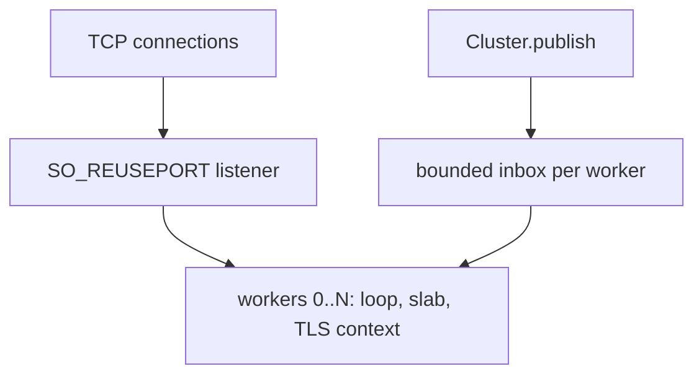
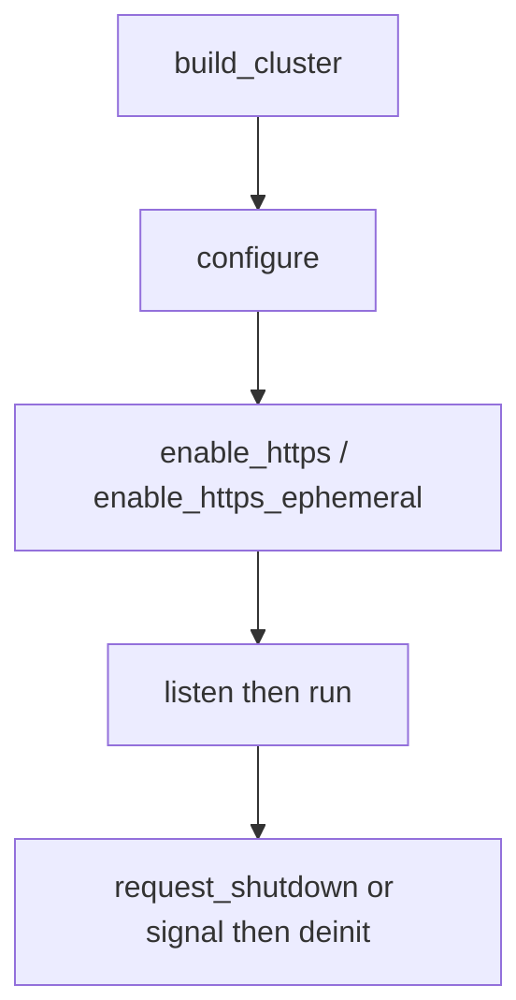

A µWebZockets cluster is a thread-per-core group of complete applications. Each
active worker owns one event loop, one startup slab, one bounded inbox, and, when
TLS is enabled, one TLS context. No connection, request buffer, queue, completion,
or mutable TLS state crosses a worker boundary.

## Capacity is not the active count

`build_cluster(allocator, worker_count, options)` treats its `worker_count`
argument as the compiled capacity. The runtime may use fewer workers:

- `ClusterOptions.worker_count` selects a smaller active count.
- `build_cluster_from_environment` prefers that option, then the
  `UWEBZOCKETS_WORKERS` environment variable, then the platform CPU count.
- Zero or a value above the compiled capacity fails with
  `error.InvalidWorkerCount` before any worker slab is allocated.

Only active workers allocate a slab, an inbox, and a thread handle, plus a TLS
context when TLS is enabled. A large compiled capacity therefore does not reserve
memory for unused workers. `worker_count()` reports the active count and
`worker_capacity()` reports the compiled ceiling.

## Topology



Each worker in the `W` group is a separate event loop with its own slab and TLS
context. The kernel distributes accepted connections across the listeners, and
each accepted connection lands wholly inside the accepting worker's slab.
Cross-worker publish writes into the destination worker's bounded inbox, and
only the owning worker drains it. On Windows the group binds with
`SO_REUSEADDR`; kernel distribution is unspecified and the Windows cluster is a
graceful fallback, not a load-balancing path.

## Lifecycle

```zig
const std = @import("std");
const uz = @import("uWebZockets");

fn hello(_: *uz.Request, res: *uz.Response) void {
    res.text("hello from a worker") catch {};
}

pub fn main(init: std.process.Init) !void {
    var group = try uz.Server.builder(init.io)
        .with_max_clients(256)
        .build_cluster(std.heap.page_allocator, 4, .{});
    defer group.deinit();

    const Group = @TypeOf(group);
    try group.configure(struct {
        fn routes(worker: *Group.Worker, index: usize) !void {
            _ = index;
            _ = try worker.get("/", hello);
        }
    }.routes);

    try group.listen("0.0.0.0", 3000);
    group.run() catch |err| {
        if (group.first_failure()) |failure| {
            std.log.err("worker {d} ({s}): {s}", .{
                failure.index,
                @tagName(failure.phase),
                @errorName(failure.err),
            });
        }
        return err;
    };
}
```

The program omits the signal watcher; `Cluster.catch_shutdown_signals()` installs
the same one-watcher shutdown path for every worker. The supported order is
`build_cluster`, `configure`, optional TLS setup, `listen`, `run`, shutdown, then
`deinit`. Routes are registered per worker through `configure` before `listen`
locks them.

| State        | Meaning                                                |
| ------------ | ------------------------------------------------------ |
| `configured` | Workers exist, but no worker thread has started        |
| `running`    | Worker threads are running or draining                 |
| `stopped`    | `run` returned after every worker joined               |
| `releasing`  | `deinit` claimed release and is freeing worker storage |
| `released`   | Every worker and thread handle is released             |

Lifecycle-sensitive calls fail by name instead of touching drained storage. A
configuration call while `run` is active returns `error.ClusterRunning`; a call
after `run` returns returns `error.ClusterStopped`; a call after release returns
`error.ClusterDeinitialized`. `deinit_checked()` reports `error.ClusterRunning`
while the group is active, and concurrent release waits for the winning releaser
to publish `released`.

## First failure wins

`run()` returns `error.ClusterWorkerFailed` when a worker fails. The root cause
stays available through `first_failure()`, a `WorkerFailure` with `index`,
`phase`, and `err`. The phase is `spawn`, `run`, or `cleanup`. The first failure
wins, so a later shutdown cascade does not replace it. `failure_count()` reports
the total number of failures recorded since the last `run`.

## Publish is bounded delivery

`Cluster.publish(topic, message, is_text)` broadcasts through bounded per-worker
rings and returns `PublishError!usize` with the accepted count. Each inbox holds
64 messages. A stopped group has no consumer, so publish after `run` returns
`error.ClusterStopped` instead of queueing into dead loops.

`publish_report` returns `PublishReport` with `queued`, `dropped`,
`notify_failed`, and `first_dropped_worker`. Validation runs before any inbox is
mutated, so `EmptyTopic`, `TopicTooLong`, and `ClusterMessageTooLarge` cannot
partially deliver. `all_delivered()` means every active worker accepted the
message and every loop wakeup was posted; it does not mean an application
subscriber consumed the message.

Use `request_shutdown()` to drain every worker. After `deinit` it is a
documented no-op because the worker slice is gone; use `state()` and
`deinit_checked()` when a supervisor needs a typed answer.

## TLS ordering

Call one of these exactly once after `configure` and before `listen`:



Each worker creates and owns one BoringSSL `SSL_CTX` before any listener exists,
and each connection creates its own `SSL` from that worker's context. Credential
files are read once per worker, so rotation requires a rolling restart. A second
enable returns `error.TlsAlreadyEnabled`; enabling after `listen` returns
`error.AlreadyListening`.

`enable_https` does not configure client certificates; use single-application
`init_https_mtls` when mutual TLS is required. HTTP/3 and QUIC clustering are not
supported: `init_http3` and `listen_udp` remain single-application APIs, and a
cluster listener is TCP/TLS only. The
[upstream roadmap](https://github.com/farbenbuilds/uWebZockets/blob/main/docs/roadmap.md)
records the boundary.

## Next

- [Shared-nothing workers](/docs/concepts/shared-nothing) explains the ownership
  rule behind the topology.
- [Shared-nothing cluster](/examples/shared-nothing-cluster) runs the worker group.
- [Security model](/docs/concepts/security-model) covers the TLS and
  authentication boundaries around a cluster.
