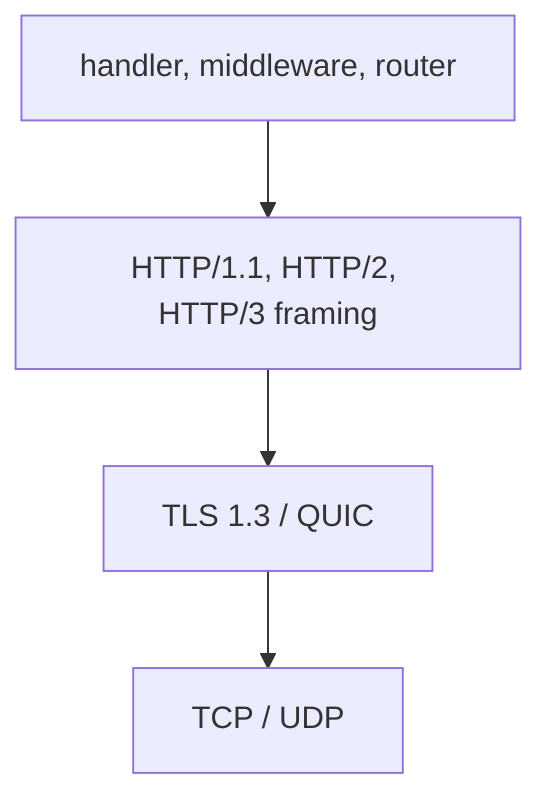

µWebZockets chooses the wire protocol from how a connection arrives, not from a
per-route setting. After negotiation, HTTP/1.1, HTTP/2, and HTTP/3 reach the same
router, middleware, and `uz.Handler`. Only the transport, its limits, and its
error behavior differ.

## One handler boundary

| Transport     | Entry point                                              | How the protocol is chosen                                     |
| ------------- | -------------------------------------------------------- | -------------------------------------------------------------- |
| Plaintext TCP | `init`                                                   | HTTP/1.1, or HTTP/2 when the client opens with prior knowledge |
| TLS over TCP  | `init_https`, `init_https_ephemeral`, `init_https_mtls`  | ALPN selects `h2` ahead of `http/1.1`                          |
| QUIC          | `init_http3`, `init_http3_ephemeral`                     | The QUIC context advertises only `h3`                          |
| TLS cluster   | `Cluster.enable_https`, `Cluster.enable_https_ephemeral` | Same ALPN policy, TCP and TLS only                             |

An HTTP/3 application uses both listeners: `listen` for TCP/TLS and
`listen_udp` for QUIC. The TCP context still advertises `h2` and `http/1.1`, so
one application can serve HTTP/1.1, HTTP/2, and HTTP/3 on the ports you bind.

## Transport layers



The application layer is identical on every path. The framing layer changes
between HTTP/1.1, HTTP/2, and HTTP/3; TLS 1.3 carries TCP and QUIC, and the
operating system carries TCP or UDP. A handler never branches on the transport
unless it chooses to inspect `Request` metadata.

## Plaintext HTTP/2 uses prior knowledge

A plaintext listener accepts HTTP/1.1 and HTTP/2 on the same socket. Before
HTTP/1.1 parsing begins, the transport checks whether the client opened with the
HTTP/2 connection preface. A client that sends the preface is routed into the
embedded HTTP/2 session.

There is no `Upgrade: h2c` exchange. The server never answers with
`101 Switching Protocols`, because the h2c Upgrade mechanism is not implemented.
RFC 9113 removed that mechanism; prior knowledge is the standard cleartext path,
and TLS ALPN is the standard encrypted one.

:::warning[Not supported]
An HTTP/2 client cannot start with an HTTP/1.1 `Upgrade` request. Configure the
client for prior knowledge on cleartext connections, or use TLS with ALPN.
:::

## TLS uses ALPN

TLS termination uses BoringSSL with TLS 1.3 only. Older protocol versions are
rejected at the context. The context advertises `h2` first and `http/1.1`
second, so a client that offers both receives HTTP/2. The context selects with
`select_http_protocol`; an established connection exposes the chosen value with
`negotiated_protocol`.

Early data follows the same policy for single-application and cluster TLS. The
dispatcher admits only safe methods until the handshake is confirmed: `GET`,
`HEAD`, `OPTIONS`, and `TRACE`. `QUERY` remains replay-unsafe, and a non-safe
method that arrives in early data receives `425 Too Early`. Client-certificate
modes `.optional` and `.required` disable TLS 1.3 early data, because the client
certificate is checked in the second flight.

## HTTP/3 uses a separate context

`init_http3` loads the same certificate and key into two contexts. The TCP
context advertises `h2` and `http/1.1`; the QUIC context advertises only `h3`.
The HTTP/3 adapter decodes pseudo-headers directly into `uz.Request` and writes
QPACK response headers without converting through HTTP/1.1 text.

```zig
const std = @import("std");
const uz = @import("uWebZockets");

fn hello(_: *uz.Request, res: *uz.Response) void {
    res.text("hello over HTTP/3") catch {};
}

pub fn main(init: std.process.Init) !void {
    var server = try uz.App(128).init_http3(
        init.io,
        "certs/fullchain.pem",
        "certs/privkey.pem",
    );
    defer server.deinit();

    _ = try server.get("/", hello);
    try server.listen("0.0.0.0", 3443);
    try server.listen_udp("0.0.0.0", 8443);
    try server.run();
}
```

`init_http3_ephemeral` generates a development certificate in memory. The `App`
value must stay at a stable address after `listen_udp`.

## Fixed protocol capacities

HTTP/2 uses one embedded session per TCP connection and fixes each connection at
eight concurrent streams. The per-stream header block, request body, and
response header limits come from `ServerConfig`:

- `max_h2_header_block_size`
- `max_h2_body_size`
- `max_h2_response_header_size`
- `max_h2_response_header_count`

One RFC 8441 WebSocket tunnel is allowed per HTTP/2 connection. A second tunnel
receives `503 Service Unavailable` without disturbing the active one. Raising
the stream count requires specializing the connection type and is tracked in the
[upstream roadmap](https://github.com/farbenbuilds/uWebZockets/blob/main/docs/roadmap.md).

HTTP/3 decodes request headers within `max_header_size` and
`max_header_count`, and bounds request bodies with `max_h3_body_size`. Response
metadata uses `max_h3_response_header_size` and `max_h3_response_header_count`.
Connections, active streams, and packet buffers are sized by the application
capacity and the QUIC engine, not by the header and body fields.

:::warning[Not supported]
HTTP/2 server push is not implemented. HTTP/3 extended CONNECT, WebTransport,
push, and application datagrams are helper-only; the live QUIC listener rejects
`CONNECT` with `501 Not Implemented`. HTTP/3 clustering is not supported. The
[upstream roadmap](https://github.com/farbenbuilds/uWebZockets/blob/main/docs/roadmap.md)
records each boundary.
:::

## Verify the negotiated version

With the server above running, an HTTP/3-capable `curl` prints the version it
used:

```sh
curl -sk --http2 https://127.0.0.1:3443/ -o /dev/null -w '%{http_version}\n'
curl -sk --http3-only https://127.0.0.1:8443/ -o /dev/null -w '%{http_version}\n'
```

The first command prints `2` when ALPN selected HTTP/2. The second prints `3`
when the QUIC listener is reachable and the client supports HTTP/3. The example
above has no plaintext listener; add one with `init` and `listen` on another
port before using `--http2-prior-knowledge`.

## Next

- [Type safety](/docs/concepts/type-safety) explains how capacities, JSON, and
  callbacks are checked before the server starts.
- [Cluster model](/docs/concepts/cluster-model) covers the TCP/TLS worker group.
- [Your first HTTP/3 server](/docs/examples/first-http3-server) builds the QUIC
  path step by step.
