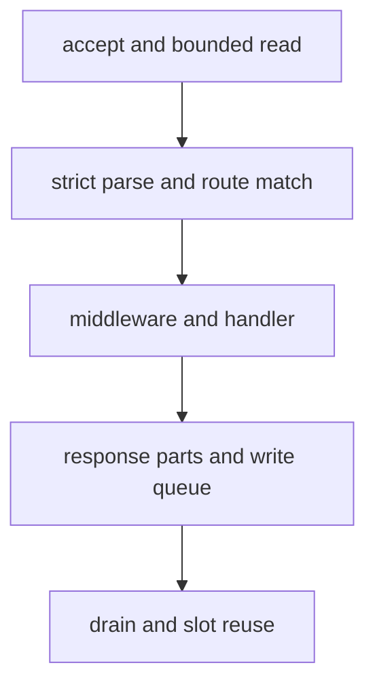

Every request follows the same bounded path. The transport differs, but parsing,
routing, middleware, and handler invocation stay on one application surface.
This page traces that path and shows where a request can fail.

The diagram groups the nine stages below into five checkpoints. The numbered
list keeps the detail: accept, read, parse, route, middleware, handler, response
parts, drain, and reuse.

## From accept to handler

1. **Accept.** The listener accepts a socket and calls the application's accept
   callback. For HTTP/1.1 and HTTP/2, the application acquires one connection
   slot from the startup slab. When the pool is exhausted, it closes the new
   socket immediately instead of growing memory.
2. **Bounded read.** The transport reads into the connection's fixed request
   buffer. TLS decrypts into the same ownership boundary; a plaintext socket is
   checked for the HTTP/2 prior-knowledge preface before HTTP/1.1 parsing.
3. **Strict parse.** The parser proves that a complete request head and body are
   present. It rejects conflicting framing and malformed syntax with
   `400 Bad Request`. Oversized input is rejected before the handler runs:
   `413 Payload Too Large` for the body and `431 Request Header Fields Too
Large` for the request line or headers.
4. **Route match.** The router resolves the first request in the buffer and
   records the matching node or pattern. Route captures borrow the connection's
   request buffer.
5. **Middleware.** Ordered middleware callbacks run before the selected handler.
   Route resolution happens first so middleware can stop dispatch for a matched
   route, and middleware also runs when no route matched, before the `404`.
6. **Handler.** The router calls the synchronous, context, async, or
   async-context handler stored for that method and route.
7. **Response parts.** The response writer appends the status line, headers,
   and body as bounded parts into the connection's write queue. A large body is
   not concatenated into one buffer.
8. **Drain.** The event loop writes queued bytes as the socket becomes writable.
   Chunked responses, producer streams, and file bodies finish through their own
   completion path.
9. **Reuse or close.** A complete response leaves the connection available for
   the next request unless the response asked to close it. A closing connection
   returns its slot to the pool only after close, read, write, and cancellation
   completions have all drained.

## HTTP/1.1, HTTP/2, and HTTP/3

| Stage            | HTTP/1.1                              | HTTP/2                                             | HTTP/3                        |
| ---------------- | ------------------------------------- | -------------------------------------------------- | ----------------------------- |
| Unit             | Connection                            | Stream in one connection                           | QUIC stream                   |
| Request storage  | Per-connection request buffer         | One per-connection session with eight stream slots | QUIC engine pools             |
| Concurrency      | One request dispatched at a time      | Up to eight concurrent streams                     | Bounded by the QUIC engine    |
| Response framing | Text head and body parts              | HPACK frames                                       | QPACK fields                  |
| Early data       | TLS 0-RTT: safe methods only          | TLS 0-RTT: safe methods only                       | Listener rejects 0-RTT        |
| Reuse gate       | Connection slot after all completions | Stream slot plus its async token                   | Stream close and pool release |

HTTP/1.1 keeps pipelined bytes after a response completes and dispatches each
complete request in order. HTTP/2 reads stay armed while a stream waits on an
async token, and each stream owns its response state. HTTP/3 decodes pseudo
headers directly into the same `Request` shape and writes structured response
headers without converting through HTTP/1.1 text.

## Where a request stops

A request can leave this path before the handler:

- A full connection pool closes the accepted socket. No queue waits for a slot.
- A malformed request receives `400 Bad Request`.
- An oversized body receives `413 Payload Too Large` with a structured JSON
  document that names the limit and its value.
- Oversized headers or a request line receive `431 Request Header Fields Too
Large` with the equivalent document.
- Middleware can finish the response and stop dispatch before the handler runs.

A handler that returns without starting a response receives
`500 Internal Server Error`. The response lifecycle explains that completion
rule in detail.

## Next

- [Response lifecycle](/docs/concepts/response-lifecycle)
- [HTTP limits](/docs/http/limits)
- [Routing model](/docs/concepts/routing-model)
