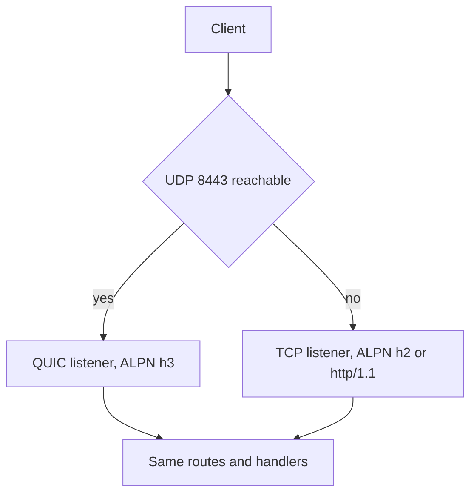

HTTP/3 is a second listener on the same application, not a second deployment
model. `init_http3` creates a TCP context that advertises `h2` and `http/1.1` and a
QUIC context that advertises only `h3`; `listen_udp` binds the UDP endpoint. The
handlers are unchanged, so the operational work is firewalls, load balancers, and
certificate rotation.

## What changes with QUIC

| Property            | TCP listener                          | QUIC listener                         |
| ------------------- | ------------------------------------- | ------------------------------------- |
| Transport           | TCP                                   | UDP                                   |
| ALPN                | `h2`, then `http/1.1`                 | `h3` only                             |
| Early data          | Safe methods only, others `425`       | Rejected                              |
| Clustering          | `build_cluster` with per-worker loops | Not supported                         |
| Metrics registry    | Advances request counters             | Emits log records, no counter advance |
| Client certificates | `init_https_mtls` only                | Not requested                         |

The metrics gap matters for dashboards: an HTTP/3-only path can serve traffic
while `uwz_http_requests` stays flat. Alert on the QUIC listener separately.

## Bind both listeners

```zig
const std = @import("std");
const uz = @import("uWebZockets");

fn index(_: *uz.Request, res: *uz.Response) void {
    res.text("hello over HTTP/3") catch {};
}

pub fn main(init: std.process.Init) !void {
    var server = try uz.App(128).init_http3(
        init.io,
        "certs/fullchain.pem",
        "certs/privkey.pem",
    );
    defer server.deinit();

    _ = try server.get("/", index);
    try server.catch_shutdown_signals();
    try server.listen("0.0.0.0", 3443);
    try server.listen_udp("0.0.0.0", 8443);
    try server.run();
}
```

The `App` value must stay at a stable address after `listen_udp`; the QUIC
transport borrows it. One process owns the QUIC endpoint, so do not add
`listen_udp` to a worker group.

## Firewall and port binding

```sh
sudo ufw allow 8443/udp
sudo ufw allow 3443/tcp
ss -lunp | grep 8443
ss -ltnp | grep 3443
```

Open UDP on every hop, including cloud security groups and node firewalls. A
blocked UDP port fails at the first QUIC handshake, while TCP keeps working, so
the symptom looks like a broken HTTP/3 client rather than a firewall. Confirm the
socket is bound before debugging the client.

## Certificate contexts

`init_http3` reads the same PEM chain and key into both contexts. The certificate
argument is a chain with the leaf first, and a key that does not match fails at
startup rather than at the first handshake.

| Fact                             | Consequence                                         |
| -------------------------------- | --------------------------------------------------- |
| TLS 1.3 only on both contexts    | A TLS 1.2 client fails the handshake                |
| QUIC advertises `h3` only        | No cross-protocol downgrade on the UDP listener     |
| Client certificates are TCP-only | mTLS does not protect QUIC traffic                  |
| Files are read once at startup   | Rotation is a rolling restart, never a file rewrite |

There is no hot reload, so a rotated certificate requires a new process. Keep the
old one draining while the new one serves, exactly as for TCP TLS.

## No clustering

`init_http3` and `listen_udp` are single-application APIs. A clustered worker group
is a TCP/TLS listener, and QUIC clustering is not implemented. Scale HTTP/3 by
running independent replicas behind a UDP-capable load balancer, not by adding
workers that share a QUIC endpoint.



Replicas share no QUIC state, so a client that reconnects to another replica starts
a new connection. That is normal for this topology and does not need session
affinity, but it does mean resumption is per process.

## Early data is disabled

The live QUIC listener rejects 0-RTT, so a replayed datagram cannot reach a
handler. The policy helpers exist for a future backend, but the deployed path does
not admit early data. TCP keeps its safe-method policy, where `GET`, `HEAD`,
`OPTIONS`, and `TRACE` may arrive before the handshake confirms and other methods
receive `425 Too Early`.

## Load balancer requirements

| Requirement                       | Why                                                      |
| --------------------------------- | -------------------------------------------------------- |
| UDP forwarding                    | A TCP-only balancer makes the QUIC listener unreachable  |
| Per-connection backend stickiness | One QUIC connection's datagrams must stay on one replica |
| Health check outside QUIC         | Probe the TCP listener; a UDP check cannot speak HTTP    |
| No TLS termination for QUIC       | Terminating QUIC at the balancer leaves a TCP backend    |
| Idle timeout above QUIC idle      | Short NAT or LB timers drop long-lived connections       |

Address migration breaks per-connection stickiness, so a deployment that relies on
5-tuple hashing should keep migration disabled or accept reconnect failures after
a network change.

## Verify

```sh
curl --version | grep -i HTTP3
curl --http3-only -k https://127.0.0.1:8443/
curl --http2 -k https://127.0.0.1:3443/
```

```console
hello over HTTP/3
hello over HTTP/3
```

`--http3-only` fails when the QUIC handshake fails; `--http3` silently falls back to
HTTP/2 and can pass on the wrong protocol. Use `-v` when you need to see the
negotiated version.

## Fallback to TCP

Keep the TCP listener even when UDP works everywhere. Clients without QUIC, and
clients behind a network that blocks UDP, then use HTTP/2 or HTTP/1.1 with the same
handlers. The framework does not emit `Alt-Svc`, so discovery belongs to the client
or the edge; do not advertise `h3` in DNS if you cannot keep UDP open.

## Failures

| Symptom                              | Cause                                       | Fix                                                     |
| ------------------------------------ | ------------------------------------------- | ------------------------------------------------------- |
| HTTP/3 handshake times out           | UDP blocked on a firewall or security group | Allow the UDP port end to end                           |
| TCP works, QUIC never does           | A TCP-only load balancer sits in front      | Add UDP forwarding or bypass the balancer               |
| `425 Too Early` on QUIC              | Early data expected to work                 | It is rejected by design; retry after the handshake     |
| Client reconnects to another replica | No stickiness or a NAT rebind               | Enable per-connection affinity, or accept the reconnect |
| Metrics show no HTTP/3 traffic       | The QUIC path does not advance the registry | Alert on development-log records or a separate probe    |
| Certificate rejected only on QUIC    | A client without TLS 1.3 or `h3` support    | Use the TCP listener for that client                    |
