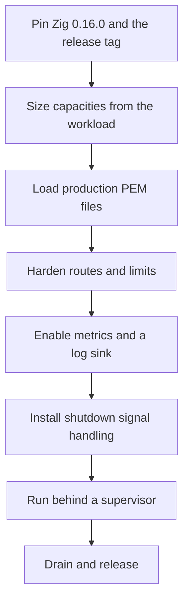

This section turns the framework's contracts into a production runbook. It
covers the decisions you own at launch: credentials, capacity, request
hardening, observability, and the process lifecycle around a supervisor.

µWebZockets gives you a server, not a platform. Certificates, secret storage,
load balancing, and the operating system stay yours. Read this section as the
list of decisions you must make before the first real client connects.

## Deployment path

Each step is verifiable before the next one matters. A capacity error shows up
as a startup allocation failure, a credential error as a failed `listen`, and a
missing shutdown handler as a truncated drain.

## Ready to ship

| Gate          | Minimum bar                                                       | Evidence                                       | Page                                                    |
| ------------- | ----------------------------------------------------------------- | ---------------------------------------------- | ------------------------------------------------------- |
| Credentials   | Production PEM chain and key, or a documented ephemeral exception | `init_https` returns without a load error      | [TLS deployment](/docs/deployment/tls)                  |
| Capacity      | `slab_bytes()` fits the host budget for every active worker       | Printed per-worker footprint and worker count  | [Capacity planning](/docs/deployment/capacity-planning) |
| Hardening     | Auth, rate limits, CORS, headers, and limits are decided          | Middleware registration and configured limits  | [Hardening](/docs/deployment/hardening)                 |
| Observability | Metrics endpoint or snapshots, and a log destination              | A scrape or a `log_metrics` line after traffic | [Observability](/docs/deployment/observability)         |
| Shutdown      | SIGTERM drains and the process exits cleanly                      | A load test that sends SIGTERM under traffic   | [Production checklist](/docs/deployment/checklist)      |
| Platform      | The supported target set matches the deployment plan              | Compile and runtime evidence from the release  | [Production checklist](/docs/deployment/checklist)      |

## Page map

<CardGroup cols={2}>
  <Card title="Production checklist" href="/docs/deployment/checklist" icon="clipboard-check">
    Run one ordered list with the evidence and rollback for every launch gate.
  </Card>
  <Card title="TLS deployment" href="/docs/deployment/tls" icon="lock">
    Load production PEM files, choose mTLS, and rotate credentials without a hot reload.
  </Card>
  <Card title="Capacity planning" href="/docs/deployment/capacity-planning" icon="ruler">
    Turn a preset into per-worker memory, then verify the slab before allocation.
  </Card>
  <Card title="Hardening" href="/docs/deployment/hardening" icon="shield">
    Decide authentication, rate limits, headers, timeouts, and the TRACE policy.
  </Card>
  <Card title="Observability" href="/docs/deployment/observability" icon="activity">
    Collect bounded metrics, route the development log, and read the HTTP/3 gap.
  </Card>
</CardGroup>

## Also in this section

| Page                                                    | What it covers                                       |
| ------------------------------------------------------- | ---------------------------------------------------- |
| [Shutdown and draining](/docs/deployment/shutdown)      | Drain order, signals, and cluster release            |
| [Docker](/docs/deployment/docker)                       | Multi-stage image, non-root, read-only filesystem    |
| [Kubernetes](/docs/deployment/kubernetes)               | Probes, grace period, and capacity requests          |
| [systemd](/docs/deployment/systemd)                     | Unit file, hardening directives, and logs            |
| [Reverse proxy](/docs/deployment/reverse-proxy)         | Client address, upgrade, buffering, and timeouts     |
| [HTTP/3 deployment](/docs/deployment/http3)             | UDP binding, certificate contexts, and no clustering |
| [Zero-downtime rollout](/docs/deployment/zero-downtime) | Rolling restart and per-worker resumption            |
| [Windows](/docs/deployment/windows)                     | Support gate, build path, and IOCP transport facts   |
| [BSD targets](/docs/deployment/bsd)                     | Build-only status and local validation               |

## Boundaries

These are framework decisions, not missing configuration. Plan around them
instead of waiting for a switch.

| Boundary                       | Behavior                                                                                         | What to do                                                       |
| ------------------------------ | ------------------------------------------------------------------------------------------------ | ---------------------------------------------------------------- |
| No hot certificate reload      | PEM files are read once when each worker creates its context                                     | Roll a new process and drain the old one                         |
| No HTTP/3 cluster              | `init_http3` and `listen_udp` remain single-application APIs                                     | Run QUIC as a separate single application                        |
| Windows support is gated       | Compile gates plus a native runtime job; official support follows a green run for the release    | Treat Windows as gated until the release evidence says otherwise |
| No dynamic capacity growth     | Every pool is fixed at startup and exhaustion returns a structured rejection                     | Size before launch and monitor rejections                        |
| No shipped deployment assets   | There is no published image, Helm chart, or systemd unit                                         | Build your own from Zig 0.16.0                                   |
| BSD targets have no runtime CI | FreeBSD, NetBSD, OpenBSD, and DragonFlyBSD share the build graph without hosted runtime coverage | Validate on your own host before promising support               |

Windows binaries are not published. Releases are source tags, so a Windows
deployment builds from source and owns its own runtime evidence.

## Related

- [Server lifecycle](/docs/http/server-lifecycle) for `listen`, `run`, and
  `shutdown` ordering.
- [Graceful shutdown](/docs/operations/graceful-shutdown) for the signal path
  and drain behavior.
- [Platform support](/docs/operations/platforms) for the supported target
  matrix and gated claims.
- [Threat model](/docs/security/threat-model) for the assets this section
  protects.
