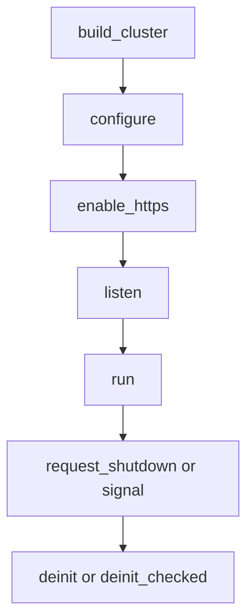

A production µWebZockets listener terminates TLS 1.3 with BoringSSL. The
framework fixes the protocol policy and reads the credentials your deployment
provides. This page covers the credential path, the mTLS decision, the early-data
rule, and the restart procedure that replaces a certificate.

For the protocol surface itself, read [TLS 1.3 and ALPN](/docs/security/tls).
This page is about the deployment around it.

## Load production credentials

```zig
var server = try uz.App(128).init_https(
    init.io,
    "certs/fullchain.pem",
    "certs/privkey.pem",
);
defer server.deinit();
```

Both paths are NUL-terminated Zig slices (`[:0]const u8`). The certificate file
is a PEM chain with the leaf certificate first. The key file is a PEM private
key. BoringSSL checks the pair while loading, so a mismatch fails at startup
with `error.PrivateKeyLoadFailed` instead of failing during the first handshake.

| Path                             | Credential source                        | Intended use                  |
| -------------------------------- | ---------------------------------------- | ----------------------------- |
| `init_https`                     | PEM chain and key                        | Production and shared systems |
| `init_http3`                     | PEM files into the TCP and QUIC contexts | Production QUIC               |
| `init_https_ephemeral`           | Generated in memory                      | Local development and tests   |
| `init_https_mtls`                | Server PEM plus a client CA bundle       | Client-certificate identity   |
| `Cluster.enable_https`           | PEM files loaded once per worker         | Production TLS cluster        |
| `Cluster.enable_https_ephemeral` | Generated once per worker                | Development cluster only      |

Ephemeral credentials are not exportable and are unsuitable for pinning. Use
them only where a client can skip verification.

## Decide on mutual TLS

mTLS belongs at the TLS layer when the caller's identity must be proven before
any route runs. It is TCP-only: the HTTP/3 context does not request a client
certificate, and `Cluster.enable_https` does not configure client certificates.

| Mode                      | Requests a certificate | Verifies it             | Anonymous clients | Early data        |
| ------------------------- | ---------------------- | ----------------------- | ----------------- | ----------------- |
| `tls.ClientAuth.none`     | No                     | No                      | Allowed           | Safe-method 0-RTT |
| `tls.ClientAuth.optional` | Yes                    | When presented          | Allowed           | Disabled          |
| `tls.ClientAuth.required` | Yes                    | Yes; missing cert fails | Rejected          | Disabled          |

`.optional` and `.required` need a non-empty `ca_path`. A verified certificate
proves possession of a key; it does not grant a role. Authorization still
belongs to the handler. Read [Mutual TLS](/docs/security/mtls) for the bundle
format and the revocation boundary.

## ALPN and protocol split

| Transport | Context               | Advertised protocols  |
| --------- | --------------------- | --------------------- |
| TCP       | One context for HTTPS | `h2`, then `http/1.1` |
| QUIC      | A separate context    | `h3` only             |

TLS 1.3 is the only accepted version; there is no downgrade switch. A client
that offers only `http/1.1` still connects, because the TCP context advertises
both protocols. A client that offers only `h2` on a QUIC listener fails, because
the QUIC context advertises `h3`.

## Early data

The TCP context enables 0-RTT unless client certificates are configured. Before
the handshake confirms, the dispatcher admits only `GET`, `HEAD`, `OPTIONS`, and
`TRACE`. Every other method receives `425 Too Early`.

Early data is replayable by a network attacker. Treat `GET` handlers on the
public listener as read-only, or move state-changing work to a method that
cannot arrive as early data. `QUERY` stays replay-unsafe. The QUIC context keeps
early data disabled.

## Cluster ordering



Call one enable function exactly once after `configure` and before `listen`.
`listen` locks routes and starts accepting, so an enable call after it returns
`error.AlreadyListening`, and a second enable returns `error.TlsAlreadyEnabled`.

Each active worker creates and owns one `SSL_CTX` before any listener exists,
then creates one `SSL` per accepted connection. Credential files are read once
per worker, and no TLS state is shared between loops. The request path adds no
lock and no allocation.

Per-worker ticket keys also bound session resumption. A reconnect that lands on
another worker cannot resume the earlier session. The 1.9.0 measurement reused
100 of 120 handshakes with one worker and 23 of 120 with four workers, which is
the expected per-worker ticket behavior. Plan for a full handshake when a load
balancer redistributes connections.

## Rotate credentials

There is no hot reload. Replacing the files on disk has no effect on a running
process, and a signal does not reload them. Rotate with a rolling restart:

1. Install the new chain and key at the configured paths, keeping the old files
   available.
2. Start a new process with the same routes and capacity.
3. Verify the new handshake and negotiated protocol before sending user traffic.
4. Shift traffic with the load balancer or service discovery.
5. Send `SIGTERM` to the old process and wait for it to drain and exit.
6. Remove the old files after the supervisor reports a clean exit.

[Certificate rotation](/docs/security/certificate-rotation) covers the full
sequence and the cluster case.

## Errors

| Error                         | Cause                                                                |
| ----------------------------- | -------------------------------------------------------------------- |
| `CertificateLoadFailed`       | The PEM chain could not be read or parsed                            |
| `PrivateKeyLoadFailed`        | The PEM key could not be read, parsed, or matched to the certificate |
| `KeyMismatch`                 | Defensive context check; the key already fails during load           |
| `InvalidClientAuthConfig`     | A mode other than `.none` was given with an empty `ca_path`          |
| `TrustStoreLoadFailed`        | The client CA bundle could not be read or parsed                     |
| `ProtocolConfigurationFailed` | The TLS 1.3 bounds could not be applied                              |
| `TlsContextCreationFailed`    | BoringSSL could not allocate the context                             |
| `AlreadyListening`            | `enable_https` was called after `listen` started                     |
| `TlsAlreadyEnabled`           | `enable_https` was called more than once                             |
| `ClusterRunning`              | A configuration call was made while `run` was active                 |
| `ApplicationUnavailable`      | A worker was already shutting down or deinitialized                  |

A failed enable releases only the contexts that call created and can be retried
after the cause is fixed. It never rewrites a context installed by an earlier
successful call.

## Related

- [TLS 1.3 and ALPN](/docs/security/tls) for the protocol policy.
- [Mutual TLS](/docs/security/mtls) for client-certificate modes.
- [Certificate rotation](/docs/security/certificate-rotation) for the rolling
  restart evidence.
- [Capacity planning](/docs/deployment/capacity-planning) for the per-worker
  memory that a TLS context adds outside the slab.
