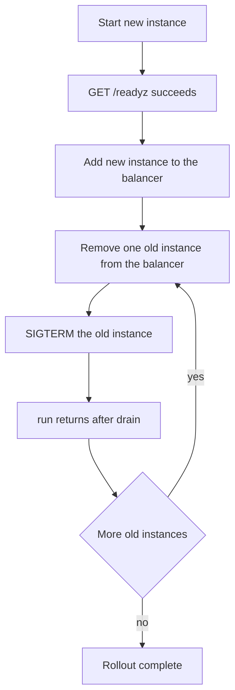

Zero downtime here means no client request fails because a process was replaced.
The framework supplies a clean drain; it does not supply hot reload, a socket
handoff, or a coordinated listener takeover. A rollout is therefore a load
balancer procedure with the application cooperating, not an application feature
you switch on.

## What the framework gives you

| Mechanism                        | Available | Boundary                                                          |
| -------------------------------- | --------- | ----------------------------------------------------------------- |
| Signal-driven drain              | Yes       | SIGINT and SIGTERM; bounded by `idle_timeout_ms`                  |
| Explicit shutdown from a handler | Yes       | The active `run` drains before it returns                         |
| `SO_REUSEPORT` inside a process  | Yes       | Workers in one group share the port; the kernel balances accepts  |
| Cross-process socket handoff     | No        | `listen_all` is in-process all-or-nothing; handoff is carried     |
| Hot certificate reload           | No        | Per-worker contexts read the PEM files once at startup            |
| Cross-worker TLS resumption      | No        | Per-worker ticket keys mean a reconnect may need a full handshake |

The cluster requests `SO_REUSEPORT` for its own workers, but that is not a
cross-process handoff: a replacement process starts its own listeners, and nothing
tells the old process to stop accepting. The safe rollout still removes an instance
from the load balancer before stopping it.

## Rollout sequence



1. Build an immutable artifact and tag it by digest, not by a moving tag.
2. Start the new instance next to the old ones. It binds its own port and slab.
3. Poll `/readyz` until it answers. Readiness must mean the listener is bound.
4. Add the instance to the load balancer and wait for the first healthy checks.
5. Remove one old instance from the balancer. For a TCP proxy, wait for its
   connection draining or keep-alive timeout.
6. Send SIGTERM. The app stops accepting, cancels completions, and waits for the
   pool to empty.
7. Wait for the process to exit inside the grace period, then repeat.

Starting the new instance before removing the old one keeps capacity flat. A
rollout that stops first and starts later has a gap even when each step is clean.

## Certificate rotation

Certificate rotation uses the same procedure with a different artifact:

| Step | Action                                                             |
| ---- | ------------------------------------------------------------------ |
| 1    | Put the new chain and key where the new process reads them         |
| 2    | Start the new process; it reads the files once at startup          |
| 3    | Add it to the balancer and confirm the served chain with `openssl` |
| 4    | Remove and drain the old process                                   |
| 5    | Keep the old certificate valid until the last old process exits    |

There is no file watch and no reload call. Rewriting a PEM file under a running
process changes nothing, because every worker loaded its context at startup.
A cluster loads one context per worker from the same files, so all workers see the
new credential only after they restart.

## Per-worker resumption

TLS ticket keys are per worker, so a client that reconnects after a restart may
land on a worker that cannot resume its session. The 1.9.0 measurement recorded
this as expected behavior and accepted it for the target HTTP workload; a
four-worker group resumes far fewer reconnects than a single worker.

The operational effect is a burst of full handshakes after a restart, not a
failure. Budget CPU for it, and do not build a rollout plan that assumes session
resumption survives a process replacement.

## What a rollout cannot do

| Assumption                                 | Reality                                                         |
| ------------------------------------------ | --------------------------------------------------------------- |
| Send SIGHUP to reload configuration        | No SIGHUP handler; the default action terminates the process    |
| Replace the binary in place                | The running process keeps its mapped image                      |
| Inherit listeners from the old process     | No descriptor handoff; `listen_all` is in-process only          |
| Keep WebSocket sessions across the restart | A drained socket closes; clients must reconnect and resubscribe |
| Migrate QUIC connections to a new process  | HTTP/3 is single-application and per process                    |

WebSocket clients need a reconnect strategy with backoff and a way to re-establish
subscriptions, because the server does not transfer a live socket to a new
process. The same applies to long-lived SSE streams.

## Rollback

Keep the previous image digest, the previous certificate pair, and the previous
capacity configuration until the rollout has survived one full traffic cycle.
Rollback is the same procedure in reverse:

1. Start instances of the previous digest.
2. Wait for readiness, then add them to the balancer.
3. Remove the new instances, send SIGTERM, and wait for the drain.
4. Confirm the previous version serves the same routes and protocols.

The framework has no schema or data migration mechanism, so a change that alters
stored data is outside this procedure. Decide the compatibility window before the
rollout, not during the rollback.

## Verify

```sh
fail=0
for i in $(seq 1 300); do
  curl -fsS -o /dev/null https://app.example.com/healthz || fail=$((fail + 1))
  sleep 0.2
done
echo "failures: $fail"
```

Run that loop in one terminal while the rollout runs in another. Expect
`failures: 0`; any other count names a gap in the balancer drain, the readiness
gate, or the grace period, not a framework drain defect.

## Failures

| Symptom                               | Cause                                             | Fix                                                     |
| ------------------------------------- | ------------------------------------------------- | ------------------------------------------------------- |
| Brief 502s at each replacement        | SIGTERM sent before the balancer removed the pod  | Remove from the balancer first, then signal             |
| Connection resets during drain        | Grace period shorter than `idle_timeout_ms`       | Raise the grace period or lower the idle timeout        |
| New instance receives traffic early   | Readiness passes before the listener binds        | Make `/readyz` check the listener, not just the process |
| Old process never exits               | A handler blocks its loop                         | Return from the handler; do not block on shutdown work  |
| Handshake CPU spike after the rollout | Per-worker ticket keys force full handshakes      | Expect it; size CPU and connection limits for the burst |
| WebSocket clients do not recover      | No reconnect and resubscribe logic in the client  | Add backoff and subscription replay to the client       |
| Rollback serves mixed behavior        | Old and new instances share one balancer too long | Drain one version fully before the other takes over     |
