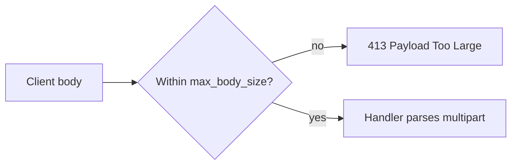

An upload is a request body the server buffers completely before your handler runs;
`max_body_size` decides whether it can arrive at all.

## Problem

A form posts one file and a few text fields. Bound the file, validate the fields,
and reject an oversized request clearly.

## Assumptions

- The upload fits a fixed body limit chosen at startup.
- The handler runs after the body is complete, so it can inspect every part.
- The server, not the handler, answers a body over the limit.

## Request body model



µWebZockets has no incremental upload streaming. A handler cannot start processing
bytes while the client is still sending, and no API exposes a partial body.

## Build the upload route

```zig src/main.zig
const std = @import("std");
const uz = @import("uWebZockets");

const max_upload: usize = 8 * 1024 * 1024;

fn safe_filename(name: []const u8) bool {
    if (name.len == 0 or name.len > 255) return false;
    if (std.mem.indexOfAny(u8, name, "/\\") != null) return false;
    return std.mem.endsWith(u8, name, ".png") or std.mem.endsWith(u8, name, ".jpg");
}

fn upload(req: *uz.Request, res: *uz.Response) void {
    var parser = req.multipart() catch |err| {
        res.end("400 Bad Request", @errorName(err)) catch {};
        return;
    };

    var files: usize = 0;
    while (true) {
        const maybe_part = parser.next_part() catch |err| {
            res.end("400 Bad Request", @errorName(err)) catch {};
            return;
        };
        const part = maybe_part orelse break;
        const filename = part.filename orelse continue;
        if (!safe_filename(filename)) {
            res.end("415 Unsupported Media Type", "") catch {};
            return;
        }
        files += 1;
    }

    var buffer: [48]u8 = undefined;
    const body = std.fmt.bufPrint(&buffer, "files={d} bytes={d}", .{
        files,
        req.bytes().len,
    }) catch return;
    res.text(body) catch {};
}

pub fn main(init: std.process.Init) !void {
    const builder = uz.Server.builder(init.io).with_max_body_size(max_upload);
    var server = try builder.build(std.heap.page_allocator);
    defer server.deinit();

    _ = try server.post("/upload", upload);
    try server.catch_shutdown_signals();
    try server.listen("127.0.0.1", 3000);
    try server.run();
}
```

`with_max_body_size` takes a compile-time value because it sizes the generated
application type, and a larger limit enlarges the per-connection slab.

## Validate before use

| Check                   | Reject with                         | Why                                  |
| ----------------------- | ----------------------------------- | ------------------------------------ |
| Media type is multipart | `400`, `error.NotMultipartFormData` | `req.multipart()` needs a boundary   |
| Part has a valid name   | `400`, `error.MissingPartName`      | A part without `name` is not a field |
| Filename has no path    | `415`                               | A path must not reach storage        |

`Part.filename` is attacker-controlled. Treat it as a label, never as a path.

## Capacity assumptions

| Resource     | Default          | Behavior when exceeded                                 |
| ------------ | ---------------- | ------------------------------------------------------ |
| Request body | 16 KiB           | `413` before the handler; HTTP/2 closes the connection |
| Boundary     | 70 bytes maximum | `error.InvalidMultipartBoundary`                       |

The default body limit fails most real uploads. Set `with_max_body_size` to the
largest body you accept, then keep an application cap per file. See
[HTTP limits](/docs/http/limits) and [backpressure](/docs/concepts/backpressure).

## Failure behavior

| Condition                     | Result                                           |
| ----------------------------- | ------------------------------------------------ |
| Body over `max_body_size`     | `413` with `payload_too_large` and `limit_bytes` |
| Missing or malformed boundary | `400` from your handler                          |

## Verification

```sh
curl -i -X POST http://127.0.0.1:3000/upload \
  -F 'title=guide' -F 'avatar=@./avatar.png'

head -c 9000000 /dev/zero > big.bin
curl -s -o rejection.json -w '%{http_code}\n' \
  -F 'file=@big.bin' http://127.0.0.1:3000/upload
jq -e '.error.code == "payload_too_large"' rejection.json
```

The first call returns the byte count; the second returns `413` and no handler runs.

## Variation: one file only

Count file parts and reject a second one.

```zig
var seen = false;
while (true) {
    const maybe_part = parser.next_part() catch break;
    const part = maybe_part orelse break;
    if (part.filename == null) continue;
    if (seen) {
        res.end("400 Bad Request", "one file only") catch {};
        return;
    }
    seen = true;
}
res.end("201 Created", "") catch {};
```

## Variation: several fields

Copy each text value into bounded storage as you meet it.

```zig
const Form = struct { title: [128]u8 = undefined, title_len: usize = 0 };

fn read_field(form: *Form, part: uz.multipart.Part) bool {
    const name = part.name orelse return false;
    if (!std.mem.eql(u8, name, "title")) return true;
    if (part.data.len > form.title.len) return false;
    @memcpy(form.title[0..part.data.len], part.data);
    form.title_len = part.data.len;
    return true;
}
```

A value larger than its column must fail before the copy, not truncate silently.

## Next

- [Multipart parsing](/docs/http/helpers/multipart) lists part headers and errors.
- [HTTP limits](/docs/http/limits) covers every body and header bound.
