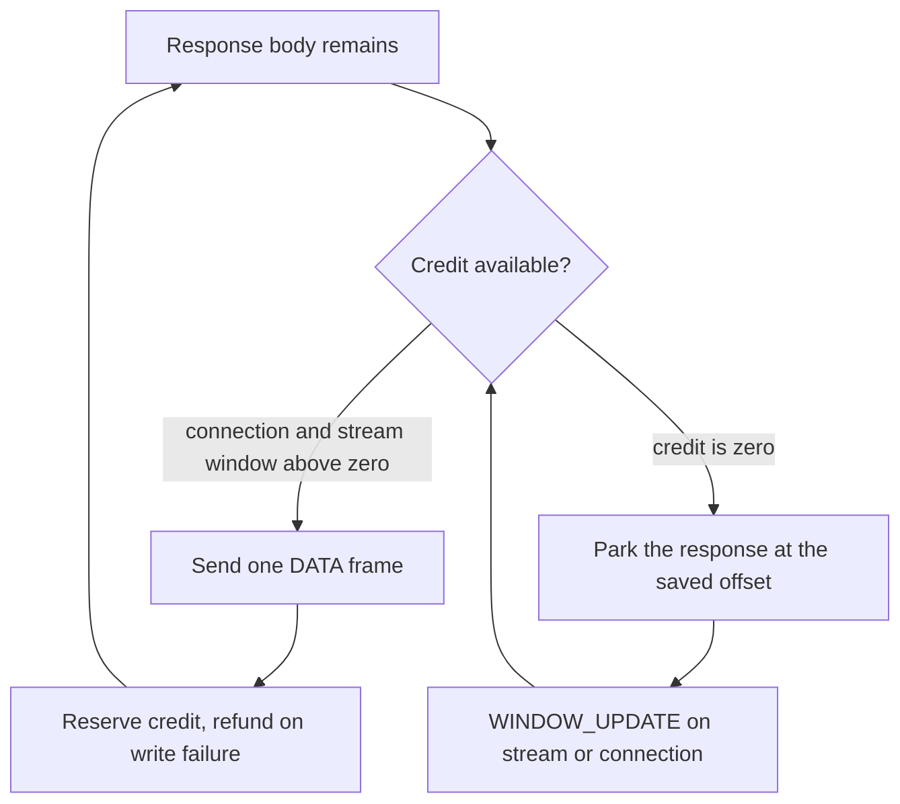

HTTP/2 flow control is credit-based in both directions. The receiver grants
credit with WINDOW_UPDATE and the sender may not exceed it. µWebZockets uses the
mechanism in two different ways: receive credit keeps the protocol moving, and
send credit bounds a response that the peer is not reading.

## Initial windows

| Window             | Initial value | Raised by                           |
| ------------------ | ------------- | ----------------------------------- |
| Connection receive | 65,535 bytes  | `WINDOW_UPDATE` on stream zero      |
| Connection send    | 65,535 bytes  | Peer `WINDOW_UPDATE` on stream zero |
| Stream receive     | 65,535 bytes  | `WINDOW_UPDATE` on the stream       |
| Stream send        | 65,535 bytes  | Peer `WINDOW_UPDATE` on the stream  |

A peer can change the initial stream window for new streams through
`SETTINGS_INITIAL_WINDOW_SIZE`. The session applies the delta to every open
stream, as RFC 9113 requires, and rejects a value that would overflow a window.

## Receive: credit is replenished per DATA frame

When a DATA frame arrives, the session returns the accepted byte count to both
the connection and the stream window and sends two WINDOW_UPDATE frames. This
keeps a client from stalling while the application is busy.

Receive flow control therefore is not the memory bound. The request body is
bounded separately:

1. `max_h2_body_size` sizes the per-stream body region.
2. A body that exceeds it resets the stream with `ENHANCE_YOUR_CALM`.
3. A `content-length` above the limit resets with `PROTOCOL_ERROR` before any
   byte is buffered.

A client that ignores the reset and keeps sending consumes credit but cannot
write past the stream buffer. The stream is already closed.

## Send: credit is the backpressure signal

A response body is written in DATA frames. Each frame reserves connection and
stream credit before it is written and refunds it if the transport refuses the
write.

Each frame is the smallest of four values:

| Limit                    | Source                                       |
| ------------------------ | -------------------------------------------- |
| Remaining response body  | The producer or the one-shot body            |
| Peer maximum frame size  | `SETTINGS_MAX_FRAME_SIZE`                    |
| Transport frame capacity | The write path's maximum payload             |
| Available credit         | Minimum of connection and stream send window |

When `available` reaches zero, the response parks. `WINDOW_UPDATE` for either the
stream or the connection calls the pending path again and continues from the
saved offset. The handler is not re-entered and the body is not copied twice.

## Producer streaming

A `StreamProducer` resumes on the same signal. The producer runs once when it is
armed, then again after each drain or WINDOW_UPDATE. Returning `.pending` because
of credit exhaustion is correct; returning it because data is not ready is not,
because nothing will call the producer again.

Keep the producer cursor in application storage. The response object is
connection-owned and may move between callbacks. See
[streaming responses](/docs/http/streaming).

## WebSocket tunnels

An RFC 8441 tunnel sends WebSocket frames as DATA. The session has no per-stream
pending queue for tunnel frames, so it cannot park a partial frame. When no
credit is available, the tunnel resets instead of buffering.

`data_frame_capacity` reports the largest DATA payload the peer and transport
accept. A tunnel send splits a payload across frames up to that capacity, and
terminates when capacity reaches zero.

## Errors

| Condition                                         | Result                          |
| ------------------------------------------------- | ------------------------------- |
| WINDOW_UPDATE increment of zero on the connection | GOAWAY `PROTOCOL_ERROR`         |
| WINDOW_UPDATE increment of zero on a stream       | RST_STREAM `PROTOCOL_ERROR`     |
| Window above 2^31-1                               | GOAWAY `FLOW_CONTROL_ERROR`     |
| DATA that exceeds the stream window               | RST_STREAM `FLOW_CONTROL_ERROR` |
| DATA that exceeds the connection window           | GOAWAY `FLOW_CONTROL_ERROR`     |
| DATA on an idle stream                            | GOAWAY `PROTOCOL_ERROR`         |

A flow-control error is not retryable on the same connection when it is
connection-scoped. The client must reconnect.

## Tuning

The shipped windows are not configurable. The repository benchmark sweep found
worker-count scaling sufficient without window tuning, so 65,535 remains the
initial value and `SETTINGS_INITIAL_WINDOW_SIZE` accepts a peer value.

If a peer advertises a small initial window, large responses become many small
DATA frames. That is correct behavior, not a bug. Measure frame count and
`WINDOW_UPDATE` frequency before asking for a larger window.

## Next

- [Frames and streams](/docs/http2/frames-and-streams) for the frame state
  machine.
- [HTTP/2 limits](/docs/http2/limits) for the full bound table.
