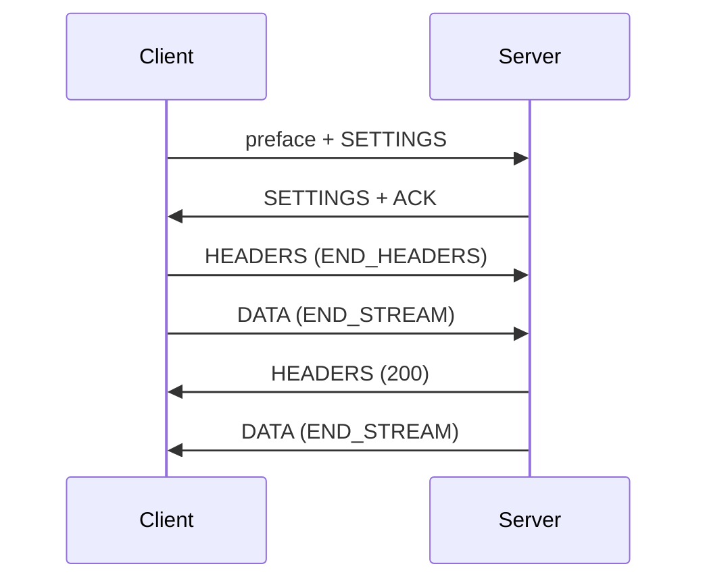

An HTTP/2 connection multiplexes requests as streams. Each stream carries one
request and one response, and the connection owns the shared state: the preface,
SETTINGS, HPACK tables, and flow-control windows. This page traces one exchange
and names the validation that rejects a malformed one.

## One request, end to end



The session dispatches a request when its end-stream marker arrives: either
`END_STREAM` on the initial header block or the final DATA frame. The handler
always sees the complete bounded body, and a client that never ends the request
keeps its stream slot reserved until the connection closes.

## Preface

The first bytes on a cleartext connection are compared against the public
`client_preface` constant:

```zig
const std = @import("std");
const uz = @import("uWebZockets");

test "cleartext preface is 24 bytes" {
    try std.testing.expectEqual(@as(usize, 24), uz.http2.client_preface.len);
}
```

The bytes are `PRI * HTTP/2.0`, CRLF twice, `SM`, then CRLF twice. A mismatch
falls back to HTTP/1.1 parsing. Once the preface is accepted, the first frame
must be a non-acknowledged SETTINGS frame; anything else sends GOAWAY with
`PROTOCOL_ERROR`.

## Frame header

Every frame starts with nine bytes:

| Offset | Size | Field                                |
| ------ | ---- | ------------------------------------ |
| 0      | 3    | Payload length, 24-bit big-endian    |
| 3      | 1    | Frame type                           |
| 4      | 1    | Flags                                |
| 5      | 4    | Stream identifier, high bit reserved |

A payload above 16 KiB is a connection error and sends GOAWAY with
`FRAME_SIZE_ERROR`, regardless of what the peer advertised.

## Frame types

| Type            | Handling                                                    |
| --------------- | ----------------------------------------------------------- |
| `SETTINGS`      | Validated, acknowledged, and applied                        |
| `PING`          | Echoed with the ACK flag and the same payload               |
| `GOAWAY`        | Stops new local streams and lets active ones finish         |
| `RST_STREAM`    | Releases the stream slot and notifies the close callback    |
| `HEADERS`       | Starts a request or trailer section                         |
| `CONTINUATION`  | Appends to the open header block                            |
| `DATA`          | Appends to the request body and returns flow-control credit |
| `WINDOW_UPDATE` | Raises connection or stream send credit                     |
| `PRIORITY`      | Parsed and ignored; the session does not reprioritize       |
| Unknown type    | Ignored, as RFC 9113 requires                               |

Padding is removed before the payload reaches the parser. Forbidden frames on
stream zero, such as DATA, are connection errors.

## Header blocks

A header block is one HEADERS frame followed by zero or more CONTINUATION frames.
No other frame may appear between them. The session enforces:

- The block is contiguous.
- `END_HEADERS` closes the block.
- The cumulative size fits `max_h2_header_block_size`.
- The decoded fields fit `max_header_count` and `max_header_size`.
- A trailer section carries no pseudo-field and no `content-length`, and it ends
  the stream.

A block that exceeds the configured size sends GOAWAY with `COMPRESSION_ERROR`.
An HPACK syntax error does the same. A request whose pseudo-fields are invalid,
duplicated, out of order, or paired with connection-specific headers resets only
that stream with `PROTOCOL_ERROR`.

## Stream lifecycle

| State                | Peer may send    | Local may send   |
| -------------------- | ---------------- | ---------------- |
| `idle`               | HEADERS only     | nothing          |
| `open`               | any stream frame | any stream frame |
| `half_closed_remote` | nothing          | any stream frame |
| `half_closed_local`  | any stream frame | nothing          |
| `closed`             | nothing          | nothing          |

Client stream identifiers are odd and strictly increasing. HEADERS for a
never-opened lower identifier is a connection error; HEADERS for a stream that
was opened and closed keeps stream-level handling so a late frame cannot reopen
it.

## Stream capacity

The connection owns eight stream slots. Each slot holds request header bytes,
request body bytes, response body bytes, and the async token state. When all
eight are active, a new HEADERS frame is recorded and answered with
`RST_STREAM REFUSED_STREAM`; the connection stays open and other streams keep
running.

The queue is not a concurrency limiter for the application. It bounds memory, so
a client that opens more streams waits for a slot or reconnects.

## Reset behavior

A reset releases the slot, runs the stream close callback once, and fails any
in-flight response for that stream. The response helper reports
`error.ConnectionClosed` or `error.StreamClosed`. It never writes into another
stream's storage.

An async token belongs to one stream. Completing it after a reset is a no-op
failure; the token cannot revive the stream. See
[asynchronous responses](/docs/concepts/async-responses).

## Next

- [Flow control](/docs/http2/flow-control) for data-window behavior.
- [HTTP/2 limits](/docs/http2/limits) for every bound in one table.
