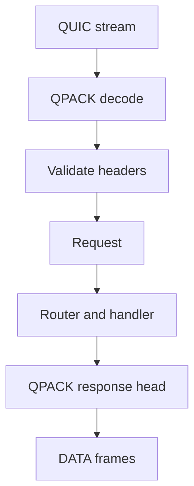

The HTTP/3 adapter decodes pseudo-headers directly into the same `Request` shape
that HTTP/1.1 and HTTP/2 use. It does not build an HTTP/1.1 text request and
re-parse it. This page follows one request from the QUIC stream to the handler and
back.



The flow is one direction: decode, validate, dispatch, encode. A validation failure
ends at the stream, before `Request` exists.

## Decode and validate

| Field          | Source           | Validation                               |
| -------------- | ---------------- | ---------------------------------------- |
| `method`       | `:method`        | Non-empty HTTP token                     |
| `target`       | `:path`          | Origin-form path or `*` for OPTIONS      |
| `authority`    | `:authority`     | No user information, valid host and port |
| `scheme`       | `:scheme`        | `https` for the live listener            |
| Regular fields | QPACK field list | Lowercase names, no control bytes        |

A request reaches the handler only if the field list is valid. The adapter
rejects:

- Pseudo-fields after a regular field.
- Duplicate pseudo-fields.
- Unknown pseudo-fields.
- Uppercase field names.
- `connection`, `keep-alive`, `proxy-connection`, `transfer-encoding`, and
  `upgrade`.
- A second `content-length`, or a body length that disagrees with it.

A validation failure closes the stream with `H3_MESSAGE_ERROR`. Other streams on
the connection keep working.

If the field list has an `:authority` but no `host`, the adapter adds a `host`
field so handler code sees the same header on every transport.

## Body handling

The request body is buffered into the stream's body region. There is no
request-body streaming API; handlers always see a complete, bounded body.

| Condition                           | Result                     |
| ----------------------------------- | -------------------------- |
| Body at or below `max_h3_body_size` | Delivered as `req.bytes()` |
| Body above `max_h3_body_size`       | `413 Payload Too Large`    |
| `content-length` mismatch           | `400 Bad Request`          |
| Body larger than `content-length`   | `400 Bad Request`          |

Request bodies are bounded by capacity, not by flow control. The receive credit
is returned as data is consumed, so a client can keep sending; the body limit is
what protects memory.

## Dispatch

The adapter parses the method, applies the `HEAD` body suppression, and
dispatches through the same router and middleware chain as the other transports.
A `CONNECT` request is answered with `501 Not Implemented` before routing, except
for the extended CONNECT case the WebTransport helpers model but the live
listener does not enable.

`QUERY` is a first-class method. The adapter requires a valid `Content-Type`; the
handler owns the media-type policy. See
[QUERY over HTTP/3](/docs/http3/query-method).

## Response building

The response helper validates the status and header block before anything is
written:

| Rule                                   | Error                  |
| -------------------------------------- | ---------------------- |
| Status is three digits, 100 to 599     | `error.InvalidStatus`  |
| Header line has a colon                | `error.InvalidHeaders` |
| No connection-specific header or `te`  | `error.InvalidHeaders` |
| Field count within the configured cap  | `error.BufferOverflow` |
| Header bytes within the configured cap | `error.BufferOverflow` |

Field names are lowercased into the response header storage. The adapter writes a
structured QPACK header set with `:status` first, then one field per stored name
and value.

## Body writes

Two paths exist:

| Path                     | Behavior                                                                           |
| ------------------------ | ---------------------------------------------------------------------------------- |
| One-shot `end`           | Copies the body into the stream response buffer; `WouldBlock` when it does not fit |
| Streaming `begin_stream` | Uses `write_chunk` until the buffer is full, then waits for the write callback     |

The stream response buffer is `write_queue_size` bytes. A one-shot body larger
than that returns `WouldBlock` instead of truncating; use streaming for large
bodies.

`HEAD` responses suppress the body but keep the headers. A body on a suppressed
response returns `error.BodyNotAllowed`.

## Writes and partial progress

QUIC stream writes advance by the bytes the transport accepts. A write that
cannot make progress returns `WouldBlock` and the stream is re-armed with
`wantwrite`. The body offset is preserved, so the next callback continues where
the previous one stopped.

This is the same backpressure contract as the other transports, with one
difference: there is no TCP write ring to absorb a burst. A large one-shot body
must fit the per-stream buffer or fail.

## Verify the path

```sh
curl --http3-only -k -v https://127.0.0.1:8443/items?id=7
```

Check the response headers and body, then send a request with a duplicated
pseudo-field from a custom client and confirm `H3_MESSAGE_ERROR` on that stream
while a sibling request still succeeds.

## Next

- [QPACK](/docs/http3/qpack) for the header compression above this path.
- [HTTP/3 limits](/docs/http3/limits) for the exact capacities.
