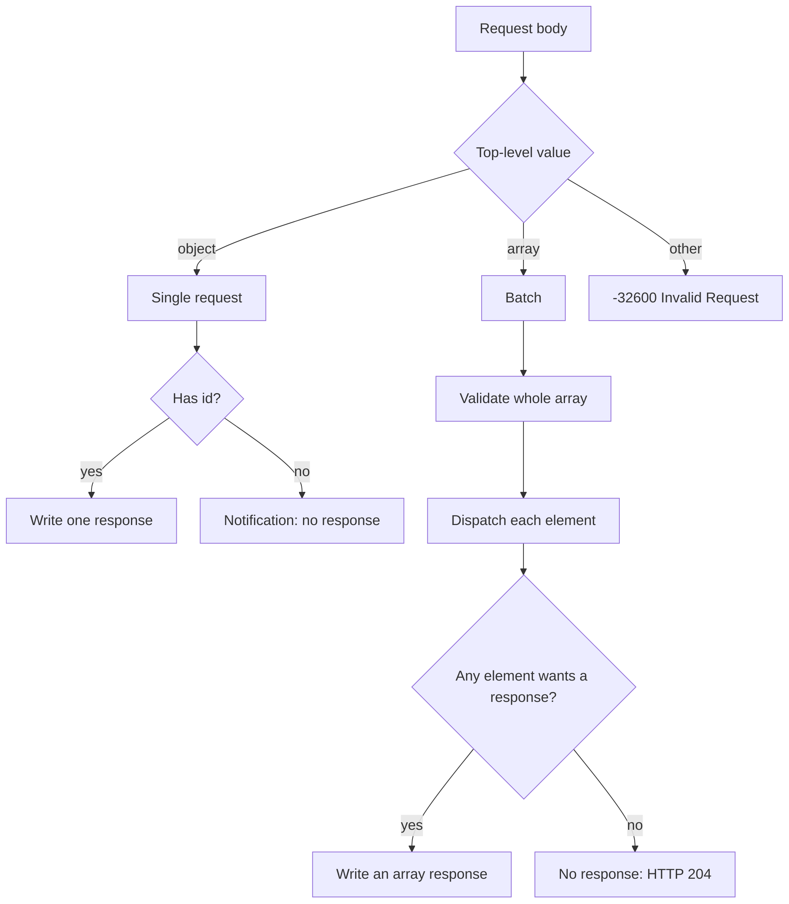
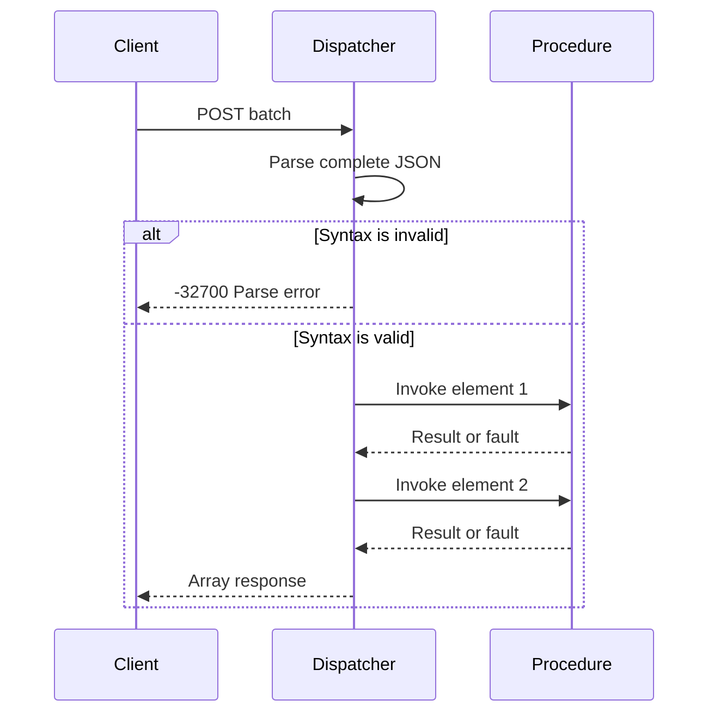

JSON-RPC 2.0 accepts one object or an array of objects in one HTTP body. The
difference between a call and a notification is the presence of `id`, not a
separate endpoint. The dispatcher classifies the document before it invokes a
procedure, so a malformed batch cannot run a valid prefix.

## Classify the document



The top-level type decides the response container. A single request produces one
object. A batch produces an array, even when only one element wants a response.
An empty array is an invalid request and produces one error object, not an empty
array.

## Request shapes

| Request body                               | Response body                     | HTTP status |
| ------------------------------------------ | --------------------------------- | ----------- |
| One object with `id`                       | One result or error object        | `200`       |
| One object without `id`                    | Empty                             | `204`       |
| Array with at least one request            | Array of result and error objects | `200`       |
| Array of notifications only                | Empty                             | `204`       |
| Empty array                                | One `-32600` error object         | `200`       |
| Malformed JSON                             | One `-32700` error object         | `200`       |
| Top-level string, number, boolean, or null | One `-32600` error object         | `200`       |

Notifications are omitted from the response array. The remaining responses keep
their input order, so a client can correlate an `id` without a separate index.

## Pre-validation before side effects

A batch is validated in two passes. The first pass parses the complete JSON
syntax and checks that the document ends after the array. Only then does the
dispatcher re-scan the array and invoke procedures.



A syntax error in the last element prevents the first element from running. A
semantic error in one element, such as an unknown method or invalid parameters,
does not stop the other elements.

## Invalid elements

An array element that is not an object produces a `-32600` error object with a
`null` id. Valid elements still run:

```json
[
  { "jsonrpc": "2.0", "result": 5, "id": 1 },
  { "jsonrpc": "2.0", "error": { "code": -32600, "message": "Invalid Request" }, "id": null },
  { "jsonrpc": "2.0", "result": 8, "id": 3 }
]
```

The error object occupies the invalid element's position. It is not appended to
the end. The block is formatted for readability; the dispatcher emits compact
JSON on the wire.

## Notifications

A notification is a valid request without `id`. It runs the procedure and
suppresses the response:

```json
{ "jsonrpc": "2.0", "method": "metrics.increment", "params": { "name": "requests" } }
```

| Notification outcome              | Response                         |
| --------------------------------- | -------------------------------- |
| Procedure returns a result        | None                             |
| Procedure returns a fault         | None                             |
| Method is not found               | None                             |
| Request shape is invalid          | One error object with `id: null` |
| Batch contains only notifications | HTTP 204, no body                |

The last two rows are deliberate. A notification is only a notification when it
is a valid request. An object with no `method` cannot be treated as a
notification, so the dispatcher reports the protocol error.

## Method names and sealing

Method names are copied into the service during registration. The copy means a
caller can free or reuse the source slice after `register` returns.

| Rule                               | Result                     |
| ---------------------------------- | -------------------------- |
| Empty name                         | `error.InvalidMethodName`  |
| Longer than 255 bytes              | `error.InvalidMethodName`  |
| Invalid UTF-8                      | `error.InvalidMethodName`  |
| Starts with `rpc.`                 | `error.InvalidMethodName`  |
| Duplicate name                     | `error.DuplicateProcedure` |
| Registration after `seal` or mount | `error.RegistryLocked`     |

`app.rpc` seals the registry at mount time. A batch cannot add a procedure, and a
procedure cannot be replaced while the server is running.

## Verify a batch

```sh
curl -sS http://127.0.0.1:3000/rpc \
  -H 'Content-Type: application/json' \
  --data '[
    {"jsonrpc":"2.0","method":"math.add","params":{"left":2,"right":3},"id":1},
    {"jsonrpc":"2.0","method":"math.add","params":{"left":4,"right":5}},
    {"jsonrpc":"2.0","method":"math.add","params":{"left":6,"right":7},"id":3}
  ]'
```

```json
[
  { "jsonrpc": "2.0", "result": { "sum": 5 }, "id": 1 },
  { "jsonrpc": "2.0", "result": { "sum": 11 }, "id": 3 }
]
```

The notification ran but produced no element. Replace the middle object with
`1` and the response contains a `-32600` error in its place.

## Next

- [JSON-RPC errors](/docs/json-rpc/errors) lists every code and HTTP mapping.
- [JSON-RPC capacities](/docs/json-rpc/capacities) explains what happens when a
  batch response exceeds the buffer.
- [Testing a JSON-RPC service](/docs/json-rpc/testing) shows batch fixtures and
  assertions.
