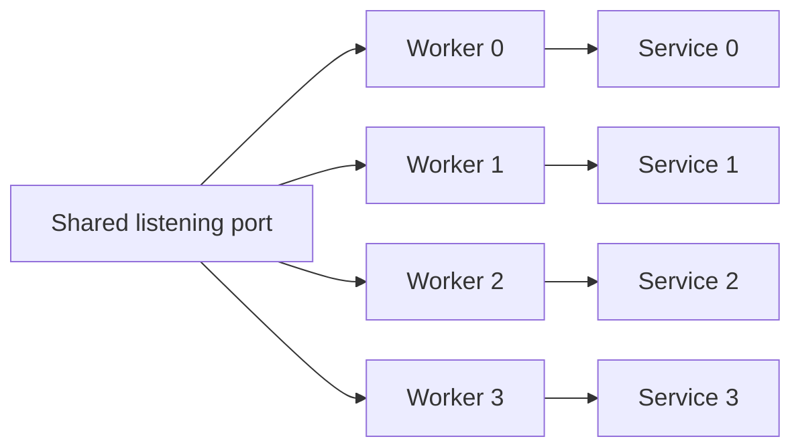

A cluster runs one event loop per worker, and each worker has its own slab,
connections, and route table. A JSON-RPC service owns a mutable response buffer,
so it follows the same rule: one service per worker, mounted on that worker's
loop. Sharing one service across workers would race on the response bytes.

## Topology



The kernel distributes accepted connections. A connection stays on the worker
that accepted it. Each worker dispatches JSON-RPC calls on its own loop and writes
into its own response buffer.

## Mount one service per worker

`configure` runs before any worker thread starts and cannot capture local
variables, so keep the service array at a stable address:

```zig
const worker_capacity = 4;

const AddParams = struct { left: i64, right: i64 };
const AddResult = struct { sum: i64 };

fn add(params: AddParams) uz.json_rpc.HandlerError!AddResult {
    return .{ .sum = params.left + params.right };
}

var services = [_]uz.json_rpc.Service{
    .{}, .{}, .{}, .{},
};

pub fn main(init: std.process.Init) !void {
    var group = try uz.Server.builder(init.io)
        .with_max_clients(256)
        .build_cluster(std.heap.page_allocator, worker_capacity, .{});
    defer group.deinit();

    const Cluster = @TypeOf(group);
    try group.configure(struct {
        fn routes(worker: *Cluster.Worker, index: usize) !void {
            const service = &services[index];
            try service.register_typed("math.add", AddParams, AddResult, add);
            _ = try worker.rpc("/rpc", service);
        }
    }.routes);

    try group.catch_shutdown_signals();
    try group.listen("0.0.0.0", 3000);
    try group.run();
}
```

The array length must cover the compiled worker capacity, not the active count.
`build_cluster` fixes the capacity at compile time; `options.worker_count` may
select fewer active workers, but a worker index never exceeds the capacity.

## What each worker owns

| Item               | Owner                                         |
| ------------------ | --------------------------------------------- |
| Service value      | One array element per worker                  |
| Response buffer    | The service on that worker                    |
| Procedure state    | The context pointer registered on that worker |
| Event loop         | The worker                                    |
| Client connections | The worker that accepted them                 |

No service, response buffer, or procedure context is shared between workers.

## Share data between workers

A procedure can read or write data owned by another worker only through an
explicit mechanism:

| Need                            | Mechanism                                     |
| ------------------------------- | --------------------------------------------- |
| Broadcast a bounded message     | `Cluster.publish` or `Cluster.publish_report` |
| Read shared configuration       | Immutable startup data                        |
| Store durable state             | An external database or service               |
| Share a counter                 | Per-worker counters plus a merge at read time |
| Share a service response buffer | Not supported                                 |

`Cluster.publish` copies into bounded per-worker inboxes. It does not share a
pointer, a slab, or a response buffer. A procedure that needs a global view must
query the store that owns it, not another worker's memory.

## Registration rules

Each service registers its own procedures inside `configure`:

| Rule                                    | Consequence                                 |
| --------------------------------------- | ------------------------------------------- |
| Register before `worker.rpc`            | `app.rpc` seals the registry                |
| Register on every worker                | A route exists only where it was registered |
| Register the same names on every worker | The same method is available on every loop  |
| Use a distinct context per worker       | State stays worker-local                    |
| Do not register after `run`             | `error.RegistryLocked`                      |

The configure callback runs once per worker. A method registered only on worker
0 is missing when the kernel routes a request to worker 1. Register the full
method set on every worker.

## Memory

Multiply the service capacity by the compiled worker count:

| Capacity        | Per worker | Four workers |
| --------------- | ---------: | -----------: |
| Procedures      |       `64` |        `256` |
| Method storage  |    `4 KiB` |     `16 KiB` |
| Response buffer |   `16 KiB` |     `64 KiB` |

The service values also embed handler arrays and lookup slots; see
[JSON-RPC capacities](/docs/json-rpc/capacities) for the full layout. The array
lives for the process lifetime, so it does not add allocation to the request
path.

## Verify the worker path

Start the group and send several requests:

```sh
for index in $(seq 1 20); do
  curl -sS http://127.0.0.1:3000/rpc \
    -H 'Content-Type: application/json' \
    --data '{"jsonrpc":"2.0","method":"math.add","params":{"left":2,"right":3},"id":1}'
done
```

Every response must be identical. A method that exists on only one worker
produces `-32601 Method not found` on the other workers. Repeat the loop after a
worker failure to confirm the failure is reported by `first_failure()` rather
than hidden by a partial route table.

## Next

- [JSON-RPC capacities](/docs/json-rpc/capacities) sizes each worker's service.
- [Your first cluster](/docs/examples/first-cluster) covers the cluster
  lifecycle.
- [Cluster model](/docs/concepts/cluster-model) explains the shared-nothing
  rule.
