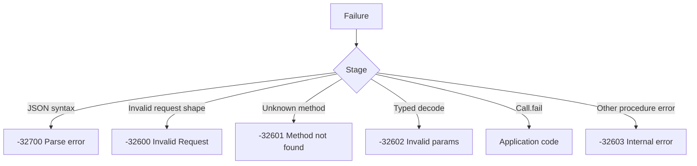

A JSON-RPC error is a protocol response, not an HTTP failure. The adapter returns
`200 OK` with an `error` object for a parse error, an unknown method, invalid
parameters, or an application fault. HTTP status codes are reserved for the
transport boundary: media type, response-buffer exhaustion, and server failure.

## Error object

```json
{
  "jsonrpc": "2.0",
  "error": { "code": -32601, "message": "Method not found" },
  "id": 7
}
```

The block is formatted for readability; the dispatcher emits compact JSON on
the wire.

A valid request echoes its raw id bytes in the `id` member. Any request marked
invalid writes `"id": null`, even when a syntactically valid id was present.
That includes duplicate `id`, `method`, `params`, or `jsonrpc` members and
member values of the wrong type.

## Standard codes

| Constant                         | Code     | Message            | Cause                                     |
| -------------------------------- | -------- | ------------------ | ----------------------------------------- |
| `StandardError.parse_error`      | `-32700` | `Parse error`      | The body is not valid JSON                |
| `StandardError.invalid_request`  | `-32600` | `Invalid Request`  | The document shape or a member is invalid |
| `StandardError.method_not_found` | `-32601` | `Method not found` | No procedure is registered for the name   |
| `StandardError.invalid_params`   | `-32602` | `Invalid params`   | `HandlerError.InvalidParams` was returned |
| `StandardError.internal_error`   | `-32603` | `Internal error`   | A procedure failed for another reason     |

The dispatcher writes these exact messages. Tests can snapshot the full object
without normalization.

## Procedure errors

| `HandlerError`         | JSON-RPC result                                   |
| ---------------------- | ------------------------------------------------- |
| `InvalidParams`        | `-32602 Invalid params`                           |
| `ApplicationError`     | The `Call.fail` code and message                  |
| `Aborted`              | No response; the request or connection is gone    |
| `InternalError`        | `-32603 Internal error`                           |
| `OutOfMemory`          | `-32603 Internal error`                           |
| `ResultAlreadyWritten` | `-32603 Internal error`                           |
| `ResultTooLarge`       | `-32603 Internal error` when the error still fits |

`Call.fail` is the only supported way to choose an application code:

```zig
fn withdraw(call: *uz.json_rpc.Call) uz.json_rpc.HandlerError!void {
    return call.fail(-32001, "insufficient funds");
}
```

The dispatcher does not validate the code range. Use `-32000` through `-32099`
for implementation-defined server errors, as JSON-RPC 2.0 reserves that range.
An application that returns `error.ApplicationError` without calling `Call.fail`
gets `-32603`.

## Protocol failures



A malformed batch is validated before any procedure runs. A syntax failure
returns one `-32700` object, not an array. A syntactically valid batch with an
invalid element returns an array that contains the error object for that
element and the results for the valid elements.

## HTTP mapping

| Condition                                   | HTTP status | Body                                     |
| ------------------------------------------- | ----------- | ---------------------------------------- |
| Missing, duplicate, or wrong `Content-Type` | `415`       | Empty; `Accept: application/json`        |
| A response is requested                     | `200`       | Result or error object                   |
| No response is requested                    | `204`       | Empty                                    |
| Dispatch returns `error.Aborted`            | `500`       | Empty, unless a response already started |
| Dispatch returns `error.ResponseTooLarge`   | `500`       | Empty, unless a response already started |
| An unexpected adapter failure occurs        | `500`       | Empty                                    |

The adapter never maps a JSON-RPC error to HTTP 400. A client that treats
`200` as success must inspect the `error` member. A monitoring rule that counts
HTTP 5xx as the only failure signal will miss every protocol error.

## Registration errors

`register`, `register_typed`, `register_context`, and `register_typed_context`
return `RegistrationError`:

| Error                          | Cause                                                  |
| ------------------------------ | ------------------------------------------------------ |
| `DuplicateProcedure`           | The method name is already registered                  |
| `InvalidMethodName`            | Empty, over 255 bytes, invalid UTF-8, or starts `rpc.` |
| `MethodStorageCapacityReached` | Copied method names exceed the storage capacity        |
| `ProcedureCapacityReached`     | The procedure count reaches the configured maximum     |
| `RegistryLocked`               | Registration happened after `seal` or after `app.rpc`  |

These are startup errors. They are not JSON-RPC responses because no request is
involved.

## Dispatch errors

| Error                            | Meaning                                          |
| -------------------------------- | ------------------------------------------------ |
| `DispatchError.Aborted`          | The abort signal fired before or during dispatch |
| `DispatchError.ResponseTooLarge` | The output buffer could not hold the document    |

`dispatch` returns `?[]const u8`: `null` means the document requested no
response, so the HTTP adapter sends `204`. `dispatch_with_signal` takes the same
input plus an abort signal.

## Next

- [Batches and notifications](/docs/json-rpc/batches-and-notifications) shows
  the document shapes that produce each result.
- [JSON-RPC capacities](/docs/json-rpc/capacities) explains the response buffer
  that limits error and result documents.
- [Testing a JSON-RPC service](/docs/json-rpc/testing) turns these objects into
  assertions.
