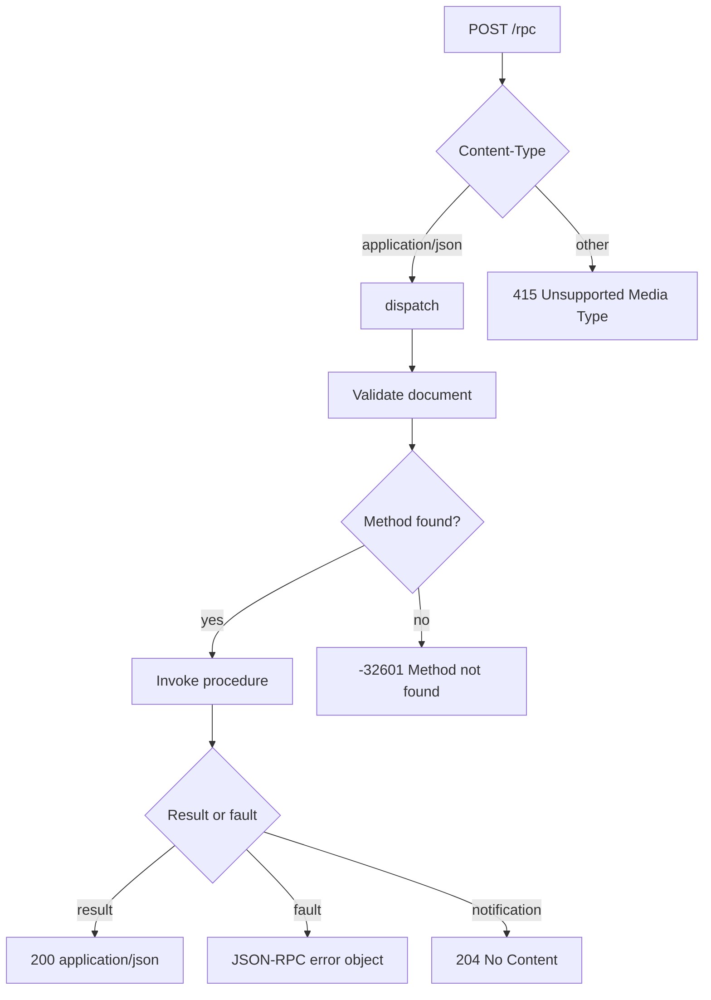

`uz.json_rpc.Service` is a fixed-capacity JSON-RPC 2.0 registry. It decodes
named parameters into Zig types, serializes typed results into a bounded
response buffer, and mounts on one POST route with `app.rpc`. The dispatcher has no
HTTP request or response dependency; it needs only an abort signal. You can call
it from another transport when the HTTP adapter does not fit.

This section covers the typed API, the protocol rules, the error model, and the
ownership rules that make one service safe on one event loop.

## Start here

<CardGroup cols={2}>
  <Card title="JSON-RPC quickstart" href="/docs/json-rpc/quickstart" icon="play">
    Register one typed procedure, mount it on a route, and verify a call with curl.
  </Card>
  <Card title="Typed procedures" href="/docs/json-rpc/typed-procedures" icon="braces">
    Decode named parameters and serialize results with compile-time adapters.
  </Card>
  <Card
    title="Context and custom decoding"
    href="/docs/json-rpc/context-and-decoding"
    icon="layers"
  >
    Carry caller-owned state and take control of parameter allocation.
  </Card>
  <Card title="JSON-RPC errors" href="/docs/json-rpc/errors" icon="shield-alert">
    Map standard codes, application faults, and HTTP statuses without ambiguity.
  </Card>
</CardGroup>

## Protocol behavior

<CardGroup cols={2}>
  <Card
    title="Batches and notifications"
    href="/docs/json-rpc/batches-and-notifications"
    icon="list"
  >
    Classify single calls, notifications, batches, and invalid elements.
  </Card>
  <Card title="JSON-RPC capacities" href="/docs/json-rpc/capacities" icon="ruler">
    Read the procedure, method-storage, scratch, and response bounds.
  </Card>
  <Card title="Transports and raw dispatch" href="/docs/json-rpc/transports" icon="network">
    Compare the HTTP adapter with a direct `dispatch` call and a custom transport.
  </Card>
  <Card title="JSON-RPC in a cluster" href="/docs/json-rpc/cluster-deployment" icon="server">
    Create one service per worker and mount it inside the configure callback.
  </Card>
</CardGroup>

## Operate it

<CardGroup cols={1}>
  <Card title="Testing a JSON-RPC service" href="/docs/json-rpc/testing" icon="flask-conical">
    Test the dispatcher as a pure function, then prove the route with curl and a load tool.
  </Card>
</CardGroup>

## Request path



The adapter checks the media type before it touches the body. The dispatcher
then validates JSON syntax, resolves the method, and writes either a result or
an error into the service-owned response buffer.

## Smallest service

```zig
const std = @import("std");
const uz = @import("uWebZockets");

const AddParams = struct { left: i64, right: i64 };
const AddResult = struct { sum: i64 };

fn add(params: AddParams) uz.json_rpc.HandlerError!AddResult {
    return .{ .sum = params.left + params.right };
}

pub fn main(init: std.process.Init) !void {
    var app = try uz.App(128).init(init.io);
    defer app.deinit();

    var rpc = uz.json_rpc.Service{};
    try rpc.register_typed("math.add", AddParams, AddResult, add);
    _ = try app.rpc("/rpc", &rpc);

    try app.catch_shutdown_signals();
    try app.listen("0.0.0.0", 3000);
    try app.run();
}
```

## Supported surface

| Surface                        | Status                                                |
| ------------------------------ | ----------------------------------------------------- |
| Single calls                   | Supported                                             |
| Notifications                  | Supported; HTTP 204 when no response is requested     |
| Batches                        | Supported; validated before the first procedure       |
| Typed procedures               | Supported with a 4 KiB parameter scratch              |
| Custom parameter decoding      | Supported through `register` and `Call.parse_params`  |
| Application error faults       | Supported through `Call.fail`                         |
| HTTP adapter                   | Supported; one POST route                             |
| Direct dispatch                | Supported; caller owns input and output buffers       |
| JSON-RPC over WebSocket        | Not built in; the application can dispatch raw frames |
| JSON-RPC over HTTP/2 or HTTP/3 | Supported through the normal POST route               |

:::warning[One service per event loop]
A service owns one response buffer. Do not share a service between cluster
workers or call it from two threads. See
[JSON-RPC in a cluster](/docs/json-rpc/cluster-deployment).
:::

## Next

Read [JSON-RPC quickstart](/docs/json-rpc/quickstart) to build and verify the
service, then [capacities](/docs/json-rpc/capacities) before you size a
production deployment.
