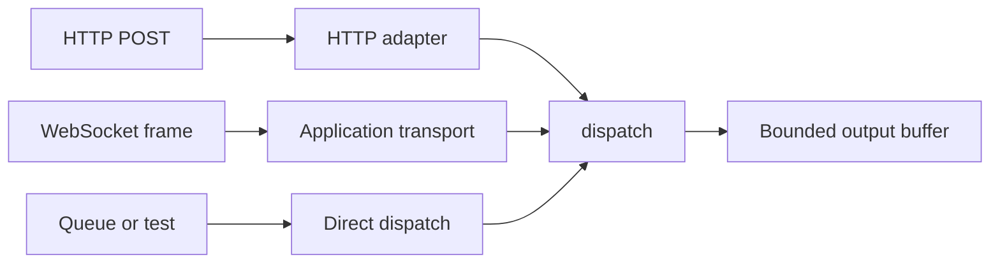

The JSON-RPC dispatcher is transport-neutral. It accepts a byte slice, writes a
byte slice, and returns `null` when the document requests no response. The HTTP
adapter is one caller of that contract; a WebSocket route, a queue consumer, or a
test can be another.

## Dispatch without HTTP

```zig
fn handle_document(
    service: *uz.json_rpc.Service,
    input: []const u8,
    output: []u8,
) uz.json_rpc.DispatchError!?[]const u8 {
    return service.dispatch(input, output);
}
```

The caller owns `input` and `output`. A returned slice points into `output` and
is valid until the caller reuses that buffer. A `null` return means the document
was a notification or a batch of notifications, so the transport sends nothing.

For cancellation, pass the transport's abort signal:

```zig
const body = try service.dispatch_with_signal(signal, input, &output);
```

`AbortSignal` is the only framework type the dispatcher imports. The protocol
layer does not import `Request`, `Response`, a socket, or an HTTP parser.

## Transport options



| Transport        | Entry point              | Output buffer           | Response shape                    |
| ---------------- | ------------------------ | ----------------------- | --------------------------------- |
| HTTP POST        | `app.rpc`                | Service-owned           | HTTP 200, 204, 415, or 500        |
| Direct dispatch  | `service.dispatch`       | Caller-owned            | `?[]const u8`                     |
| Custom WebSocket | Application code         | Caller-owned, then sent | Text frame with the JSON document |
| HTTP/2 or HTTP/3 | The same HTTP POST route | Service-owned           | Same as HTTP/1.1                  |

HTTP/2 and HTTP/3 need no separate JSON-RPC path. The route is a normal POST
route, so the transport adapter delivers a complete request body and the service
writes one bounded response.

## HTTP adapter rules

The adapter lives in `src/rpc/http.zig` and enforces the transport boundary:

| Check                             | Result                                       |
| --------------------------------- | -------------------------------------------- |
| Exactly one `Content-Type` header | Otherwise `415 Unsupported Media Type`       |
| Media type `application/json`     | Accepted, with or without parameters         |
| Media type `application/json-rpc` | Accepted, with or without parameters         |
| Case and whitespace               | Media type comparison is case-insensitive    |
| Dispatch returns a body           | `200` with `application/json; charset=utf-8` |
| Dispatch returns `null`           | `204 No Content`                             |
| Adapter failure before a response | `500 Internal Server Error`                  |

The adapter reads `request.bytes()` and writes through
`service.response_buffer()`. It does not stream, chunk, or parse a partial
document. A request body above `ServerConfig.max_body_size` is rejected by the
HTTP parser before the adapter runs.

## Build a custom transport

A custom transport owns four steps:

1. Receive one complete document.
2. Call `dispatch` with a buffer that lives until the response is sent.
3. Send the returned slice, or send nothing for `null`.
4. Keep the service on the same event loop and thread as every other caller.

The output buffer is owned by the transport and must not be reused until the send
completes. The `WebSocket.send` method copies bytes into the connection write
queue before it returns, so a WebSocket transport can reuse the buffer after
that call. Other transports need an equivalent copy or an await.

:::warning[No built-in WebSocket transport]
µWebZockets does not ship a JSON-RPC-over-WebSocket transport. The `ws` route
callbacks receive a `*WebSocket` and a message; the application must call
`dispatch` itself. Do not describe WebSocket JSON-RPC as a framework feature.
:::

## One service, one loop

`dispatch` writes into the caller's output buffer, but a mounted service also
exposes one `response_buffer`, and procedure context is unsynchronized. Two
threads sharing either storage would race. Keep every call for one service on
the owning event loop.

| Caller                  | Same loop required | Why                              |
| ----------------------- | ------------------ | -------------------------------- |
| HTTP route              | Yes                | Uses the service response buffer |
| WebSocket message       | Yes                | Same buffer, same loop           |
| Background job          | Yes                | No internal synchronization      |
| Separate cluster worker | Own service        | Shared-nothing worker model      |

## Next

- [JSON-RPC in a cluster](/docs/json-rpc/cluster-deployment) applies the
  one-service-per-loop rule to workers.
- [JSON-RPC capacities](/docs/json-rpc/capacities) sizes the output buffer.
- [WebSocket messages](/docs/websocket/messages) covers the frame callback this
  transport would sit behind.
