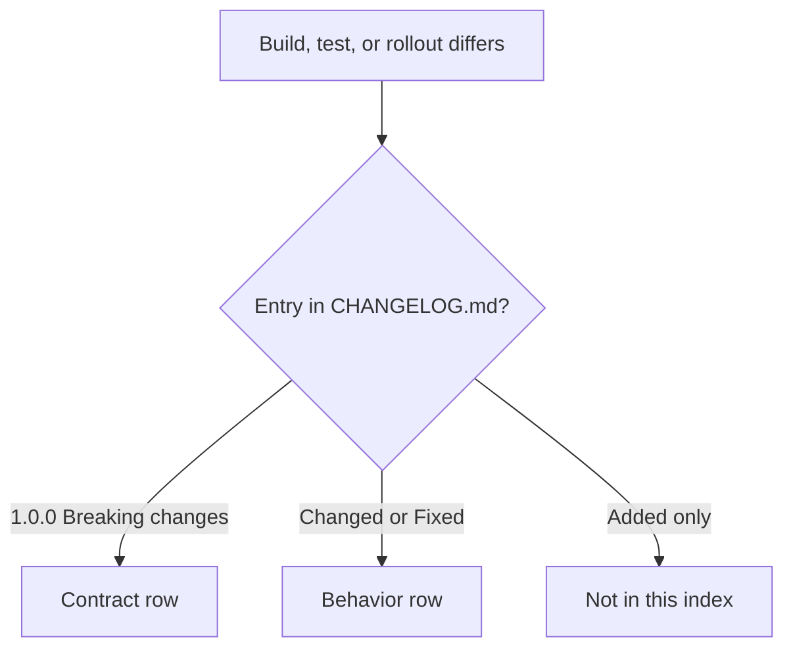

This page indexes the changes that can break a build, a test, or an operational
assumption. It includes the 1.0.0 `Breaking changes` entries and the behavior
changes that later releases record under `Changed` or `Fixed`. It does not list
performance-only work or an additive API unless the addition changes existing
behavior.

Every index row links to its changelog section. If an entry is not in
[CHANGELOG.md](https://github.com/farbenbuilds/uWebZockets/blob/main/CHANGELOG.md),
it is not in this index. The 2.2.0 line is not released and has no row.

## How to read this index [#how-to-read-this-index]

| Label             | Meaning                                                                                              |
| ----------------- | ---------------------------------------------------------------------------------------------------- |
| Contract change   | A 1.0.0 entry from the changelog's `Breaking changes` heading; source or a public promise changed    |
| Behavior change   | A later `Changed` or `Fixed` entry; no public signature removal, but a test or deployment can notice |
| Source adjustment | A later entry that changes a call site without removing the feature                                  |

| Release | Index entries                                          |
| ------- | ------------------------------------------------------ |
| 1.0.0   | 8 contract changes                                     |
| 1.7.1   | 4 behavior changes and 1 source adjustment             |
| 1.8.5   | 1 behavior change                                      |
| 1.9.0   | 1 behavior change                                      |
| 2.0.0   | 2 behavior changes                                     |
| 2.0.5   | 2 behavior changes                                     |
| 2.1.0   | 1 footprint change                                     |
| 2.1.5   | 5 behavior changes and 1 source adjustment             |
| 2.1.6   | No entry; patch release with no public contract change |
| 2.2.0   | No entry; not released                                 |

Rows that are easy to miss:

- A minor release can change a callback signature (2.1.5).
- A minor release can change a default footprint (2.1.0).
- A security fix can reject input that used to pass (2.0.5).

## Contract changes from 1.0.0 [#contract-changes-from-100]

| Version                                                                                      | Area                             | Old behavior                                                                                  | New behavior                                                                                             | Action                                                                    |
| -------------------------------------------------------------------------------------------- | -------------------------------- | --------------------------------------------------------------------------------------------- | -------------------------------------------------------------------------------------------------------- | ------------------------------------------------------------------------- |
| [1.0.0](https://github.com/farbenbuilds/uWebZockets/blob/main/CHANGELOG.md#breaking-changes) | Route and WebSocket registration | Registration did not require handling an error union                                          | Returns an error union; handle it with `try`, `catch`, or equivalent                                     | `_ = try app.get("/", handler);` and `_ = try app.ws("/chat", behavior);` |
| [1.0.0](https://github.com/farbenbuilds/uWebZockets/blob/main/CHANGELOG.md#breaking-changes) | Route mutation after listen      | Route mutation was not guarded by a listener lock                                             | Returns `error.RoutesLocked` after `listen` or `listen_udp` succeeds                                     | Register every route before the first successful listener call            |
| [1.0.0](https://github.com/farbenbuilds/uWebZockets/blob/main/CHANGELOG.md#breaking-changes) | WebSocket message size           | The plain `App(N)` path carried the 16 KiB default ceiling                                    | Messages above 16 KiB need `ConfiguredApp` and matching `WsBehavior` limits                              | Set `max_frame_size <= max_message_size <= message capacity`              |
| [1.0.0](https://github.com/farbenbuilds/uWebZockets/blob/main/CHANGELOG.md#breaking-changes) | Output and backpressure          | Output had no bounded-queue failure to report                                                 | Response writers and `WebSocket.send` can return `error.WouldBlock`                                      | Treat `WouldBlock` as normal; resume from the `drain` callback            |
| [1.0.0](https://github.com/farbenbuilds/uWebZockets/blob/main/CHANGELOG.md#breaking-changes) | WebSocket send and close         | Continuation was not documented as rejected; the close path had no drain-then-terminate split | `send` rejects `.continuation` with `error.InvalidOpcode`; `send_close` drains, `terminate` is immediate | Send complete final messages; use `terminate` for an immediate close      |
| [1.0.0](https://github.com/farbenbuilds/uWebZockets/blob/main/CHANGELOG.md#breaking-changes) | HTTP/3 availability              | `http3_available` was false; HTTP/3 was not a live listener                                   | `http3_available` reports the compiled QUIC backend; `listen_udp` starts the live path                   | Add `listen_udp` before `run`; gate the listener on `uz.http3_available`  |
| [1.0.0](https://github.com/farbenbuilds/uWebZockets/blob/main/CHANGELOG.md#breaking-changes) | RFC 7692 compression             | `WsBehavior` had no public compression switch                                                 | `WsBehavior.compression` exists and defaults to `.disabled`                                              | Opt in with `.permessage_deflate` per route                               |
| [1.0.0](https://github.com/farbenbuilds/uWebZockets/blob/main/CHANGELOG.md#breaking-changes) | Request target fields            | Route matching used one target string                                                         | `path` is the match path, `target` is the original target with its query, `query` excludes `?`           | Use `path` for routing, `target` and `query` for logging and parsing      |

## Behavior changes after 1.0.0 [#behavior-changes-after-100]

| Version                                                                                      | Area                                      | Old behavior                                                                                                              | New behavior                                                                                          | Action                                                                    |
| -------------------------------------------------------------------------------------------- | ----------------------------------------- | ------------------------------------------------------------------------------------------------------------------------- | ----------------------------------------------------------------------------------------------------- | ------------------------------------------------------------------------- |
| [1.7.1](https://github.com/farbenbuilds/uWebZockets/blob/main/CHANGELOG.md#171---2026-10-06) | Route pattern conflicts                   | A parameterized pattern whose segment skeleton differed only in capture names made the later pattern silently unreachable | Registration returns `error.RoutePatternConflicts`                                                    | Rename or remove the duplicate skeleton before upgrading                  |
| [1.7.1](https://github.com/farbenbuilds/uWebZockets/blob/main/CHANGELOG.md#171---2026-10-06) | `App.shutdown` scope                      | `App.shutdown` had no documented loop-thread restriction                                                                  | `App.shutdown` is loop-thread only; use `App.request_shutdown` from another thread or a callback      | Replace cross-thread `shutdown` calls with `request_shutdown`             |
| [1.7.1](https://github.com/farbenbuilds/uWebZockets/blob/main/CHANGELOG.md#171---2026-10-06) | `max_h3_response_header_count`            | Values above 4096 were accepted by configuration                                                                          | Validation caps the value at 4096                                                                     | Lower any value above 4096; QUIC framing cannot size a larger stack frame |
| [1.7.1](https://github.com/farbenbuilds/uWebZockets/blob/main/CHANGELOG.md#171---2026-10-06) | mTLS early data                           | TLS 1.3 early data could reach a route before the client certificate was verified                                         | Early data is disabled in `optional` and `required` mTLS modes                                        | Expect a full handshake; do not build a 0-RTT path that depends on mTLS   |
| [1.8.5](https://github.com/farbenbuilds/uWebZockets/blob/main/CHANGELOG.md#185---2026-10-18) | `Cluster.listen` after release            | A released cluster could report success without binding a worker                                                          | Returns `error.ClusterDeinitialized`                                                                  | Check the lifecycle before listen; rebuild after `deinit`                 |
| [1.9.0](https://github.com/farbenbuilds/uWebZockets/blob/main/CHANGELOG.md#190---2026-10-20) | `Cluster.request_shutdown` after `deinit` | The no-op after `deinit` was not documented                                                                               | Returns immediately as a documented no-op                                                             | Rebuild the cluster instead of relying on shutdown to report the release  |
| [2.0.0](https://github.com/farbenbuilds/uWebZockets/blob/main/CHANGELOG.md#200---2026-10-20) | HTTP/1.1 pipelining batching              | Each pipelined response took its own write path                                                                           | Multiple complete requests in one read append responses to the bounded ring and flush once            | Update tests that assert one write per response                           |
| [2.0.0](https://github.com/farbenbuilds/uWebZockets/blob/main/CHANGELOG.md#200---2026-10-20) | WebSocket batching                        | Each buffered frame armed a completion and wrote separately                                                               | Consecutive frames from one read share one write flush; AVX2 uses 256-bit unmasking                   | Re-run echo and backpressure tests                                        |
| [2.0.5](https://github.com/farbenbuilds/uWebZockets/blob/main/CHANGELOG.md#205---2026-10-22) | WebSocket upgrade duplicates              | A duplicate security-sensitive field in the extra header slots could be treated as absent                                 | The upgrade is rejected                                                                               | Remove duplicate handshake fields at the client or proxy                  |
| [2.0.5](https://github.com/farbenbuilds/uWebZockets/blob/main/CHANGELOG.md#205---2026-10-22) | HTTP/3 `max_header_size`                  | `max_header_size` above 65535 could reach activation                                                                      | Rejected with `error.InvalidHttp3Capacity` before the QUIC slab is allocated                          | Set the HTTP/3 request header size to 65535 or less                       |
| [2.1.0](https://github.com/farbenbuilds/uWebZockets/blob/main/CHANGELOG.md#210---2026-10-24) | Default application slab                  | Default slab total was `681_752_192` bytes                                                                                | Default slab total is `683_382_400` bytes; configured limits are unchanged                            | Recheck the memory budget or call `slab_bytes()` before deployment        |
| [2.1.5](https://github.com/farbenbuilds/uWebZockets/blob/main/CHANGELOG.md#215---2026-10-25) | `Cluster.publish` after `run`             | A publish after `run` could queue into loops that no longer consume                                                       | Returns `error.ClusterStopped`                                                                        | Stop publishing before `run` returns; use `publish_report` while running  |
| [2.1.5](https://github.com/farbenbuilds/uWebZockets/blob/main/CHANGELOG.md#215---2026-10-25) | `Cluster.run` error shape                 | A worker event-loop or cleanup failure was not distinguished at the call site                                             | Returns the original spawn error, or `error.ClusterWorkerFailed` for an event-loop or cleanup failure | Branch on the error and read `first_failure()` for the worker and phase   |
| [2.1.5](https://github.com/farbenbuilds/uWebZockets/blob/main/CHANGELOG.md#215---2026-10-25) | Cluster lifecycle misuse                  | Lifecycle misuse could touch drained worker storage                                                                       | Returns `ClusterRunning`, `ClusterStopped`, or `ClusterDeinitialized`                                 | Handle the named errors instead of retrying blindly                       |
| [2.1.5](https://github.com/farbenbuilds/uWebZockets/blob/main/CHANGELOG.md#215---2026-10-25) | `message_queue.pop_copy`                  | An undersized caller buffer could trigger a release-build out-of-bounds copy or lose the message                          | The copy checks actual lengths and leaves the message queued when it does not fit                     | Size the destination buffers or use `pop_scratch`                         |
| [2.1.5](https://github.com/farbenbuilds/uWebZockets/blob/main/CHANGELOG.md#215---2026-10-25) | Best-effort response endings              | A failed best-effort write could leave the request unanswered or append a second response to a partial frame              | The TCP connection or HTTP/2 or HTTP/3 stream is aborted                                              | Audit callers that treat the best-effort call as infallible               |

## Source adjustments in minor releases [#source-adjustments-in-minor-releases]

| Version                                                                                      | Area                | Old call site                                                  | New requirement                                                                                                           | Action                                                       |
| -------------------------------------------------------------------------------------------- | ------------------- | -------------------------------------------------------------- | ------------------------------------------------------------------------------------------------------------------------- | ------------------------------------------------------------ |
| [1.7.1](https://github.com/farbenbuilds/uWebZockets/blob/main/CHANGELOG.md#171---2026-10-06) | `AesGcmError`       | A residual seal failure was labeled as a caller sizing mistake | `SealFailed` is a distinct error variant                                                                                  | Handle `SealFailed` separately if you match on the error set |
| [2.1.5](https://github.com/farbenbuilds/uWebZockets/blob/main/CHANGELOG.md#215---2026-10-25) | `Cluster.configure` | Accepted an `anytype` callback parameter                       | Accepts the named `Cluster.ConfigureCallback`; a generic route function must be specialized to the concrete `Worker` type | Use a concrete function or specialize the generic one        |

## Not breaking [#not-breaking]

The following releases record no public-name removal or rename in their changelog
section. This list exists to prevent a major version number or a patch release
from being read as a larger change than the record supports. A source adjustment
that changes a call site is listed above, not in this table.

| Release | Recorded scope                                                                                                                    |
| ------- | --------------------------------------------------------------------------------------------------------------------------------- |
| 1.8.0   | No exported function signature, wire behavior, or default capacity semantic change                                                |
| 1.8.9   | No exported Zig or C API changes                                                                                                  |
| 1.9.0   | No exported Zig or C API signature changes                                                                                        |
| 2.0.0   | No removal or rename between 1.9.0 and 2.0.0; cluster API and C struct layouts unchanged; the only C enum addition is append-only |
| 2.0.6   | Public APIs, C ABI layouts, route capacities, runtime behavior, and wire formats unchanged                                        |
| 2.1.5   | No wire-protocol, TLS, capacity, or request-path change                                                                           |
| 2.1.6   | No public API, C ABI layout, capacity, wire format, or TLS policy change                                                          |
| 2.2.0   | Not released; no row can be sourced from a changelog section                                                                      |

Additive work is indexed by migration page instead of this table: the 2.0.0
options are in [v1 to v2](/docs/migration/v1-to-v2#the-200-additive-changes), and
the 2.1.x surface is in
[2.1 to 2.2](/docs/migration/v2-1-to-v2-2#what-21x-added).

## Check an upgrade [#check-an-upgrade]

1. Recompile with Zig 0.16.0 before changing code.
2. Run the route registration tests, including a route added after `listen`.
3. Re-run WebSocket tests with a message above 16 KiB, a full write queue, and a
   close that must drain.
4. Confirm that C enum values were not renumbered and that
   `UWZ_HTTP_TRACE = 9` is the new value.
5. Use [v1 to v2](/docs/migration/v1-to-v2) for the full checklist and
   [2.1 to 2.2](/docs/migration/v2-1-to-v2-2) for the current baseline.

## Related [#related]

- [v1 to v2](/docs/migration/v1-to-v2) applies the 1.0.0 contract to a 1.x
  application.
- [2.1 to 2.2](/docs/migration/v2-1-to-v2-2) separates the shipped 2.1.6
  surface from the 2.2.0 planning target.
- [Errors](/reference/errors) lists the named errors and their causes.
- [Compatibility](/reference/compatibility) lists the supported toolchain and
  platforms.
