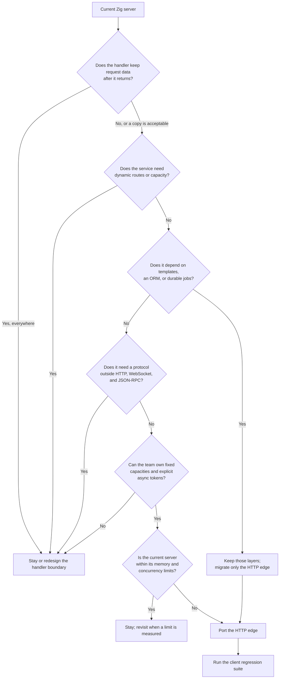

This page is a decision aid, not an API mapping. It describes the shape of a
migration from another Zig HTTP framework: which responsibilities transfer,
which ones are replaced, and when a port costs more than it returns. It makes no
claim about a particular framework's API.

## Start with the handler shape [#start-with-the-handler-shape]

A framework migrates cleanly when a handler is a function from a borrowed
request to one bounded response. It migrates poorly when the handler owns a
future, a connection object, a framework-managed socket, or an allocator that
lives for the request.

| Current handler shape                                   | Fits µWebZockets | Consequence                                              |
| ------------------------------------------------------- | ---------------- | -------------------------------------------------------- |
| `fn (*Request, *Response) void` with borrowed slices    | Yes              | Direct rewrite into a named handler                      |
| Function returning a response value                     | Yes              | Call a response helper in the handler                    |
| `async` function or future awaited by the runtime       | No               | Complete work through `AsyncResponse` on the owning loop |
| Handler that retains the request after return           | No               | Copy the data or use `req.clone(allocator)`              |
| Handler that allocates per request                      | No               | Move the allocation to startup or use a fixed buffer     |
| Handler that mutates shared state behind a lock         | No               | Move state per worker or use a bounded message path      |
| Handler that streams an unbounded request body          | No               | Raise `max_body_size` or redesign the endpoint           |
| Handler that streams a response as the transport drains | Yes              | Use `begin_stream` and a `StreamProducer`                |

## Fit matrix [#fit-matrix]

Score the current application against these dimensions. A single "stay" row is
not automatically a veto, but two or three usually are.

| Dimension         | Fits when                                                                  | Stay when                                                                                                          |
| ----------------- | -------------------------------------------------------------------------- | ------------------------------------------------------------------------------------------------------------------ |
| Response model    | One response per request, completed once                                   | The framework supports multiple responses, long polling per socket, or a response object that outlives the handler |
| Request memory    | Borrowed request fields are enough, or a bounded copy is acceptable        | Handlers keep request data indefinitely without copying                                                            |
| Capacity          | Connection, body, header, and route counts can be fixed at startup         | The service needs dynamic capacity or per-tenant limits changed at runtime                                         |
| Routing           | Static, `:param`, and terminal `*wildcard` routes registered before listen | Routes are added or replaced while serving                                                                         |
| Middleware        | Global ordered middleware is enough, up to 32 callbacks                    | The framework composes per-route stacks with framework-specific context                                            |
| Protocol surface  | HTTP/1.1, HTTP/2, HTTP/3, WebSocket, and TLS 1.3 cover the clients         | The service depends on another protocol or a TLS version below 1.3                                                 |
| WebSocket state   | Pub/sub topics or application-owned records are enough                     | The framework provides per-socket user data that the code relies on                                                |
| Rendering         | The application returns text, bytes, JSON, files, or streams               | The framework owns an HTML template engine or component renderer                                                   |
| Data access       | The application brings its own database client                             | The framework ships an ORM, migrations, and a query builder the code uses                                          |
| Background work   | Work is short, scheduled on the loop, or handled by an external queue      | The framework owns durable jobs, retries, and a scheduler                                                          |
| Platform          | The target is a supported Linux or macOS host                              | The deployment requires a platform outside the support matrix                                                      |
| Team and schedule | The team can own fixed capacities and explicit lifetimes                   | The migration has no owner or no client regression suite                                                           |

Check [Compatibility](/reference/compatibility) and
[Feature matrix](/reference/feature-matrix) before treating a protocol or
platform row as available.

## What maps directly [#what-maps-directly]

| Current responsibility | µWebZockets target                           | Notes                                    |
| ---------------------- | -------------------------------------------- | ---------------------------------------- |
| Request router         | `app.get`, `app.post`, and the other helpers | Registration before `listen`             |
| Path parameters        | `:name` plus `req.get_param`                 | Up to 16 borrowed captures               |
| Global middleware      | `app.use`                                    | At most 32 callbacks, registration order |
| JSON response          | `res.json`, `res.json_buf`                   | `json_buf` uses caller storage           |
| JSON request           | `req.json(T, allocator)`                     | Explicit allocator call                  |
| Static directory       | `app.static(prefix, root, options)`          | Path confinement and range support       |
| WebSocket route        | `app.ws(path, .{ .open, .message, .close })` | One WebSocket registration per path      |
| JSON-RPC service       | `app.rpc(path, &service)`                    | Typed procedures and batches             |
| Per-worker startup     | `build_cluster` and `configure`              | One callback per worker                  |
| Server-sent events     | `res.sse()`                                  | No extra package                         |

## What does not map [#what-does-not-map]

| Current behavior                                    | Required change                                                                         |
| --------------------------------------------------- | --------------------------------------------------------------------------------------- |
| `await` inside a handler                            | Return an `AsyncResponse` token or finish the work on the loop                          |
| Request-local arena that the framework frees        | Use a stack buffer, the startup slab, or a bounded application allocator                |
| Response written from a background thread           | Marshal the result to the owning loop first                                             |
| Framework-managed connection registry               | Keep a fixed application table keyed by an identity you assign                          |
| Middleware that mutates a framework request context | Move the value into explicit context passed to the handler                              |
| Unlimited upload body                               | Set `max_body_size`; the parser rejects above the limit                                 |
| Runtime route hot reload                            | Rebuild and restart, or route through a proxy that changes upstreams                    |
| HTML template rendering                             | Render before the response helper, or keep the template engine in the application layer |
| ORM and migrations                                  | Keep the database layer; only the HTTP edge moves                                       |
| Durable job queue                                   | Keep the queue; the HTTP handler only enqueues                                          |
| Brotli or another response codec                    | Only gzip response compression and WebSocket deflate are built in                       |
| WebSocket user-data slot                            | Keep application state in explicit context or a bounded table                           |
| HTTP/3 clustering                                   | HTTP/3 listeners stay single-application; cluster listeners are TCP/TLS                 |

## Decision flow [#decision-flow]

A "migrate only the HTTP edge" answer is common. Keep the template engine,
database layer, and job queue, and let µWebZockets own the listener, routing,
protocol negotiation, and response writer.

## Migration checklist [#migration-checklist]

| Step | Check                                                        | Evidence                                         |
| ---- | ------------------------------------------------------------ | ------------------------------------------------ |
| 1    | Inventory every route, method, and capture name              | Route table with the old and new pattern         |
| 2    | Classify each handler as synchronous, deferred, or streaming | Handler list with the target registration helper |
| 3    | Measure peak concurrent connections and body size            | Load test or production metrics                  |
| 4    | Count middleware and confirm the order                       | Ordered list, 32 or fewer                        |
| 5    | Identify every place request data outlives the callback      | Copy or clone decision per site                  |
| 6    | Identify shared mutable state and assign an owner            | Per-worker state table                           |
| 7    | Port pure functions and response formatting first            | Unit tests unchanged                             |
| 8    | Port the routes and run the old client suite                 | Same status and body assertions                  |
| 9    | Add shutdown, TLS, and cluster behavior                      | Signal test, TLS handshake, worker failure test  |
| 10   | Roll out behind a proxy or one worker group at a time        | Error rate and latency comparison                |

Step 7 is the cheapest proof that the port preserves behavior. If the response
formatting can move without the framework, the rest is transport work.

## When not to migrate [#when-not-to-migrate]

- The current framework supplies a feature this application depends on and
  µWebZockets does not: an ORM, a template engine, durable jobs, a plugin
  system, or a protocol outside the supported set.
- Every handler retains request data or awaits a future, so the port would
  rewrite the application instead of the edge.
- The service needs routes or capacities that change without a restart.
- The deployment target is outside the supported platform matrix.
- There is no client regression suite and no owner for the cutover.

In those cases, keep the current server and use µWebZockets for a new service
with a bounded request path. A partial rewrite that splits one application
across two incompatible state models is worse than either server alone.

## Verify the decision [#verify-the-decision]

Before writing handlers, prove the target on one route:

1. Add the dependency with `zig fetch --save` as described in
   [Quickstart](/docs/getting-started/quickstart).
2. Serve one route with the same status and body as the current server.
3. Run the existing client test against both servers.
4. Measure the slab size with `slab_bytes()` and confirm it fits the host.
5. Stop the server with `SIGTERM` and confirm the drain path.

If one route cannot preserve its contract, stop and return to the decision flow
before porting the rest.

## Next [#next]

- [Application model](/docs/concepts/application-model) explains the slab and
  lifecycle.
- [Capacity model](/docs/concepts/capacity-model) explains what must be fixed at
  startup.
- [Ownership and lifetimes](/docs/concepts/ownership-and-lifetimes) lists every
  borrowed value.
- [Testing](/docs/guides/testing) shows how to keep the old client assertions.
- [CHANGELOG](https://github.com/farbenbuilds/uWebZockets/blob/main/CHANGELOG.md)
  lists the release that contains each public API.
