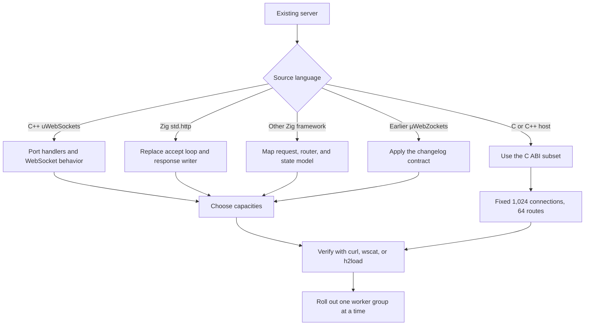

This section maps an existing server onto the µWebZockets application model. Each
page starts from a working program, names the source and target API, and states
which behavior does not carry over.

Migration is a port, not a dependency swap. µWebZockets fixes capacities at
startup, borrows request memory from the connection, and represents deferred work
with a one-shot token. A project that keeps an allocator-per-request design will
fight the runtime instead of using it.

## Choose your starting point

<CardGroup cols={2}>
  <Card title="From uWebSockets" href="/docs/migration/from-uwebsockets" icon="git-compare">
    Move a C++ event-loop service to Zig values, explicit errors, and bounded response writers.
  </Card>
  <Card title="From std.http" href="/docs/migration/from-std-http" icon="arrow-right-left">
    Replace a hand-written accept loop and response writer with the router, slab, and helpers.
  </Card>
  <Card
    title="From another Zig framework"
    href="/docs/migration/from-other-zig-frameworks"
    icon="boxes"
  >
    Decide what maps, what does not, and when staying on the current framework is cheaper.
  </Card>
  <Card title="From C servers" href="/docs/migration/from-c" icon="file-code">
    Use the opaque handle ABI, fixed capacities, and callback-scoped borrowed views.
  </Card>
  <Card title="v1 to v2" href="/docs/migration/v1-to-v2" icon="arrow-up-right">
    Apply the route, response, WebSocket, and HTTP/3 contract changes from the changelog.
  </Card>
  <Card title="2.1 to 2.2" href="/docs/migration/v2-1-to-v2-2" icon="clock">
    Track the carried work and the current 2.1.6 baseline before 2.2.0 ships.
  </Card>
</CardGroup>

## Decide the path

The first branch is the source language, not the wire protocol. A C++ service
that already speaks HTTP/2 still ports through the same `Request` and `Response`
boundary as an HTTP/1.1 service.

## What changes in every migration

| Area                | Before migration                                      | After migration                                                  |
| ------------------- | ----------------------------------------------------- | ---------------------------------------------------------------- |
| Memory              | Per-request allocation or a general-purpose allocator | One startup slab; request slices are borrowed                    |
| Error handling      | Exceptions, ignored return values, or process exit    | Named Zig error unions and explicit `try`                        |
| Concurrency         | Shared state behind a lock, or one loop per process   | One loop and one slab per worker; shared-nothing by default      |
| Routing             | Runtime registration or framework-specific patterns   | Startup registration; static, `:param`, and terminal `*wildcard` |
| Response completion | Write calls in any order                              | One response per request, completed exactly once                 |
| Deferred work       | Future, promise, or callback chain                    | Copyable `AsyncResponse` token on the owning loop                |

## Common migration checklist

| Step | Check                                                     | Evidence                                       |
| ---- | --------------------------------------------------------- | ---------------------------------------------- |
| 1    | Pin Zig 0.16.0 and µWebZockets 2.1.6                      | `zig version` and `build.zig.zon`              |
| 2    | Add the package with `zig fetch --save`                   | Consumer `build.zig.zon`                       |
| 3    | Map every route, method, and parameter                    | Route table in the migrated `main`             |
| 4    | Replace response helpers and status strings               | `res.text`, `res.json`, `res.end`, or a stream |
| 5    | Move retained request data into owned storage             | `req.clone(allocator)` or a bounded copy       |
| 6    | Size connections, body, write queue, and protocol limits  | `ServerConfig` table and `slab_bytes()`        |
| 7    | Run the old and new servers against the same client tests | `curl`, `wscat`, `h2load`, or a service test   |
| 8    | Roll out with a drain on `SIGTERM`                        | `catch_shutdown_signals` and the shutdown log  |

## What this section does not promise

- Source compatibility with another framework. A migration page maps concepts
  and APIs; it does not provide a transpiler.
- Dynamic capacity growth. A capacity that is too small is a configuration
  error, not a runtime resize.
- A feature that the target framework does not expose. Check the
  [feature matrix](/reference/feature-matrix) before planning a port.
- A benchmark result. Throughput claims need the evidence contract described in
  [Benchmarking](/docs/guides/benchmarking).

## Related

- [Compatibility](/reference/compatibility) lists the supported Zig, platform,
  and dependency versions.
- [Feature matrix](/reference/feature-matrix) separates supported, helper-only,
  experimental, and unsupported surfaces.
- [Breaking changes](/docs/migration/breaking-changes) is the version-by-version
  action table.
