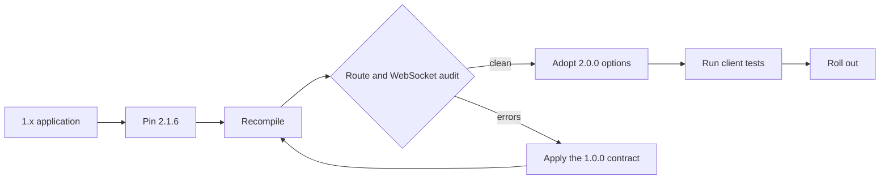

This page is for an application pinned to a µWebZockets 1.x tag, especially the
last 1.x release, 1.9.0. The target is the 2.x line; pin 2.1.6 for the current
patch baseline. The changelog records no removal or rename between 1.9.0 and
2.0.0. The 2.0.0 entry states that the cluster API and C struct layouts are
unchanged and that the only C enum addition is append-only.

The 1.0.0 entry is the contract that defines the v1 API line. If you are porting
code from a pre-1.0 tag, apply those changes first. If you are already on 1.9.0,
they are in force; they are listed here because they describe the API that the
2.x line inherits. The 2.0.0 entry is additive and performance-focused, with the
behavior changes called out below.

## Who this applies to [#who-this-applies-to]

| Starting point | Work                                                                                              |
| -------------- | ------------------------------------------------------------------------------------------------- |
| A pre-1.0 tag  | Apply the 1.0.0 contract, then the 2.0.0 additions                                                |
| 1.9.0          | Recompile on 2.1.6; no removal or rename is recorded, but review the 2.1.5 `configure` adjustment |
| C ABI consumer | Rebuild against the header; layouts are unchanged and `UWZ_HTTP_TRACE = 9` is appended            |
| 2.x            | No v1-to-v2 work; read [2.1 to 2.2](/docs/migration/v2-1-to-v2-2)                                 |

## Compatibility at a glance [#compatibility-at-a-glance]

| Area               | v1 behavior                                                  | v2 behavior                                                                                                         | Action                                                                                 |
| ------------------ | ------------------------------------------------------------ | ------------------------------------------------------------------------------------------------------------------- | -------------------------------------------------------------------------------------- |
| Route registration | Error union, locked after `listen` or `listen_udp`           | Same rules; `trace` is added and `listen_all` can start the lock                                                    | Handle every registration result; register before the listener                         |
| Request target     | `path`, `target`, and `query` are separate fields            | Same fields and meaning                                                                                             | Match on `path`; log `target`; parse `query`                                           |
| WebSocket          | Bounded send, `WouldBlock`, `send_close`, and `terminate`    | Same API; frames from one read share a flush and compression codecs are pre-opened                                  | No source change; re-run frame and backpressure tests                                  |
| HTTP/3             | `init_http3` creates two contexts; `listen_udp` before `run` | Same startup; Linux transmit uses UDP GSO                                                                           | Keep `listen_udp` before `run`; GSO needs no source change                             |
| Cluster            | `build_cluster`, `publish`, and public lifecycle fields      | Same `build_cluster` and `publish` signatures; `worker_count` option in 2.0.0, typed lifecycle and reports in 2.1.5 | No change for `build_cluster` and `publish`; specialize a generic `configure` callback |
| C ABI              | Versioned opaque handles and fixed capacities                | Struct layouts unchanged; `UWZ_HTTP_TRACE = 9` is appended, never renumbered                                        | Recompile and keep existing enum values                                                |
| Compression        | RFC 7692 through `WsBehavior.compression`                    | Same switch; HTTP gzip is a separate opt-in pool                                                                    | Keep RFC 7692 off by default; opt into gzip explicitly                                 |

The C ABI row matters for shared libraries and generated bindings. Rebuild from
the 2.1.6 header instead of copying enum values from a local header.



## The 1.0.0 contract changes [#the-100-contract-changes]

These are the entries under the 1.0.0 `Breaking changes` heading. They are not
new in 2.0.0; they are the contract that the v1 line established and the v2 line
keeps.

| Area                        | Old behavior                                                                                  | New behavior                                                                                             | Action                                                                    |
| --------------------------- | --------------------------------------------------------------------------------------------- | -------------------------------------------------------------------------------------------------------- | ------------------------------------------------------------------------- |
| Route registration          | Registration did not require handling an error union                                          | Returns an error union; handle it with `try`, `catch`, or equivalent                                     | `_ = try app.get("/", handler);` and `_ = try app.ws("/chat", behavior);` |
| Route mutation after listen | Route mutation was not guarded by a listener lock                                             | Returns `error.RoutesLocked` after `listen` or `listen_udp` succeeds                                     | Register every route before the first successful listener call            |
| WebSocket message size      | A plain `App(N)` carried the 16 KiB default ceiling                                           | Messages above 16 KiB need `ConfiguredApp` and matching `WsBehavior` limits                              | Set `max_frame_size <= max_message_size <= message capacity`              |
| Output and backpressure     | Output had no bounded-queue failure to report                                                 | Response writers and `WebSocket.send` can return `error.WouldBlock`                                      | Treat `WouldBlock` as normal; resume from the `drain` callback            |
| WebSocket send and close    | Continuation was not documented as rejected; the close path had no drain-then-terminate split | `send` rejects `.continuation` with `error.InvalidOpcode`; `send_close` drains, `terminate` is immediate | Send complete final messages; use `terminate` only for an immediate close |
| HTTP/3 availability         | `http3_available` was false; HTTP/3 was not a live listener                                   | `http3_available` reports the compiled QUIC backend; `listen_udp` starts the live path                   | Add `listen_udp` before `run`; gate the listener on `uz.http3_available`  |
| RFC 7692 compression        | `WsBehavior` had no public compression switch                                                 | `WsBehavior.compression` exists and defaults to `.disabled`                                              | Opt in with `.permessage_deflate` per route                               |
| Request target fields       | Route matching used one target string                                                         | `path` is the match path, `target` is the original target with its query, `query` excludes `?`           | Use `path` for routing, `target` and `query` for logging and parsing      |

The WebSocket limits are checked before the upgrade. A message capacity larger
than the compiled connection storage fails registration with
`error.InvalidWebSocketLimits` instead of truncating a message at runtime:

```zig
var app = try uz.ConfiguredApp(512, 32 * 1024, 32 * 1024).init(init.io);
defer app.deinit();

_ = try app.get("/", hello_handler);
_ = try app.ws("/chat", .{
    .message = on_message,
    .max_frame_size = 32 * 1024,
    .max_message_size = 32 * 1024,
    .compression = .permessage_deflate,
});
```

`ConfiguredApp` takes the connection count, the WebSocket message capacity, and
the write queue size. The same message capacity must cover
`WsBehavior.max_message_size`; the frame ceiling cannot exceed it.

HTTP/3 startup has two listeners in 1.0.0 and later. `init_http3` prepares the
TCP and QUIC TLS contexts, and `listen_udp` binds the QUIC endpoint:

```zig
var server = try uz.App(128).init_http3_ephemeral(init.io);
defer server.deinit();

_ = try server.get("/", index);
try server.listen_udp("0.0.0.0", 8443);
try server.run();
```

The `App` value must stay at a stable address after `listen_udp`; the QUIC
engine holds a pointer to it. `uz.http3_available` reports whether the build
supports the listener; the 2.1.6 source enables it. Check the value before you
document an HTTP/3 endpoint.

## The 2.0.0 additive changes [#the-200-additive-changes]

The 2.0.0 entry adds behavior without removing the v1 surface. Every row below
requires no source change or is an explicit opt-in, except the C enum value,
which may require a rebuild and one new switch case.

| Addition                         | Behavior                                                                                                                                      | Action                                                                                                                                 |
| -------------------------------- | --------------------------------------------------------------------------------------------------------------------------------------------- | -------------------------------------------------------------------------------------------------------------------------------------- |
| `listen_all`                     | Binds up to four TCP endpoints, verifies every local port, then arms accepts; a failed bind leaves routes unlocked                            | Adopt when one process binds several ports; `listen` remains the one-endpoint wrapper                                                  |
| `ClusterOptions.worker_count`    | Selects an explicit active count up to the compiled capacity; only active workers allocate slabs, inboxes, and threads                        | Set it when the CPU or cgroup limit is known at startup                                                                                |
| `build_cluster_from_environment` | Resolves the explicit option, then `UWEBZOCKETS_WORKERS`, then the platform CPU count                                                         | Use it for containers; the explicit option wins                                                                                        |
| HTTP gzip pool                   | `with_http_compression(true)` opens one compressor per active worker; `Response.end_gzip` avoids a request-path allocation                    | Opt in per server; RFC 7692 WebSocket compression is separate                                                                          |
| TRACE                            | Opt-in method across `HttpMethod`, `Router.trace`, `App.trace`, the client, C ABI `UWZ_HTTP_TRACE`, HTTP/2, HTTP/3 replay safety, and OpenAPI | Register only when needed; redact `Authorization`, `Cookie`, `Proxy-Authorization`, and application secrets; bound the reflected bytes |
| Linux UDP GSO                    | Equal-sized lsquic packets for one destination use one `sendmsg` with `UDP_SEGMENT`; other cases fall back                                    | No source change; it is transport-internal                                                                                             |
| HTTP/1.1 pipelining batch        | Multiple complete requests from one read append responses to the bounded ring and flush once                                                  | No source change; check tests that assume one write per response                                                                       |
| WebSocket batching               | Consecutive frames from one read share one write flush; AVX2 uses 256-bit unmasking with a scalar tail                                        | No source change; re-run echo and backpressure tests                                                                                   |
| Cluster active slice             | `Cluster.worker(index)` and every loop use the active worker slice; unused compiled capacity reserves no inboxes                              | No source change; `worker_count()` reports the active count                                                                            |
| C enum append                    | `UWZ_HTTP_TRACE = 9` follows `UWZ_HTTP_QUERY = 8`; no existing value is renumbered                                                            | Recompile; never renumber a local copy; add a TRACE case only if your switch is exhaustive                                             |

The 2.0.0 changelog publishes no throughput number without a quiet-host rerun.
Treat the implementation as shipped and the performance claim as unmeasured
until the evidence is recorded.

## Upgrade checklist [#upgrade-checklist]

1. Pin Zig 0.16.0 and µWebZockets 2.1.6 in your own project.
2. Fetch the release tag and confirm the `uWebZockets` package entry:

   ```sh
   zig fetch --save 'https://github.com/farbenbuilds/uWebZockets/archive/refs/tags/v2.1.6.tar.gz'
   ```

3. Recompile before changing code. A clean compile is the first signal because
   the changelog records no removal or rename between 1.9.0 and 2.0.0.
4. Audit every `get`, `post`, `ws`, and `trace` call. Each result is handled,
   and no route is registered after a successful listener call.
5. Audit WebSocket limits. Use `ConfiguredApp` for messages above 16 KiB, keep
   the frame ceiling at or below the message ceiling, and opt into
   `.permessage_deflate` only when required.
6. Audit backpressure. `WouldBlock` is normal, the producer resumes from
   `drain`, and no retry loop spins inside a callback.
7. Audit HTTP/3 startup. `init_http3` and `listen_udp` come before `run`, and the
   listener is gated on `uz.http3_available`.
8. Decide on the 2.0.0 options one at a time: `listen_all`, `worker_count`,
   HTTP gzip, and TRACE. Each is opt-in.
9. Run the verification block below against the same client tests as the 1.x
   server.

## Verification [#verification]

```sh
zig build
```

```sh
curl -i http://127.0.0.1:3000/
```

```sh
wscat -c ws://127.0.0.1:3000/chat
```

```sh
curl --http3-only -k -i https://127.0.0.1:8443/
```

| Check             | Pass condition                                                                                 |
| ----------------- | ---------------------------------------------------------------------------------------------- |
| HTTP/1.1 route    | Status and body match the pre-upgrade contract                                                 |
| WebSocket message | A message above 16 KiB round-trips after `ConfiguredApp`; smaller messages still work          |
| Backpressure      | A producer paused by `WouldBlock` resumes from `drain` with no duplicate or truncated frame    |
| HTTP/3 listener   | `uz.http3_available` is true, `listen_udp` precedes `run`, and the QUIC endpoint answers       |
| Route lock        | A route added after `listen` returns `error.RoutesLocked`, and the registered set still serves |
| C ABI             | The rebuilt header keeps existing enum values and defines `UWZ_HTTP_TRACE` as 9                |

Assert the status and body, not header order. Header order and exact field
casing are transport details. See [HTTP limits](/docs/http/limits) for the
default capacities and [WebSocket](/docs/websocket) for the frame and drain
contract.

## Related [#related]

- [Breaking changes](/docs/migration/breaking-changes) is the version-by-version
  action index.
- [2.1 to 2.2](/docs/migration/v2-1-to-v2-2) separates the shipped 2.1.6
  baseline from the 2.2.0 planning target.
- [Compatibility](/reference/compatibility) lists the supported Zig, platform,
  and dependency versions.
- [ServerConfig](/reference/server-config) lists every capacity and default.
- [CHANGELOG 1.0.0](https://github.com/farbenbuilds/uWebZockets/blob/main/CHANGELOG.md#100---2026-09-01)
  is the source of the contract changes.
- [CHANGELOG 2.0.0](https://github.com/farbenbuilds/uWebZockets/blob/main/CHANGELOG.md#200---2026-10-20)
  is the source of the additive changes.
