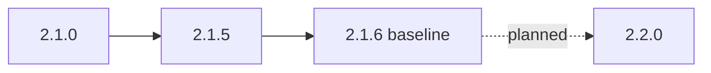

µWebZockets 2.1.6 is the current baseline. 2.2.0 is a planning target: at this
baseline no 2.2.0 tag exists, no release date is recorded, and the roadmap does
not promise an API. This page separates what shipped in 2.1.x from what is
carried for 2.2.0, so you can pin a release today without coding against a
future name.

:::note[2.2.0 is not released]
Do not treat a carried item as an API. A capability becomes available only when
a release tag and a dated `CHANGELOG.md` section exist. The roadmap records
intent and order, not a contract.
:::

Use the status table as a planning boundary. A `Shipped in 2.1.x` row is backed
by a release and a dated changelog entry; a `Carried for 2.2.0` row is only a
roadmap candidate. A candidate can be reordered or dropped without a changelog
entry, and no candidate becomes available before its release tag.

## Current baseline [#current-baseline]

| Version | Date       | Status          | Public surface                                                                  |
| ------- | ---------- | --------------- | ------------------------------------------------------------------------------- |
| 2.1.6   | 2026-10-26 | Current patch   | No public API, C ABI layout, capacity, wire format, or TLS policy change        |
| 2.1.5   | 2026-10-25 | Previous minor  | Cluster lifecycle, failure, and publish reporting; best-effort response endings |
| 2.1.0   | 2026-10-24 | Previous minor  | Timing wheel, sleep parking, header read deadline, indexed rate limiting        |
| 2.2.0   | Not dated  | Planning target | No shipped API; every row below is a carry                                      |

The 2.1.0 release moved the default slab total from `681_752_192` to
`683_382_400` bytes, a growth of `1_630_208` bytes for one idle timer node and
nine parking slots per default connection. Configured limits did not change.
This is a footprint change, not a capacity model change.



## What 2.1.x added [#what-21x-added]

### 2.1.0 [#what-210-added]

| Area          | Addition                                                                     | Effect                                                                  |
| ------------- | ---------------------------------------------------------------------------- | ----------------------------------------------------------------------- |
| Deadlines     | Four-level timing wheel; `AsyncResponse.sleep` and `sleep_complete`          | A delayed response parks without blocking the loop                      |
| Header timing | `ServerConfig.header_read_timeout_ms`; `Builder.with_header_read_timeout_ms` | An incomplete head or body has a deadline separate from idle keep-alive |
| Rate limiting | `middleware.RateLimitTable`; `rate_limit_indexed`                            | O(1) expected lookup and insert with caller-owned index and LRU storage |
| Client        | A monotonic scan cursor                                                      | Response parsing stays linear across reads                              |
| Pub/sub       | Stable topic ids and per-topic subscriber lists                              | Publish work scales with the live subscribers of the topic              |

### 2.1.5 [#what-215-added]

| Area      | Addition                                                                                                                          |
| --------- | --------------------------------------------------------------------------------------------------------------------------------- |
| Lifecycle | `ClusterState` with `configured`, `running`, `stopped`, `releasing`, `released`; `state()`, `worker_count()`, `worker_capacity()` |
| Failures  | `FailurePhase`, `WorkerFailure { index, phase, err }`, `first_failure()`, `failure_count()`                                       |
| Publish   | `PublishReport { queued, dropped, notify_failed, first_dropped_worker }`, `attempted()`, `all_delivered()`, `publish_report()`    |
| Callback  | `Cluster.ConfigureCallback` replaces the `anytype` parameter                                                                      |
| Errors    | Named `RunError` and `PublishError` through `uz.cluster`; `deinit_checked()`                                                      |
| Responses | `Response.end_best_effort` and `Response.end_with_headers_best_effort`                                                            |
| Safety    | Cluster wakeup uses queue-owned scratch; `message_queue.pop_copy` checks message lengths before copying                           |

The 2.1.5 release is API hardening, not a wire or capacity release. It adds the
typed surface that supervisors need without changing the shared-nothing request
path.

### 2.1.6 [#what-216-added]

The 2.1.6 release is a patch. It disarms and re-arms the timer scheduler instead
of replaying an expired absolute timeout, pins libxev `c49f6dfb` with XEV-003
through XEV-005, keeps `TCP_NODELAY` best effort after a reset peer, and makes
the HTTP and HTTP/2 benchmark harnesses fail closed. Public APIs, C ABI layouts,
capacities, wire formats, and TLS policy are unchanged.

## Status for 2.2.0 [#status-for-220]

| Item                                                                                                     | Status            | Note                                                                        |
| -------------------------------------------------------------------------------------------------------- | ----------------- | --------------------------------------------------------------------------- |
| `ClusterState`, `state()`, `worker_count()`, `worker_capacity()`                                         | Shipped in 2.1.x  | 2.1.5                                                                       |
| `FailurePhase`, `WorkerFailure`, `first_failure()`, `failure_count()`                                    | Shipped in 2.1.x  | 2.1.5                                                                       |
| `PublishReport`, `publish_report()`, `attempted()`, `all_delivered()`                                    | Shipped in 2.1.x  | 2.1.5                                                                       |
| `Cluster.ConfigureCallback`, named `RunError` and `PublishError`, `deinit_checked()`                     | Shipped in 2.1.x  | 2.1.5                                                                       |
| `Response.end_best_effort`, `end_with_headers_best_effort`                                               | Shipped in 2.1.x  | 2.1.5                                                                       |
| `AsyncResponse.sleep`, `sleep_complete`, and the timing wheel                                            | Shipped in 2.1.x  | 2.1.0                                                                       |
| `header_read_timeout_ms`, `RateLimitTable`, `rate_limit_indexed`                                         | Shipped in 2.1.x  | 2.1.0                                                                       |
| Timer scheduler fix, best-effort `TCP_NODELAY`, fail-closed benchmarks                                   | Shipped in 2.1.x  | 2.1.6                                                                       |
| Quiet-host evidence for the v2.0.0 and v2.1.0 pipeline, WebSocket, `json-comp`, and `latency-1m` targets | Carried for 2.2.0 | No performance number is claimed before the rerun                           |
| Receive-side `UDP_GRO`                                                                                   | Carried for 2.2.0 | Transmit GSO shipped in 2.0.0; receive GRO waits for ancillary sizes        |
| HttpArena `async` adapter for the shipped `/delay/:ms` surface                                           | Carried for 2.2.0 | The route surface shipped in 2.1.0; the adapter did not                     |
| Cross-process `SO_REUSEPORT` or systemd socket-activation handoff                                        | Carried for 2.2.0 | `listen_all` is an in-process all-or-nothing barrier                        |
| Decisions on per-listener certificates                                                                   | Carried for 2.2.0 | All TLS listeners share the application certificate at 2.1.6                |
| A bounded TRACE reflection example                                                                       | Carried for 2.2.0 | TRACE is opt-in; the library does not synthesize an echo                    |
| An optional `uwz_app_listen_all` C entry point                                                           | Carried for 2.2.0 | The C ABI has no `listen_all` entry point today                             |
| Retained fork archives and second-machine resolution for libxev, lsquic, and h1spec                      | Carried for 2.2.0 | Dependency provenance and the native Windows runtime gate are open          |
| Fresh lsquic and h1spec fork gate evidence                                                               | Carried for 2.2.0 | The pins are recorded; the compliance artifacts still need a rerun          |
| HTTP/3 datagram and WebTransport through the maintained lsquic fork                                      | Carried for 2.2.0 | The live path stays capability-gated until the compliance gate              |
| Extract the nested `Cluster` runtime from `src/router/app.zig`                                           | Carried for 2.2.0 | Internal ownership work; 2.1.5 moved lifecycle policy to `worker_group.zig` |

Every `Carried for 2.2.0` row comes from the roadmap's carried list. The roadmap
is a plan, not a changelog section. A shipped row is backed by a released
version and a dated changelog entry.

## What to do today [#what-to-do-today]

- No migration is required for the 2.2.0 plan. The 2.1.6 patch changes no
  public API, C ABI layout, capacity, wire format, or TLS policy.
- If you are on 2.1.0, review the 2.1.5 `Cluster.configure` source adjustment, the
  named lifecycle errors, and the `publish`-after-`run` error before you pin
  2.1.6. From 2.1.5, the patch is source-compatible.
- Pin 2.1.6. Do not pin `main`, and do not write code against a name that only
  appears in the roadmap.
- Keep Zig 0.16.0. It is the only supported toolchain for this baseline.
- Do not enable WebTransport, per-listener certificates, or an HTTP/3 cluster.
  None is available at 2.1.6.
- If you need a carried capability, keep a fallback and watch the released
  `CHANGELOG.md`, not the roadmap alone.

```sh
zig fetch --save 'https://github.com/farbenbuilds/uWebZockets/archive/refs/tags/v2.1.6.tar.gz'
```

## Boundaries that do not move [#boundaries-that-do-not-move]

| Boundary               | 2.1.6 status  | What it means for a 2.2.0 plan                                                                      |
| ---------------------- | ------------- | --------------------------------------------------------------------------------------------------- |
| Fixed startup slabs    | Fixed         | Size with `ServerConfig` or a preset; exhaustion returns a structured error, not a resize           |
| TLS 1.3 only           | Fixed         | TLS 1.2 and its older cipher suites stay unsupported                                                |
| HTTP/3 clustering      | Not supported | `init_http3` and `listen_udp` are single-application; a cluster listener is TCP/TLS only            |
| WebTransport live path | Not live      | A CONNECT receives `501` at 2.1.6; the carried implementation is conditional on the compliance gate |

The roadmap carries WebTransport implementation work, not a shipped API. Treat
the live path as unavailable until a release records that the gate passed.
[HTTP/3](/docs/http3) lists the current listener status, and
[Shared-nothing cluster](/examples/shared-nothing-cluster) covers the TCP cluster boundary.

## Related [#related]

- [v1 to v2](/docs/migration/v1-to-v2) applies the earlier contract changes.
- [Breaking changes](/docs/migration/breaking-changes) indexes every recorded
  contract and behavior change.
- [Compatibility](/reference/compatibility) lists the supported toolchain and
  platforms.
- [CHANGELOG 2.1.0](https://github.com/farbenbuilds/uWebZockets/blob/main/CHANGELOG.md#210---2026-10-24)
  is the source of the timing-wheel and header-deadline additions.
- [CHANGELOG 2.1.5](https://github.com/farbenbuilds/uWebZockets/blob/main/CHANGELOG.md#215---2026-10-25)
  is the source of the lifecycle and publish-report surface.
- [CHANGELOG 2.1.6](https://github.com/farbenbuilds/uWebZockets/blob/main/CHANGELOG.md#216---2026-10-26)
  is the patch baseline.
- [Limits](/reference/limits) is the capacity lookup for the 2.1.6 baseline.
