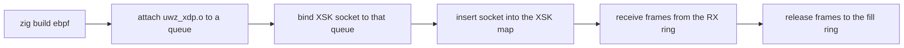

AF_XDP moves packets between a network queue and a userspace UMEM region through
four rings, bypassing the kernel socket stack. µWebZockets exposes the socket and
transport helpers, plus an XSK redirect program. It does not attach that program
or route server traffic through it.

## Prerequisites

| Requirement | Detail                                                                  |
| ----------- | ----------------------------------------------------------------------- |
| Kernel      | Linux with AF_XDP support built in                                      |
| Driver      | A driver and queue that support XDP and, for zero copy, XSK zero copy   |
| Privilege   | Network-administration capability for the socket, map, and attach steps |
| Build       | A Linux build host for `zig build ebpf`                                 |

`uz.xdp` is a compile error off Linux; `uz.xdp_transport` reports `.standard`
with reason `unsupported_platform` at runtime. The build step fails rather than
emitting an object the kernel cannot load.

## Build the redirect in your application

After [`zig fetch --save`](/docs/getting-started/installation), add a step to your
own `build.zig` that compiles the redirect from the dependency. No clone of the
framework repository is required.

```zig build.zig
const std = @import("std");

pub fn build(b: *std.Build) void {
    const uz = b.dependency("uWebZockets", .{});
    const redirect = compileEbpf(b, uz.path("src/xdp/xdp_redirect.c"), "uwz_xdp.o");

    const step = b.step("ebpf", "Build the XSK redirect from the package sources");
    step.dependOn(&b.addInstallFile(redirect, "share/uwebzockets/uwz_xdp.o").step);
}

fn compileEbpf(b: *std.Build, source: std.Build.LazyPath, name: []const u8) std.Build.LazyPath {
    const compile = b.addSystemCommand(&.{
        b.graph.zig_exe, "cc", "-target", "bpfel-freestanding",
        "-std=c11", "-O2", "-g", "-c",
    });
    compile.addFileArg(source);
    compile.addArg("-o");
    return compile.addOutputFileArg(name);
}
```

```sh
zig build ebpf
```

The step installs `zig-out/share/uwebzockets/uwz_xdp.o`. That program looks up
the receiving queue index in an XSK map with 256 entries and redirects the packet
into the mapped socket; an unmapped queue falls through to `XDP_PASS`, so traffic
keeps flowing on the normal path.

## Framework checkout shortcut

The repository also defines `zig build ebpf` for its own contributors. Run that
command from a clone of
[farbenbuilds/uWebZockets](https://github.com/farbenbuilds/uWebZockets); it
installs the redirect and the latency histogram objects together.



Attaching the program, pinning maps, and inserting the socket into the XSK map
are operator steps. The server never performs them and never attaches the
redirect.

## Modules

`uz.xdp_transport` is the policy layer. `probe()` never fails: it returns a mode
and a reason, so startup can always fall back to the standard stack.

| API                                                 | Purpose                                                                  |
| --------------------------------------------------- | ------------------------------------------------------------------------ |
| `probe()`                                           | Reports `.kernel_bypass` or `.standard` with a fallback reason           |
| `resolve_mode(requested)`                           | Returns `.standard` off Linux, otherwise the requested mode              |
| `validate_umem(umem, chunk_size)`                   | Checks page alignment, chunk size, and frame count                       |
| `XdpTransport.init(umem, config)`                   | Owns one socket, the caller's UMEM, and a fixed free-frame stack         |
| `bind`, `receive`, `release`, `transmit`, `reclaim` | Drive the rings; a frame returns to the free stack only after completion |
| `status()`                                          | Reports the current `Availability`                                       |

`uz.xdp` is the socket layer below it: UMEM registration, the fill, completion,
receive, and transmit rings, and frame recycling. Reach for it when you need ring
control that the transport does not expose.

The default `XdpConfig` uses 2,048-byte chunks, 1,024 frames, and a copying data
path. A transport tracks at most 4,096 frames, and zero copy is requested
explicitly rather than assumed.

## Why the server stays standard

`ServerConfig.transport = .kernel_bypass` is a request, not a promise. The server
data path serves every connection through the standard stack:

| Path                            | Result                                               |
| ------------------------------- | ---------------------------------------------------- |
| `ServerConfig.transport`        | Reports `.standard` with reason `.data_path_unwired` |
| `xdp_kernel_bypass_fallbacks`   | Incremented once at startup for that request         |
| XSK redirect                    | Never attached by the server                         |
| `uz.xdp_transport` and `uz.xdp` | Available to code that drives them directly          |

No accept, read, or write completion dispatches through AF_XDP, so reporting a
live bypass would be false. The fallback reason names that gap instead of hiding
it.

## Drive the transport yourself

```zig
const uz = @import("uWebZockets");

const umem = try std.heap.page_allocator.alignedAlloc(
    u8,
    .fromByteUnits(std.heap.page_size_min),
    1024 * 2048,
);
defer std.heap.page_allocator.free(umem);

var transport = try uz.xdp_transport.XdpTransport.init(umem, .{
    .chunk_size = 2048,
    .frame_count = 1024,
    .interface_index = interface_index,
    .queue_id = queue_id,
});
defer transport.deinit();
```

`init` validates the geometry and registers the UMEM. `bind` attaches the socket
to the interface queue; after that, `receive` returns a frame you must `release`
so the fill ring can refill, and `transmit` consumes a frame you own. The frame
lifetime is the whole contract: a frame that is neither released nor transmitted
leaves the free stack short.

## Test procedure

1. Call `probe()` and record the mode and reason. On a host without the socket
   family or the privilege, `.standard` with `kernel_unavailable` or
   `permission_denied` is the expected result, not a defect.
2. Initialize a transport with a page-aligned UMEM and the default config, then
   bind it to a queue you control.
3. Attach `uwz_xdp.o` to that interface and insert the socket into the XSK map
   for the same queue index.
4. Send traffic on that queue and confirm `receive` returns frames while
   `release` keeps the free stack populated.
5. Run `curl` against the server's normal listener on another queue and confirm
   it still answers. The two paths are independent by design.

Step 5 is the check that matters for a mixed deployment: a broken bypass must
never take the standard listener down with it.

## Limits

- AF_XDP is Linux-only and needs a compatible driver, queue, and privileges.
- The XSK map holds 256 entries, keyed by RX queue index.
- A transport tracks at most 4,096 frames, and each frame is one chunk.
- The server exposes no configuration that activates the bypass for its own
  connections. Only direct callers get kernel-bypass behavior.
- Counters such as `xdp_frames_received` are part of the registry surface, but
  the standard transport never advances them.

## Related

- [eBPF latency histogram](/docs/operations/ebpf) covers the second object and
  the hidden metrics endpoint.
- [kTLS and AF_XDP](/docs/architecture/ktls-and-xdp) states what each helper owns
  and why the data path ignores it.
- [Transports](/docs/architecture/transports) shows the standard TCP, TLS, and
  QUIC paths that actually serve traffic.
