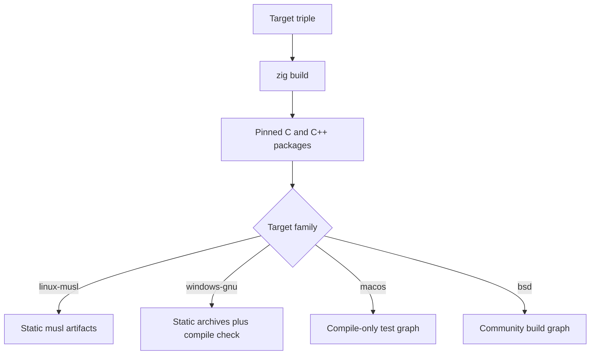

A target triple is the only extra input a cross build needs. Zig compiles
BoringSSL, lsquic, ls-qpack, ls-hpack, libdeflate, and zlib for the selected
target, so no external sysroot, MinGW zlib, or system prefix is involved.



## Bundled toolchain

| Input                    | Source                                           |
| ------------------------ | ------------------------------------------------ |
| C and C++ compiler       | Zig's bundled clang and libc++                   |
| BoringSSL, lsquic, HPACK | Pinned packages compiled for the selected target |
| zlib                     | The bundled Zig package; no external zlib prefix |
| libdeflate               | The bundled Zig package                          |
| System headers           | Zig's target libc definitions; no host sysroot   |

Do not add a cross toolchain to `PATH`. A second compiler or linker can mask a
real build-graph problem and produce artifacts that do not match the pinned
dependency set.

## musl

Build a static musl artifact with one command:

```sh
zig build -Dtarget=aarch64-linux-musl -Doptimize=ReleaseSafe
```

Use `x86_64-linux-musl` for the other supported architecture. To compile the test
graph without running it, use `test-compile` with the same target:

```sh
zig build test-compile -Dtarget=aarch64-linux-musl -Doptimize=ReleaseSafe --summary all
```

The flake also exposes a musl development shell on Linux:

```sh
nix develop .#musl
```

## Windows

The Windows target is `x86_64-windows-gnu`. Compile the test and C ABI graph,
then build the static libraries:

```sh
zig build test-compile -Dtarget=x86_64-windows-gnu -Doptimize=ReleaseSafe --summary all
zig build lib -Dtarget=x86_64-windows-gnu -Doptimize=ReleaseFast --summary all
```

Both commands are compile gates. The native workflow runs the suite on
`windows-2025` with `zig build test --summary all`; official support follows a
green runtime job for the release commit. No Windows binaries are published.

Applications that link the archives directly must also link libc, the C++
runtime, the installed `libz.a`, and the platform networking libraries:
`ws2_32`, `mswsock`, `crypt32`, and `advapi32`. The archives under `zig-out/lib`
are µWebZockets, BoringSSL, lsquic, libdeflate, and zlib.

Windows QUIC uses IOCP UDP receives and Winsock `WSASendTo`. The 1.9.0 accept
and queued-close work is recorded in ADR 0004 in the framework repository.

## macOS

macOS is a supported host on `x86_64` and `aarch64`. The test graph
cross-compiles on demand, but no hosted macOS runner executes kqueue. Treat a
macOS cross build as a compile check unless you also run the result on macOS.
Runtime coverage for kqueue is tracked separately from the Linux runtime matrix.

## BSD targets

FreeBSD, NetBSD, OpenBSD, and DragonFlyBSD share the build graph. They are
community targets: the project does not run dedicated hosted CI for them.

| Target family | Status                 |
| ------------- | ---------------------- |
| FreeBSD       | Community build target |
| NetBSD        | Community build target |
| OpenBSD       | Community build target |
| DragonFlyBSD  | Community build target |

Select the triple through `-Dtarget=`. A build that succeeds is evidence that
the graph compiles; it is not a hosted runtime result.

## What a cross build proves

| Check                           | Cross build         | Native run |
| ------------------------------- | ------------------- | ---------- |
| Zig sources compile             | Yes                 | Yes        |
| Pinned C/C++ dependencies build | Yes                 | Yes        |
| The test graph compiles         | With `test-compile` | Yes        |
| The test suite runs             | No                  | Yes        |
| Sanitizers run                  | No                  | Linux only |

Sanitizer builds are restricted to native Linux. A cross build cannot substitute
for the ASan, UBSan, or MSan gates; see [Sanitizers](/docs/operations/sanitizers).

## Verify

```sh
zig build test-compile -Dtarget=aarch64-linux-musl -Doptimize=ReleaseSafe --summary all
```

Replace the triple with the target you need. A successful `test-compile` proves
the test and C ABI graph builds for that target without claiming that the host
can execute it.

## Related

- [Build from source](/docs/operations/build) covers the native graph and caches.
- [Nix development shell](/docs/operations/nix) supplies the musl shell and pinned compiler.
- [Platform support](/docs/architecture/backends) describes the runtime backend behind each target.
