The `ebpf` build step emits two XDP objects. One redirects packets into an XSK
map; the other increments a per-CPU histogram of ingress frame lengths. The
server never attaches either one on its own: you build, attach, and pin, then the
hidden metrics endpoint reads the pinned map.

## Build the objects

```sh
zig build ebpf
```

The step requires a Linux build host and compiles both C sources with
`zig cc -target bpfel-freestanding`. It installs two files:

| Output                                    | Source                                | Program                                          |
| ----------------------------------------- | ------------------------------------- | ------------------------------------------------ |
| `zig-out/share/uwebzockets/uwz_xdp.o`     | `src/xdp/xdp_redirect.c`              | XSK redirect keyed by RX queue index             |
| `zig-out/share/uwebzockets/uwz_latency.o` | `src/observability/uwz_latency_bpf.c` | Packet-length histogram, 16 power-of-two buckets |

On a non-Linux host the step fails instead of producing an object the kernel
cannot load.

## Read path

```mermaid
%%{init: {"flowchart":{"useMaxWidth":false}} }%%
flowchart LR
  accTitle: eBPF histogram read path
  accDescr: The eBPF object is attached and pinned by an operator, the server opens the pinned map at startup, and the hidden metrics route renders the buckets.
  A["zig build ebpf"] --> B["attach with network-admin privileges"]
  B --> C["pin map at /sys/fs/bpf/uwz_latency"]
  C --> D["App starts with observability enabled"]
  D --> E["open pinned map"]
  E --> F["GET /metrics"]
  F --> G["uwz_latency_packets_bucket lines"]
```



The application opens the pinned map once, while the application is constructed,
and only when observability is enabled. A missing or unreadable map is not
startup failure: the file descriptor stays unset and the counters are still
served. On a non-Linux target the module reports itself unavailable and the open
is never attempted.

## Buckets

`uwz_latency.o` is an XDP program that computes a bucket from the frame length
with `31 - clz(length)` and increments a `PERCPU_ARRAY` entry, then returns
`XDP_PASS`. The map holds 16 buckets; a length that would land above bucket 15 is
counted in bucket 15.

The kernel keeps one counter set per CPU. Reading sums every possible CPU, so the
exposition holds totals, not per-CPU values. The read fails closed when
`/sys/devices/system/cpu/possible` reports more than 256 possible CPUs, because
the lookup buffer is fixed.

## Metrics output

The histogram appears only when the map is readable. The exposition uses
cumulative boundaries:

```console
# TYPE uwz_latency_packets_bucket histogram
uwz_latency_packets_bucket{le="63"} 0
uwz_latency_packets_bucket{le="127"} 12
...
uwz_latency_packets_bucket{le="+Inf"} 40
```

Each finite boundary is `(1 << index) - 1`, and counts beyond the last finite
boundary roll into `+Inf`. Read the buckets as length classes, not as exact byte
counts. The counters from the registry are rendered in the same response. Serving uses a fixed 4096-byte buffer and performs no heap
allocation; a full buffer returns `500` rather than truncating the document.

## Privileges

| Action                                       | Requirement                                    |
| -------------------------------------------- | ---------------------------------------------- |
| Compile the objects                          | Linux build host with the Zig toolchain        |
| Attach the redirect or the histogram program | Linux network-administration capability        |
| Pin the map under `/sys/fs/bpf`              | A mounted bpffs and the same privilege         |
| Populate the XSK map                         | The same privilege, plus a bound AF_XDP socket |

None of these steps belongs to an unprivileged application start. Treat the
objects as operator-supplied infrastructure and keep the attach step out of the
process that serves traffic.

## AF_XDP status

The metrics endpoint reads a pinned map. It does not give the server a data
path. A `ServerConfig.transport = .kernel_bypass` request reports `.standard`
with reason `.data_path_unwired` and increments
`xdp_kernel_bypass_fallbacks`; no accept or read completion dispatches through
AF_XDP. Applications that want the bypass drive `uz.xdp_transport` and `uz.xdp`
directly, as [AF_XDP](/docs/operations/af-xdp) describes.

## Verify

Enable observability, start the process, and read the endpoint:

```zig
var server = try uz.Server.builder(init.io)
    .with_observability(true)
    .with_metrics_path("/metrics")
    .build(std.heap.page_allocator);
defer server.deinit();
```

```sh
curl -s http://127.0.0.1:3000/metrics | grep uwz_latency_packets_bucket
```

With the map pinned and traffic flowing, counts increase; without the map the
`grep` finds nothing and the rest of the exposition is unchanged. That difference
is the signal that the histogram source, not the server, is missing.

## Related

- [kTLS and AF_XDP](/docs/architecture/ktls-and-xdp) states which helpers are
  wired into the data path and why.
- [AF_XDP](/docs/operations/af-xdp) covers the socket, UMEM, and ring setup that
  the redirect expects.
- [Metrics](/docs/operations/metrics) lists the registry counters and the hidden
  endpoint contract.
