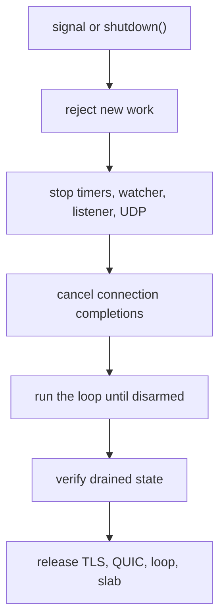

A graceful shutdown stops accepting new work, lets the connections already
accepted finish or time out, and releases the slab only after every completion
is disarmed. `catch_shutdown_signals` connects SIGINT and SIGTERM to that path.
This page shows the call order for one application and for a cluster, the errors
each call returns, and the wait a supervisor must allow.

## Arm the watcher before run

```zig src/main.zig
const std = @import("std");
const uz = @import("uWebZockets");

fn health(_: *uz.Request, res: *uz.Response) void {
    res.text("ok") catch |err| {
        std.log.err("response failed: {}", .{err});
    };
}

pub fn main(init: std.process.Init) !void {
    var server = try uz.Server.builder(init.io)
        .with_max_clients(256)
        .with_idle_timeout_ms(30_000)
        .build(std.heap.page_allocator);
    defer server.deinit();

    _ = try server.get("/healthz", health);
    _ = try server.get("/readyz", health);

    try server.catch_shutdown_signals();
    try server.listen("0.0.0.0", 3000);
    try server.run();
}
```

The order matters. `catch_shutdown_signals` must run before `run`, and `deinit`
stays in a `defer` at the scope where the application was created. A signal
arriving before the loop starts is not lost: the request is recorded and the
first loop iteration drains it.

## What the watcher owns

| Platform | Mechanism                                                                 | Loop delivery                                           |
| -------- | ------------------------------------------------------------------------- | ------------------------------------------------------- |
| POSIX    | SIGINT and SIGTERM handlers write one byte into a non-blocking self-pipe  | A file poll on the read end wakes the loop thread       |
| Windows  | `SetConsoleCtrlHandler` for Ctrl+C, console close, and logoff or shutdown | A process flag plus a libxev async wake the loop thread |

Both paths are allocation-free, and a handler never logs. Repeated signals that
arrive before the loop drains coalesce into one shutdown request. The watcher is
process-wide, so it is installed once and `deinit` restores the previous
dispositions and closes the pipe after the loop has drained.

## Drain order



A drained process has no active pool slot, no armed listener, a stopped timer
wheel, a stopped signal watcher, and an empty QUIC transport. `run` performs that
verification when it returns from a signal-driven shutdown; `deinit` repeats it
and panics rather than releasing storage a completion still points at. The
internal steps and their release order are on
[Shutdown ordering](/docs/architecture/shutdown).

## Cluster shutdown

`Cluster.catch_shutdown_signals()` installs one process-wide watcher whose
callback requests shutdown for every worker. The lifecycle is unchanged:
configure routes, install the watcher, listen, run, then release.

```zig
var group = try uz.Server.builder(init.io)
    .with_max_clients(256)
    .build_cluster(std.heap.page_allocator, 4, .{});
defer group.deinit();

const Cluster = @TypeOf(group);
try group.configure(struct {
    fn routes(worker: *Cluster.Worker, index: usize) !void {
        _ = index;
        _ = try worker.get("/healthz", health);
    }
}.routes);

try group.catch_shutdown_signals();
try group.listen("0.0.0.0", 3000);
group.run() catch |err| {
    if (group.first_failure()) |failure| {
        std.log.err("worker {d} ({s}): {s}", .{
            failure.index,
            @tagName(failure.phase),
            @errorName(failure.err),
        });
    }
    return err;
};
```

A supervisor that cannot accept a panic calls `deinit_checked` instead of
relying on the `deinit` contract. It claims release once, waits for in-flight
supervisor calls, and returns `error.ClusterRunning` while `run` is still
active. `state()` reports `configured`, `running`, `stopped`, `releasing`, or
`released`.

```zig
group.request_shutdown();
group.deinit_checked() catch |err| {
    std.log.err("cluster release failed: {s}", .{@errorName(err)});
    return err;
};
```

`request_shutdown` is the cross-thread entry and returns `void`. Calling it after
`deinit` is a documented no-op because the worker slice is already released.

## Supervisor wait

The drain budget is the time an in-flight response needs plus the idle timeout
that closes drained keep-alive connections. Give the supervisor a stop timeout
larger than that budget, and send SIGTERM once.

| Supervisor | Setting                         | Requirement                                                                    |
| ---------- | ------------------------------- | ------------------------------------------------------------------------------ |
| systemd    | `TimeoutStopSec`                | Longer than the drain budget; use `Type=exec` and an HTTP readiness probe      |
| Kubernetes | `terminationGracePeriodSeconds` | Longer than the drain budget; pair it with a readiness route                   |
| Docker     | `docker stop --time`            | Longer than the drain budget; run the server as PID 1 with exec-form arguments |

The full deployment procedure, including readiness and rollout interaction, is on
[Shutdown and draining](/docs/deployment/shutdown).

## Errors

| Error                                 | Call                                      | Cause                                                                            |
| ------------------------------------- | ----------------------------------------- | -------------------------------------------------------------------------------- |
| `error.SignalWatcherAlreadyInstalled` | `catch_shutdown_signals`                  | A watcher already owns the process-wide disposition                              |
| `error.ApplicationUnavailable`        | `catch_shutdown_signals`, `listen`, `run` | Shutdown already started or the application was deinitialized                    |
| `error.ApplicationAlreadyRunning`     | `run`                                     | The loop was re-entered                                                          |
| `error.ShutdownIncomplete`            | `shutdown`                                | A pool slot, listener, watcher, timer, or QUIC transport has not drained         |
| `error.ApplicationDeinitialized`      | `shutdown`                                | Storage was already released                                                     |
| `error.ClusterRunning`                | `deinit_checked`                          | `run` is still active                                                            |
| `error.ClusterWorkerFailed`           | `Cluster.run`                             | A worker failed; read `first_failure()` for the index, phase, and original error |

`deinit` panics instead of returning these errors. It is the wrong call inside a
supervisor that must keep a process tree observable; use `deinit_checked` for
the cluster and keep `defer deinit()` for the single application.

## Related

- [Shutdown and draining](/docs/deployment/shutdown) covers readiness, rollout,
  and supervisor configuration in production.
- [Graceful shutdown recipe](/docs/guides/graceful-shutdown) builds the same
  program as a copyable recipe.
- [Shutdown ordering](/docs/architecture/shutdown) explains each drain step and
  what `verify_shutdown` rejects.
- [Cluster lifecycle](/examples/shared-nothing-cluster) shows the full group startup
  sequence around this watcher.
