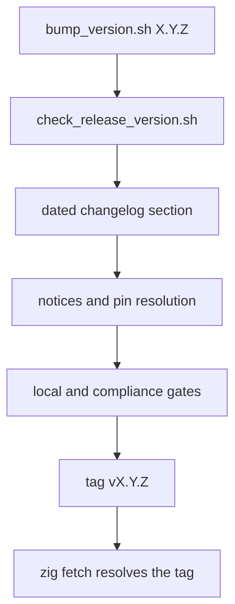

:::note[Contributing to µWebZockets]
This page describes the framework repository at
[farbenbuilds/uWebZockets](https://github.com/farbenbuilds/uWebZockets), not an application
project. Use it when you change or verify the framework and prepare a pull request
following [CONTRIBUTE.md](https://github.com/farbenbuilds/uWebZockets/blob/main/CONTRIBUTE.md).
Consume a release with `zig fetch --save`; see [Installation](/docs/getting-started/installation).
This page covers cutting a framework release.
:::

A µWebZockets release is a source tag. There are no per-platform archives, no
installer, and no checksum file: a consumer fetches the tag with `zig fetch` and
Zig builds the C and C++ dependencies from their pins. This page covers the
version surfaces, the bump and check scripts, and the tag sequence.

## Version source of truth

The release version is single-sourced in `src/version.zig`, and `build.zig`
derives its version from that file. The other copies exist because their
consumers never execute Zig code.

| Surface             | File                                                                                          | Copy                                          |
| ------------------- | --------------------------------------------------------------------------------------------- | --------------------------------------------- |
| Zig source of truth | `src/version.zig`                                                                             | `pub const semantic`                          |
| Package manifest    | `build.zig.zon`                                                                               | `.version`                                    |
| Nix flake           | `flake.nix`                                                                                   | `releaseVersion`                              |
| C header            | `include/uWebZockets.h`                                                                       | `UWZ_VERSION_MAJOR`, `_MINOR`, `_PATCH`       |
| Changelog           | `CHANGELOG.md`                                                                                | dated `## [X.Y.Z] - YYYY-MM-DD` section       |
| C assertions        | `tests/c_api/header_cpp.cc`, `tests/c_api/smoke.c`                                            | `static_assert` values and the version string |
| Documentation       | `README.md`, `CODEBASE.md`, `examples/readme_examples_test.md`, `src/tests/dev_log_tests.zig` | ready-summary and example headers             |

A release that changes one copy and not the others fails the release check
before it reaches a tag.

## Bump and verify

```sh
sh scripts/bump_version.sh 2.2.0
```

The script accepts a plain `X.Y.Z` version. It rewrites every surface in the
table above through a temporary file, inserts a dated changelog section with
`Added`, `Changed`, and `Security` headings, and then calls
`check_release_version.sh` with the new version. A version that already has a
changelog section is left alone.

```sh
sh scripts/check_release_version.sh
```

The check reads the version from `build.zig.zon`, compares it with
`src/version.zig`, `flake.nix`, and the C macros, and verifies that `build.zig`
still derives from the Zig source. It then checks the C++ assertions, the C
smoke version string, the changelog section, the documentation headers, and the
development-log test. Pass an explicit version to check a candidate that is not
yet committed.

## Release sequence



1. Bump the version and run the release check.
2. Write the dated changelog section, including breaking changes and every
   limitation the release keeps. Do not leave an `Unreleased` placeholder in a
   final release snapshot.
3. Verify `THIRD_PARTY_NOTICES.md` and every packaged license. For each
   maintained-fork pin, resolve the commit from a second machine and against the
   retained archive. See [Dependencies](/docs/operations/dependencies).
4. The release commit carries passing formatting, convention, test, and build
   evidence.
5. The same commit carries the recorded sanitizer, fuzz, Autobahn, h1spec, and
   HTTP/3 cross-implementation evidence for that release line.
6. Tag the final commit as `v<version>` and push the tag.
7. Confirm the release notes render the changelog,
   `scripts/check_package_paths.sh` passes on the release commit, and the tag
   resolves through `zig fetch` before announcing it.

## Source-only releases

There are no binary artifacts to review. The tag contains the source tree, the
pinned dependency manifest, the header, the changelog, and the license notices.
`THIRD_PARTY_NOTICES.md` and `licenses/` travel with the source because the
static archives a C consumer links are built locally from those pins.

A release does not publish a Docker image, a package-manager formula, or a
prebuilt `libuWebZockets.a`. Build the C archives from the tag instead:

```sh
zig build lib -Doptimize=ReleaseFast
```

## Pin a release in a consumer

```sh
zig fetch --save 'git+https://github.com/farbenbuilds/uWebZockets#v2.1.6'
```

This adds the package under the `uWebZockets` name in your own `build.zig.zon`.
Pin a release tag for a recognizable version, or a full 40-hex commit when the
build must be reproducible down to the exact tree. Never pin `main`.

The fetched package manifest resolves zslay, libxev, BoringSSL, lsquic,
ls-qpack, ls-hpack, libdeflate, and zlib from their own immutable pins, so your
application needs no extra entry for them and no `h1spec` development submodule.

## Confirm the tag before you announce it

```sh
mkdir -p /tmp/uwz-fetch-check && cd /tmp/uwz-fetch-check
zig init
zig fetch --save 'git+https://github.com/farbenbuilds/uWebZockets#v2.1.6'
```

A tag that does not resolve is not a release. A rewritten tag is also not a
release: move forward with a new patch version instead of retagging a commit that
someone already fetched.

## Related

- [Dependencies](/docs/operations/dependencies) covers the pins a release
  resolves and the provenance checks that guard them.
- [C ABI](/docs/operations/c-abi) shows how to build the archives from a tag.
