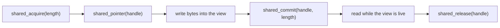

Two build steps compile the platform-neutral core to WebAssembly. The
freestanding artifact targets a V8 isolate host that owns sockets and shared
memory; the WASI artifact targets a WASI host. Neither artifact accepts network
connections: they parse and produce protocol bytes that the host moves.

## Build

```sh
zig build wasm-freestanding -Doptimize=ReleaseSafe
zig build wasm-wasi -Doptimize=ReleaseSafe
```

`zig build wasm` builds both. The artifacts land under `zig-out/wasm`:

| Artifact                        | Target                                         | Memory                                          |
| ------------------------------- | ---------------------------------------------- | ----------------------------------------------- |
| `uWebZockets-freestanding.wasm` | `wasm32-freestanding`, atomics and bulk memory | Shared, 32 MiB initial, 64 MiB maximum          |
| `uWebZockets-wasi.wasm`         | `wasm32-wasi`                                  | Single-threaded, 32 MiB initial, 64 MiB maximum |

Both modules are built with no entry point and an exported linear memory. The
freestanding build adds shared memory because the host bridge uses atomics.

## Host bridge exports

```zig
export fn alloc(length: u32) usize;
export fn free(pointer: usize, length: u32) void;
export fn shared_acquire(length: u32) u64;
export fn shared_pointer(encoded_handle: u64) usize;
export fn shared_commit(encoded_handle: u64, length: u32) u64;
export fn shared_release(encoded_handle: u64) i32;
```

The bridge is a fixed region of 64 blocks at 64 KiB each, 64-byte aligned, so at
most 4 MiB of host-visible buffers exists at once. Every accessor is bounded:

| Call             | Behavior                                                                    |
| ---------------- | --------------------------------------------------------------------------- |
| `alloc`          | Leases one block for `length` bytes; returns `0` when no block fits         |
| `free`           | Releases a block only when the pointer and length match a live lease        |
| `shared_acquire` | Returns a packed handle, or `0` when the region is full                     |
| `shared_pointer` | Returns the block address for a live handle, or `0`                         |
| `shared_commit`  | Records the used length and returns the committed handle, or `0`            |
| `shared_release` | Releases once; returns `0` on success and `-1` on a stale or invalid handle |

A handle packs the block index, a generation counter, and the committed length.
The generation is what rejects a stale release or a use-after-free: a handle from
a previous lease of the same block no longer matches the block's generation.

## Handle lifetime



Retain each handle while a shared-memory view of it is live, and release it
exactly once. A second release of the same handle fails instead of freeing a
block that another lease may already own. `alloc` and `free` are the simpler
pair: `free` validates the base pointer and length before releasing, and ignores
a pair that does not describe an acquired block.

## No listener on the edge target

The module exports the protocol core, not a server. It contains the HTTP parser
and request type, abort and stream handling, WebSocket framing and backpressure,
SIMD helpers, shared memory, and JSON-RPC. It contains no socket, no accept loop,
and no listener.

| Concern                                             | Owner                                  |
| --------------------------------------------------- | -------------------------------------- |
| Accepting connections, TLS, and timers              | The isolate or WASI host               |
| HTTP parsing, routing decisions, and response bytes | The module                             |
| Buffer lifetime across the boundary                 | The host, through handles              |
| Shared memory growth beyond 64 MiB                  | Not supported; the module fails closed |

## When to use it

Use a WASM target when the network edge is already the host's job: a CDN worker,
a proxy plugin, or an isolate runtime that wants the same strict HTTP and
WebSocket state machine as the native server. The benefit is one parser and one
set of limits in both places, not a second server.

Do not use it when you need a listener, TLS termination, cluster workers, a
client, or filesystem-backed static files. Those exist only in the native
application, and the edge artifact exports no equivalent.

## Verify

```sh
zig build wasm-freestanding -Doptimize=ReleaseSafe
ls zig-out/wasm
```

```console
uWebZockets-freestanding.wasm
uWebZockets-wasi.wasm
```

Instantiate the module in the host with a memory limit inside the documented
bounds, call `shared_acquire`, write, commit, read, and release. A handle that is
released twice must fail, and a handle from a released lease must not resolve
through `shared_pointer`.

## Related

- [Edge and WASM](/docs/architecture/edge-and-wasm) explains where the
  protocol-only core sits relative to the transports.
- [Application model](/docs/concepts/application-model) describes the native
  lifecycle the edge module deliberately omits.
- [Ownership and lifetimes](/docs/concepts/ownership-and-lifetimes) covers the
  borrowed-view rules that the handle protocol mirrors.
