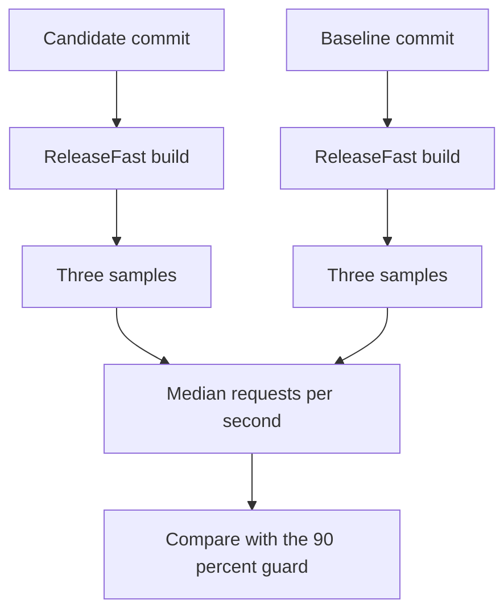

A benchmark is evidence, not a headline. The project ships two versioned
contracts: `http-throughput-v1` guards HTTP/1.1 throughput on a pull request, and
`h2-tls-scaling-v1` characterizes HTTP/2 over TLS on one host. Both record more
provenance than a single requests-per-second value.

## What each contract measures

| Contract             | Target                                                                 | Generator                | Key parameters                                                        | Guard                                                   |
| -------------------- | ---------------------------------------------------------------------- | ------------------------ | --------------------------------------------------------------------- | ------------------------------------------------------- |
| `http-throughput-v1` | `hello_world` HTTP/1.1                                                 | `wrk`                    | 2 threads, 64 connections, 10 s, 3 samples                            | Candidate median at least 90 percent of baseline median |
| `h2-tls-scaling-v1`  | HTTP/2 over TLS, plaintext cluster control, single-application control | `h2load` 1.69.0 or newer | 64 to 2,048 connections, 1 and 8 streams, 10 s, 2 s warmup, 3 samples | Characterization and regression baseline, not a CI gate |

The `http-throughput-v1` contract is the only CI-enforced performance guarantee.
The `h2-tls-scaling-v1` contract stays out of `benchmark.yml` because shared
runners cannot satisfy its quiet-host evidence contract.

## Quiet-host contract

| Requirement                                                               | Why it matters                                      |
| ------------------------------------------------------------------------- | --------------------------------------------------- |
| Dedicated host with no concurrent build, test, or benchmark               | CPU, cache, and memory contention changes medians   |
| Fixed governor and CPU affinity                                           | Frequency scaling and migration change latency      |
| Same kernel, backend, toolchain, and `ReleaseFast` build                  | Codegen and syscall behavior differ across cohorts  |
| Candidate and baseline run sequentially                                   | Thermal drift and cache state stay comparable       |
| Record CPU model, core count, quota, kernel, memlock, and open-file limit | A result without a host record cannot be reproduced |
| Keep shared-runner numbers separate from dedicated-host numbers           | The two cohorts are not comparable                  |

The 2026-10-19 `h2-tls-scaling-v1` archive is local evidence from a shared host
with the `powersave` governor. Its README states that it is not a quiet-host
competitive claim. Treat it as a host-specific characterization, not as a
portable number.

## Candidate versus baseline



Both revisions are built with `-Doptimize=ReleaseFast` from their own pinned
flakes. The candidate must not fall below 90 percent of the baseline median:

| Rule                 | Value                                                |
| -------------------- | ---------------------------------------------------- |
| Samples per revision | 3                                                    |
| Reported statistic   | Median requests per second                           |
| Guard                | `candidate_median_rps >= baseline_median_rps * 0.90` |
| Comparison scope     | Same runner and toolchain cohort                     |

The guard accounts for shared-runner variance. It is an explicit relative
regression guarantee, not an absolute capacity claim.

## The three wrk samples

The HTTP/1.1 contract uses two threads, 64 connections, a 10-second duration,
and the loopback URL of the `hello_world` server. Repeat the run three times and
keep every raw sample:

```sh
wrk -t2 -c64 -d10s http://127.0.0.1:3000/
```

A sample is rejected when `wrk` omits or zeroes the requests-per-second value,
reports a socket error or a non-2xx or non-3xx response, or leaves a malformed
counter. The runner also scans the server log and bounds both `SIGTERM` and
`SIGKILL` shutdown waits.

## The H2 over TLS contract

| Parameter              | Value                                                     |
| ---------------------- | --------------------------------------------------------- |
| Connections            | 64, 256, 512, 1,024, 2,048                                |
| Streams per session    | 1 and 8                                                   |
| Duration per sample    | 10 s                                                      |
| Warmup before sampling | 2 s                                                       |
| Samples per cohort     | 3, median reported                                        |
| Generator              | `h2load` from nghttp2 1.69.0 or newer                     |
| Protocol               | HTTP/2 over TLS 1.3 with `h2` ALPN, keep-alive            |
| Request                | `GET /` with no body, query, or extra headers             |
| Response               | `200` with the exact body `hello from a TLS worker group` |
| Server build           | `-Doptimize=ReleaseFast`                                  |
| Result schema          | 2                                                         |

A sample is successful only when `failed`, `errored`, and `timeout` are all
zero, every status code is `2xx`, every request counter was parsed, every TLS
sample reports `TLS Protocol: TLSv1.3`, a separate `GET /` returns the exact
body, and the server log has no panic or protocol error.

## Capture provenance

| Field               | Example source                                  |
| ------------------- | ----------------------------------------------- |
| Commit or tag       | Source revision under test                      |
| Date and time       | Run metadata                                    |
| Hardware            | Hostname, CPU model, core count, quota          |
| Kernel and governor | Host record                                     |
| Toolchain           | Zig version, dependency pins, `flake.lock` hash |
| Generator           | Version and flags                               |
| Command line        | Server and generator invocation                 |
| Raw samples         | Per-sample output and parsed counters           |

Without all of these, a value is an anecdote. Do not publish a number that
cannot be traced to an artifact.

## Artifact locations

| Location                                           | Contents                                                           |
| -------------------------------------------------- | ------------------------------------------------------------------ |
| `benchmarks/http_throughput_guarantee.md`          | `http-throughput-v1` contract                                      |
| `benchmarks/http_throughput_v1.env`                | Machine-readable parameters                                        |
| `benchmarks/h2_tls_scaling_guarantee.md`           | `h2-tls-scaling-v1` contract                                       |
| `benchmarks/h2_tls_scaling_v1.env`                 | Connections, streams, duration, generator, and schema              |
| `benchmarks/results/h2_tls_scaling_v1/2026_10_19/` | Host record, tables, hypothesis decisions, and archive             |
| `benchmark-data` branch                            | Records, raw samples, index, latest pointer, and generated summary |

Pull-request raw reports remain as 30-day workflow artifacts. Scheduled and
manual mainline runs append the canonical JSON record and raw evidence to the
`benchmark-data` branch. Untrusted pull-request jobs never receive write
permission to that branch.

## Related

- [Load testing](/docs/performance/load-testing)
- [Regression policy](/docs/performance/regression-policy)
- [Profiling](/docs/performance/profiling)
