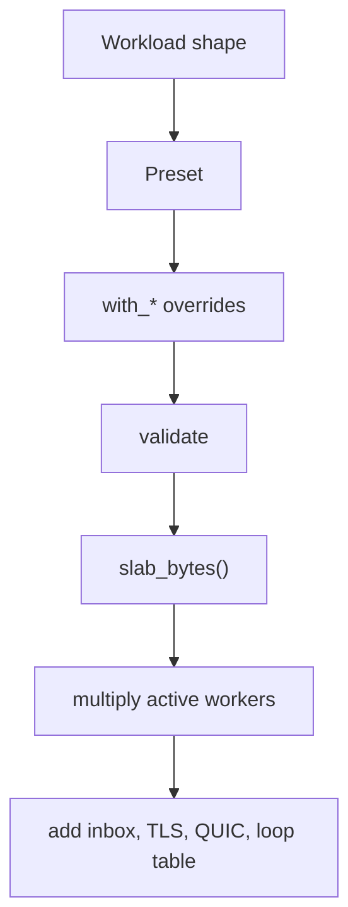

Capacity sizing starts with the workload, not with a requests-per-second target.
Choose the shape, start from a preset, override only the fields you can justify,
and call `slab_bytes()` before you allocate. The arithmetic below is derived
from `ServerConfig`; it is not a rule of thumb.

## Sizing workflow



## Worksheet

| Question                            | Field or API                                         | Record                                                    |
| ----------------------------------- | ---------------------------------------------------- | --------------------------------------------------------- |
| How many peers connect at once?     | `max_connections`, `with_max_clients`                | Peak concurrent connections, not requests per second      |
| How large is the largest upload?    | `max_body_size`, `with_max_body_size`                | Bytes, not a rounded label                                |
| How slow is the slowest reader?     | `write_queue_size`, `with_write_queue_size`          | The burst the write ring must absorb                      |
| How large is one WebSocket message? | `max_ws_message_size`, `with_max_ws_message_size`    | One inbound message, not a stream                         |
| Is per-connection compression on?   | `compression`, `with_compression`                    | Scratch reserved in the slab                              |
| Is HTTP gzip on?                    | `http_compression`, `with_http_compression`          | One codec and scratch per worker, outside the slab        |
| Which HTTP/2 limits apply?          | `max_h2_*` fields                                    | Header block, body, response header size, and field count |
| Which HTTP/3 limits apply?          | `max_h3_*` fields                                    | Body, response header size, and field count               |
| How many workers are active?        | `ClusterOptions.worker_count`, `UWEBZOCKETS_WORKERS` | Active count, not compiled capacity                       |
| Is TLS enabled?                     | `Cluster.enable_https`                               | One `SSL_CTX` per worker, outside the slab                |
| What is the exact slab?             | `slab_bytes()` on config or builder                  | Per-worker bytes                                          |
| What does the inbox add?            | `(64 + 1) * max_ws_message_size`                     | Per active worker                                         |
| What does a file server add?        | `write_queue_size - 4 KiB`                           | Largest static file body                                  |

## Which limit applies

| Limit                 | Sizes                                                                                          | Does not size                                                                      |
| --------------------- | ---------------------------------------------------------------------------------------------- | ---------------------------------------------------------------------------------- |
| `max_body_size`       | HTTP/1.1 request buffer and the HTTP/2 `request_body_limit`                                    | The HTTP/2 hard ceiling (`max_h2_body_size`) or HTTP/3 bodies (`max_h3_body_size`) |
| `write_queue_size`    | HTTP/1.1 and HTTP/2 pending output, HTTP/3 response body, and the static file body minus 4 KiB | The total size of a streamed body                                                  |
| `max_ws_message_size` | One inbound WebSocket message and the per-worker inbox                                         | Pending outbound bytes, which the write queue bounds                               |
| `max_h2_*`            | HTTP/2 header block, body, and response metadata                                               | HTTP/1.1 or HTTP/3 parsing                                                         |
| `max_h3_*`            | HTTP/3 request and response storage                                                            | The QUIC engine pools, which live outside the slab                                 |
| `max_connections`     | Connection pool and QUIC connection capacity                                                   | Worker count or throughput                                                         |

The HTTP/2 request body cap is the smaller of `max_body_size` and
`max_h2_body_size`. A header-count overflow on HTTP/2 is a connection error, not
a `431` document.

## Cluster and TLS overhead

| Item                 | Scope                                      | In `slab_bytes()` |
| -------------------- | ------------------------------------------ | ----------------- |
| Application slab     | One per active worker                      | Yes               |
| Worker inbox         | One per active worker                      | No                |
| `SSL_CTX`            | One per active worker when TLS is enabled  | No                |
| libxev backend table | One per worker loop                        | No                |
| HTTP gzip codec      | One per worker when HTTP compression is on | No                |
| QUIC engine pools    | Created by `listen_udp`                    | No                |

Only active workers allocate slabs, inboxes, and thread handles. A large
compiled worker capacity does not reserve memory for workers that never start.

## Worked example

Use the default capacities and only the fields that matter for this example:

```zig
const config: uz.ServerConfig = .{
    .max_connections = 1024,
    .write_queue_size = 64 * 1024,
    .max_body_size = 16 * 1024,
    .max_ws_message_size = 16 * 1024,
};
const per_worker = try config.slab_bytes();
std.debug.print("per worker: {d} bytes\n", .{per_worker});
```

The request buffer, write queue, and message region produce these derived
values. They are exact arithmetic, but they are not the whole slab.

| Step                     | Value                            | Derivation                                               |
| ------------------------ | -------------------------------- | -------------------------------------------------------- |
| Request stride           | 41,984 bytes                     | 8,192 + 16,384 + 1,024 + 16,384, already 16-byte aligned |
| Three controlled regions | 123,904 bytes                    | 41,984 + 65,536 + 16,384                                 |
| 1,024 connections        | 126,877,696 bytes (121.0 MiB)    | 123,904 × 1,024                                          |
| Inbox per worker         | 1,064,960 bytes (about 1.0 MiB)  | 65 × 16,384                                              |
| Four worker inboxes      | 4,259,840 bytes (about 4.06 MiB) | 1,064,960 × 4                                            |

The 121.0 MiB figure excludes the connection pool, the freelist, the HTTP/2
session, router storage, and the metrics registry. The HTTP/2 session is the
largest omitted term, so read `h2_session_bytes()` for one connection and
multiply by `max_connections`. Then multiply the full slab by the active worker
count and add the inboxes, TLS contexts, and protocol pools.

The `file_server` preset shows the same arithmetic with a different tradeoff:

| Step                     | Value                       | Derivation                     |
| ------------------------ | --------------------------- | ------------------------------ |
| Request stride           | 33,792 bytes                | 8,192 + 16,384 + 1,024 + 8,192 |
| Three controlled regions | 562,176 bytes               | 33,792 + 524,288 + 4,096       |
| 128 connections          | 71,958,528 bytes (68.6 MiB) | 562,176 × 128                  |
| Static file body         | 520,192 bytes (508 KiB)     | 524,288 − 4,096                |

## Verify before you allocate

```zig
var server = try uz.Server.builder(init.io)
    .preset(uz.Presets.microservice)
    .with_max_clients(1024)
    .with_max_body_size(256 * 1024)
    .build(std.heap.page_allocator);
defer server.deinit();
```

`Server.builder(...).slab_bytes()` reports the same checked layout that
`carve` uses. Call it before `build` when you need to compare the footprint with
the host's memory budget.

## Related

- [Capacity model](/docs/concepts/capacity-model)
- [HTTP limits](/docs/http/limits)
- [Cost model](/docs/performance/cost-model)
