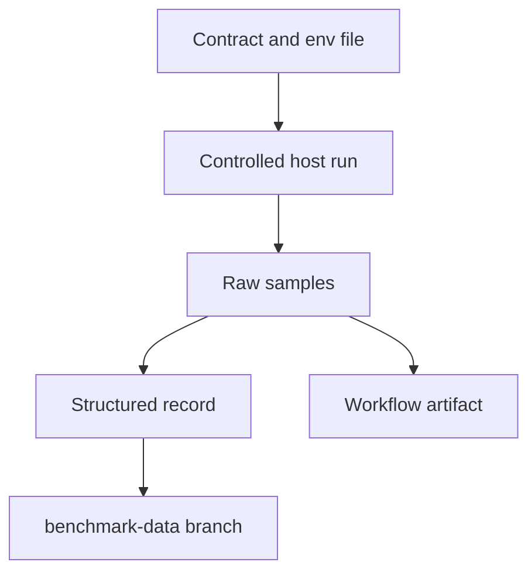

A regression policy is a contract about how performance evidence is produced
and published. It is not a promise that one host's number applies everywhere.
This page describes how to add a benchmark, when to create a new ID, and which
files must never be edited by hand.

## Add a benchmark

| Step                        | Artifact                            | Rule                                                                       |
| --------------------------- | ----------------------------------- | -------------------------------------------------------------------------- |
| 1. Name the behavior        | Benchmark ID                        | Stable and versioned, for example `http-throughput-v1`                     |
| 2. Fix the parameters       | Environment file                    | Machine-readable values that the runner consumes directly                  |
| 3. Define success           | Contract document                   | Counters, status codes, body, TLS protocol, shutdown status                |
| 4. Define the comparison    | Contract document                   | Candidate versus baseline, median, and relative guard                      |
| 5. Record provenance        | Run metadata                        | Commit, date, host, kernel, tools, flags, and command                      |
| 6. Run on a controlled host | Raw samples                         | Quiet host for a characterization; shared runner only for a relative guard |
| 7. Publish                  | History branch or workflow artifact | Append-only records and raw evidence                                       |
| 8. Wire CI                  | Workflow                            | Gating only where the host contract is satisfied                           |

A benchmark that cannot state its success definition is not ready to run. A
benchmark that cannot name its host cohort is not ready to publish.

## When parameters change

| Change                                                           | Required action                              |
| ---------------------------------------------------------------- | -------------------------------------------- |
| Duration, connections, threads, streams, warmup, or request path | New benchmark ID and schema                  |
| TLS mode, ALPN, or credential type                               | New benchmark ID and history series          |
| Generator or generator version                                   | New cohort; do not merge rows                |
| Kernel, backend, or CPU cohort                                   | New results directory; do not combine ratios |
| Metric definition or statistic                                   | New schema version                           |

The `http-throughput-v1` and `h2-tls-scaling-v1` contracts state this rule
explicitly. Changing any parameter requires a new benchmark ID, schema, and
history series. Do not edit a shipped environment file to make a new run fit an
old ID.

## Publish evidence

| Location                          | Contents                                   |
| --------------------------------- | ------------------------------------------ |
| `records/<year>/<record-id>.json` | Canonical structured result                |
| `raw/<year>/<record-id>/`         | Original generator output and sample rates |
| `index.json` and `latest.json`    | Automated consumer pointers                |
| Generated `README.md`             | Summary for humans                         |
| Contract and schema files         | Exact version that produced the record     |

Mainline scheduled and manual runs append records to the `benchmark-data`
branch. The branch is append-only at the record level: publication fails if an
existing record ID has different content. Re-running publication with identical
content is idempotent. Pull-request artifacts keep the same structured record
and raw evidence, but untrusted pull-request jobs never receive write permission
to the history branch.

## Never hand-edit generated output

| Rule                                                                                         | Reason                                                       |
| -------------------------------------------------------------------------------------------- | ------------------------------------------------------------ |
| Do not edit `dist/`, `.blume/`, or generated benchmark output                                | The next run overwrites it, and the edit destroys provenance |
| Keep one compressed archive, one `README.md`, and one `manifest.sha256` per recorded run     | The results directory stays reviewable                       |
| Treat the archive as append-only                                                             | Extract it, inspect it, and leave it unchanged               |
| Do not commit unarchived `.txt`, `.log`, `.tsv`, or `.bin` files under `benchmarks/results/` | `scripts/check_benchmark_results.sh` rejects them            |
| Regenerate rather than patch a record                                                        | A patched record no longer matches its raw evidence          |

If a run is wrong, mark it as failed and publish a new record. Do not rewrite the
old one to look correct.

## A relative guard is not a portable claim

The `http-throughput-v1` guard is:

| Field       | Meaning                                                               |
| ----------- | --------------------------------------------------------------------- |
| Comparison  | Candidate median requests per second against the base revision median |
| Threshold   | At least 90 percent of the baseline                                   |
| Scope       | Same runner, toolchain, and contract                                  |
| Not claimed | Absolute requests per second across hardware or toolchain cohorts     |

Shared-runner hardware and scheduling vary over time. Absolute results are
comparable only within matching runner and toolchain cohorts. A dedicated host
and a shared runner are different cohorts, and a row from one must never sit in
a ratio with a row from the other.

The `h2-tls-scaling-v1` contract is deliberately out of `benchmark.yml` because
shared runners cannot satisfy the quiet-host evidence contract. A future
dedicated quiet runner may add a non-gating `workflow_dispatch` job that uploads
raw artifacts and records provenance, but it must never compare its numbers with
shared runners.

## Review checklist

| Check              | Pass condition                                                                     |
| ------------------ | ---------------------------------------------------------------------------------- |
| ID and schema      | New parameters have a new ID and schema                                            |
| Provenance         | Commit, date, hardware, kernel, toolchain, command, and artifact path are recorded |
| Success definition | Failed, errored, timed-out, and non-2xx samples fail the run                       |
| Append-only        | The record ID is new or its content is byte-identical                              |
| Generated output   | No generated file was edited by hand                                               |
| Claim scope        | The result is described as relative or cohort-specific                             |

## Related

- [Benchmarking](/docs/performance/benchmarking)
- [Load testing](/docs/performance/load-testing)
- [Performance](/docs/performance)
