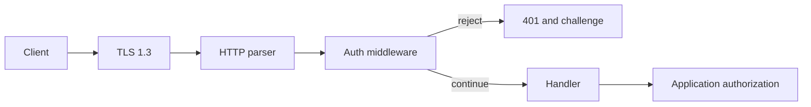

The authentication middleware answers one question: does this request carry a
configured Basic or Bearer credential. It does not identify a user, grant a
permission, or replace TLS. This page covers the trust boundary and the
deployment checks around it; the request-level API lives on
[HTTP authentication](/docs/http/authentication).

## Trust boundary

| Control                         | Enforced by            | Your responsibility                   |
| ------------------------------- | ---------------------- | ------------------------------------- |
| Credential presence and format  | `middleware.Auth`      | Choose the accepted credential set    |
| Constant-time secret comparison | `middleware.Auth`      | Store high-entropy secrets            |
| Transport confidentiality       | TLS layer              | Certificates, CA trust, and rotation  |
| Authorization and tenancy       | Application            | Roles, ownership checks, route policy |
| Token issuance and expiry       | Application            | Storage, revocation, audit            |
| Brute-force resistance          | `middleware.RateLimit` | Key choice and thresholds             |

A match means "this request carried a credential from the configured list". It
does not say which person sent it. You may configure Basic and Bearer lists at the
same time, and a request may match any entry in either list. The middleware does
not report which entry matched. The handler receives a `Request` with no identity
attached.

## What the check guarantees

| Property           | Behavior                                                          |
| ------------------ | ----------------------------------------------------------------- |
| Header selection   | `get_unique_header("authorization")`; a duplicate field is `null` |
| Scheme             | `Basic` or `Bearer`, case-insensitive, followed by space or tab   |
| Basic payload      | RFC 4648 base64 decoded into a fixed 512-byte stack buffer        |
| Basic split        | First `:` separates username from password; no `:` is rejected    |
| Bearer payload     | Empty token rejected                                              |
| Secret comparison  | `std.crypto.timing_safe.eql` over fixed 64-byte blocks            |
| Configured entries | Every entry is compared, even after one matches                   |
| Rejection          | `401 Unauthorized`, empty body, challenge for configured schemes  |

The unique-field rule matters more than it looks. A request with two
`Authorization` fields has no defined meaning, so refusing it prevents a proxy
and the origin from authenticating different values.

## Where timing still varies

The comparison runs over fixed blocks and does not exit early on content. The
code around it still branches on public shape:

- Scheme detection compares the prefix and stops on the first mismatch.
- A Basic payload is base64-decoded, which branches on syntax and padding.
- Two secrets of different length fail before the block loop, so length is
  observable.
- The loop cost grows with the number of configured credentials.

That is the intended contract: constant-time comparison protects the content of
a secret, not its length or the number of accepted entries. Do not add a
hand-written comparison that returns on the first differing byte.

## Failure modes

| Condition                                   | Result                                             |
| ------------------------------------------- | -------------------------------------------------- |
| Missing, duplicate, malformed, or unmatched | `401 Unauthorized`, empty body                     |
| Basic payload decodes above 512 bytes       | `401 Unauthorized`                                 |
| No credentials configured                   | `401` with no `WWW-Authenticate` field             |
| `realm` contains a quote, CR, or LF         | `500 Internal Server Error` on the first rejection |
| Formatted challenge exceeds 1024 bytes      | `500 Internal Server Error`                        |

The realm is validated while the challenge is formatted, not when options are
built. A bad realm therefore appears on the first rejected request. A
bearer-only configuration never formats the realm, so the defect stays hidden
until Basic is added.

The no-credentials row is a configuration defect rather than an attack: an `Auth`
with no credentials rejects every request and gives the client nothing to present.

## Deployment checklist

| Check                                       | Reason                                                           |
| ------------------------------------------- | ---------------------------------------------------------------- |
| Terminate TLS before the middleware         | `Authorization` is cleartext on the wire                         |
| Register one `Auth` per worker              | Options are immutable, but each app needs its own registration   |
| Keep credentials alive until `app.deinit()` | Credentials are borrowed slices, not copies                      |
| Plan rotation as a rolling restart          | There is no hot reload or credential store                       |
| Order CORS, then `Auth`, then `RateLimit`   | A preflight has no credential and should not consume a token     |
| Authorize inside the handler                | A valid credential is not a permission                           |
| Redact the field from logs and error bodies | A logged token is a leaked token                                 |
| Use high-entropy tokens                     | Plaintext storage means memory disclosure equals credential loss |
| Test the challenge and the realm            | A `500` on the first 401 is a production outage, not a warning   |

Do not present this middleware as an authentication program. It is one control
at one boundary. Session management, account lockout, token expiry, audit, and
secret storage remain application and deployment work.

## Related

- [HTTP authentication](/docs/http/authentication) documents the exact parsing
  order and options.
- [Rate limiting](/docs/security/rate-limiting) bounds how often a credential
  may be guessed.
- [Threat model](/docs/security/threat-model) places this boundary among the
  others.
