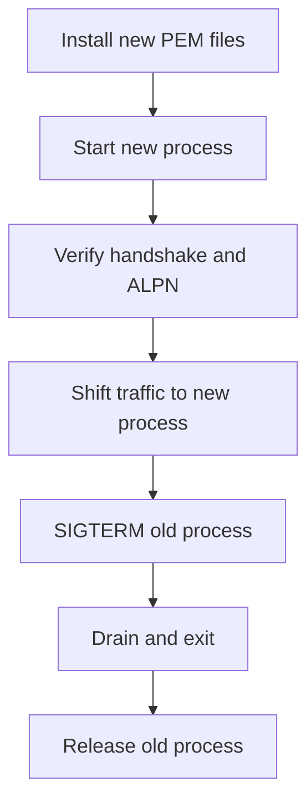

µWebZockets reads certificate files while a TLS context is created. It does not
watch them, swap them, or reload them on a signal. Rotation is a rolling
restart: start a new process with the new files, verify it, shift traffic, then
drain the old process to exit.

## No hot reload

Hot reload is not supported. A safe per-worker context swap would need a
generation-checked credential generation, atomic publication to the owning loop,
draining of every in-flight `SSL` that references the old context, secure
release after the last reference, and a rollback path for a bad PEM load. No
measured production requirement justifies that surface yet. The decision and
its restoration criterion are recorded in
[ADR 0003](https://github.com/farbenbuilds/uWebZockets/blob/main/docs/adr/0003-tls-cluster-operational-boundaries.md).

Replacing the files on disk has no effect on a running process. The old context
keeps serving until the process exits.

## Rolling restart



1. Write the new chain and key to the paths the process reads. Keep the old
   files available until the old process exits.
2. Start a new process with the same route configuration and capacity.
3. Verify the new process before directing user traffic to it.
4. Shift traffic with your load balancer, service discovery, or reverse proxy.
5. Send `SIGTERM` to the old process and wait for it to exit.
6. Confirm the supervisor reports a clean exit, then remove the old files.

A supervisor should send `SIGTERM` and wait for exit. The runtime installs
SIGINT and SIGTERM handlers through `catch_shutdown_signals`; a deployment that
already manages signals must not install a second watcher.

## Cluster ordering

A TLS cluster follows the same order for the initial start and every restarted
member:

| Step | Call                                       |
| ---- | ------------------------------------------ |
| 1    | `build_cluster`                            |
| 2    | `configure`                                |
| 3    | `enable_https` or `enable_https_ephemeral` |
| 4    | `listen`                                   |
| 5    | `run`                                      |
| 6    | `request_shutdown` or a shutdown signal    |
| 7    | `deinit`                                   |

Call one enable function exactly once before `listen`. Each worker reads the
PEM files once at startup, so a new process group gets the new credentials and
the old group keeps its old contexts until it exits.

## Drain guidance

- Keep one `Cluster` owner. Do not copy or move it after the watcher or `run`
  starts.
- The signal requests the same drain path as `App.shutdown`: stop accepting,
  cancel completions, drain connections, and release the slab.
- There is no in-flight request deadline beyond the configured connection idle
  timeout. The default idle timeout is 120 seconds.
- Use `deinit_checked()` as the supervisor-safe release path for a cluster.
  `deinit` asserts drained state and panics if called from inside the loop.
- After `run` returns, `state()` reports `stopped` and `first_failure()` names
  the first worker index, phase, and error.

## Cross-worker resumption after rotation

A new process creates new per-worker ticket keys. A client that reconnects after
the switch cannot resume a session issued by the old process, and a reconnect
that lands on a different worker cannot resume either. Expect full handshakes
during the rollout; this is the documented resumption boundary, not a
certificate failure.

## Verify

```sh
curl -v https://127.0.0.1:3443/
```

Check the certificate subject and the ALPN line. A build of `curl` with HTTP/2
support negotiates `h2`; a build without it negotiates `http/1.1`. For a local
self-signed certificate, add `-k` as described on
[Ephemeral certificates](/docs/security/ephemeral-certificates). Repeat the
check against the new process before shifting traffic.

## Related

- [TLS clusters](/docs/security/tls-clusters) shows the lifecycle that a
  restarted worker group follows.
- [Production certificates](/docs/security/production-certificates) covers the
  PEM load and startup checks.
- [TLS 1.3 and ALPN](/docs/security/tls) explains the handshake result you
  verify after a restart.
