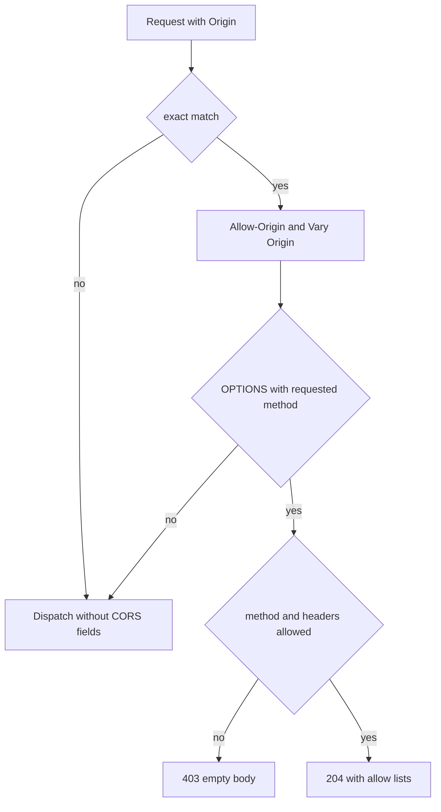

CORS and security headers are separate middleware with separate jobs. CORS
decides which browser origins may read a response; the security-header
middleware writes five response fields. Neither authenticates a caller. The
implementation detail lives on [CORS](/docs/http/cors) and
[security headers](/docs/http/security-headers).

## Origin matching

| Rule                   | Behavior                                                     |
| ---------------------- | ------------------------------------------------------------ |
| Comparison             | Byte equality with `std.mem.eql`, case-sensitive             |
| Wildcard               | None; a literal `*` entry matches only the value `*`         |
| Prefix or suffix match | None                                                         |
| Missing `Origin`       | Dispatch continues with no CORS fields                       |
| Duplicate `Origin`     | Treated as missing; `get_unique_header` returns `null`       |
| Unlisted origin        | Dispatch continues; the browser blocks the cross-origin read |

There is no reflection of an arbitrary origin. A trailing slash, a different
case, or a different port fails the match, and the response carries no
`Access-Control-Allow-Origin`.

Exact matching is not a formality. Origin comparison is the only thing that
prevents one site from reading another site's response through a browser. A
convenience wildcard would move that decision to the attacker.

## Preflight

| Condition                                  | Result                                   |
| ------------------------------------------ | ---------------------------------------- |
| Origin matches, request is not a preflight | CORS fields appended, dispatch continues |
| Origin matches, valid preflight            | `204 No Content`, dispatch stops         |
| Unknown or unconfigured method             | `403 Forbidden`, empty body              |
| Requested header not in `allow_headers`    | `403 Forbidden`, empty body              |
| More than 10 entries in `methods`          | `500` via `error.TooManyCorsMethods`     |

The checks run before routing, so a preflight for an unknown path still receives
`204`. A rejected preflight still carries `Access-Control-Allow-Origin` and
`Vary`, because those fields are appended before the method check.

## Credentials and caches

`allow_credentials = true` adds `Access-Control-Allow-Credentials: true` for
every allowed origin, including preflights. It does not make the request
authenticated, and it does not tell the browser to send cookies or an
`Authorization` field; the browser still applies its own rules.

`Vary: Origin` is mandatory next to a reflected origin. Without it, a shared
cache can store the response for one origin and serve it to another. The
middleware appends its own `Vary` line; do not add a second one from another
layer, because caches combine the values.

CORS is a browser read policy, not access control. A non-browser client ignores
it completely. Pair it with authentication, not instead of it.

## Default security headers

| Option                      | Field                       | Default                               |
| --------------------------- | --------------------------- | ------------------------------------- |
| `strict_transport_security` | `Strict-Transport-Security` | `max-age=31536000; includeSubDomains` |
| `content_security_policy`   | `Content-Security-Policy`   | `default-src 'self'`                  |
| `x_content_type_options`    | `X-Content-Type-Options`    | `true`, emitted as `nosniff`          |
| `x_frame_options`           | `X-Frame-Options`           | `DENY`                                |
| `referrer_policy`           | `Referrer-Policy`           | `no-referrer`                         |

Every field except `x_content_type_options` is optional: `null` omits it, and
`false` omits `nosniff`. The middleware appends the fields in order and returns
`continue_dispatch`, including for a response that later becomes `404`. A header
that cannot be appended ends the response as `500` instead.

## What the defaults do not promise

| Limit                    | Consequence                                                                    |
| ------------------------ | ------------------------------------------------------------------------------ |
| HSTS over plaintext      | No effect; the browser needs an HTTPS origin to store the policy               |
| `includeSubDomains`      | Extends the policy to subdomains you may not have migrated                     |
| `default-src 'self'`     | Blocks inline script, inline style, `eval`, and third-party assets             |
| No nonce or hash support | The middleware writes your string; it does not inspect HTML                    |
| No report-only mode      | A policy is not tested until a browser enforces it                             |
| No per-route policy      | Every route in the app gets the same five fields                               |
| No CORS                  | CORS is a separate middleware with its own origin list                         |
| No other headers         | `Permissions-Policy`, COOP, COEP, CORP, `Cache-Control`, and `ETag` stay yours |

A CSP header is not evidence that a page is safe. Load the real pages with the
policy active, keep the browser console open, and add only the sources the page
needs. A field appended twice is enforced as the intersection of both policies,
so give each header one owner.

`frame-ancestors 'none'` and `X-Frame-Options: DENY` both restrict framing. Keep
both while older browsers are in scope.

## Related

- [CORS](/docs/http/cors) documents every option and error name.
- [Security headers](/docs/http/security-headers) documents the exact response
  output.
- [Authentication](/docs/security/authentication) covers the check CORS does not
  perform.
