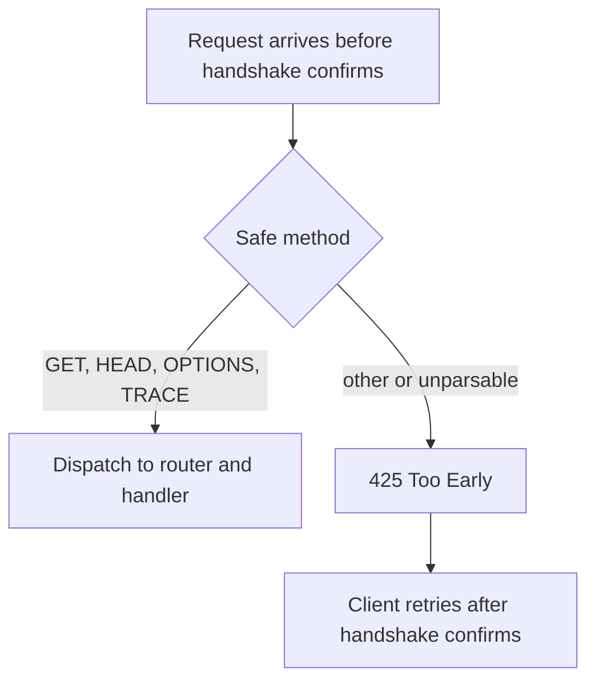

TLS 1.3 early data lets a client send request bytes before the handshake
confirms. Those bytes are replayable by a network attacker, so µWebZockets
admits only safe methods until confirmation and answers everything else with
`425 Too Early`.

## Where 0-RTT is enabled

| Context                              | Early data                 |
| ------------------------------------ | -------------------------- |
| `init_https`, `init_https_ephemeral` | Enabled, safe methods only |
| `init_https_mtls` with `.none`       | Enabled, safe methods only |
| `init_https_mtls` with `.optional`   | Disabled                   |
| `init_https_mtls` with `.required`   | Disabled                   |
| `init_http3`, `init_http3_ephemeral` | Disabled                   |
| `Cluster.enable_https`               | Enabled, safe methods only |

Client-certificate modes disable early data because the certificate is verified
in the second flight. QUIC keeps early data disabled until the lsquic replay
policy is wired end to end.

## The safe-method gate

The early-data gate admits `GET`, `HEAD`, `OPTIONS`, and `TRACE`. `QUERY` is
replay-unsafe and is rejected, as are `POST`, `PUT`, `DELETE`, `PATCH`,
`CONNECT`, and an unparsable method.

On HTTP/1.1 the rejection also sends `Connection: close` and the body
`Early data is limited to safe methods`. On HTTP/2 the response is the `425`
status without that connection header. RFC 8470 describes the client retry: the
stream can be retried once the handshake is confirmed.

## Replay model

An attacker who captures early data can replay it. The gate keeps a replayed
`POST` from reaching a route, but it cannot make a replay-safe method harmless
if the handler changes state. A `GET` that deletes a record, increments a
counter, or sends an email is a defect even though the method is classified as
safe.

Treat early data as a latency optimization for reads:

| Handler shape                          | Early-data guidance                                   |
| -------------------------------------- | ----------------------------------------------------- |
| Read-only lookup                       | Safe to serve from a `GET` or `HEAD` handler          |
| Mutation behind `GET`                  | Do not do this; move the mutation to an unsafe method |
| Idempotent `OPTIONS` or `TRACE`        | Safe to serve                                         |
| Authentication challenge on early data | Expect the client to retry after confirmation         |

## Safe handler guidance

- Keep `GET`, `HEAD`, `OPTIONS`, and `TRACE` free of side effects that a second
  delivery would duplicate.
- Do not rely on early data for authorization decisions that depend on a client
  certificate; mTLS contexts disable it.
- Expect a client to see `425 Too Early` and retry. A retry is normal protocol
  behavior, not a server failure.
- If a handler must mutate state, require an unsafe method so the gate rejects
  the early attempt before routing.

## QUIC

The HTTP/3 context advertises `h3` with early data disabled. The QUIC engine
keeps that policy until replay protection is defined end to end, so a client
cannot send a 0-RTT HTTP/3 request to the live listener. See
[Early data policy](/docs/http3/early-data) for the HTTP/3 view.

## Related

- [Mutual TLS](/docs/security/mtls) explains why client-certificate modes
  disable early data.
- [TLS 1.3 and ALPN](/docs/security/tls) covers the context policy that enables
  or disables 0-RTT.
- [HTTP/3 early data policy](/docs/http3/early-data) describes the QUIC path.
