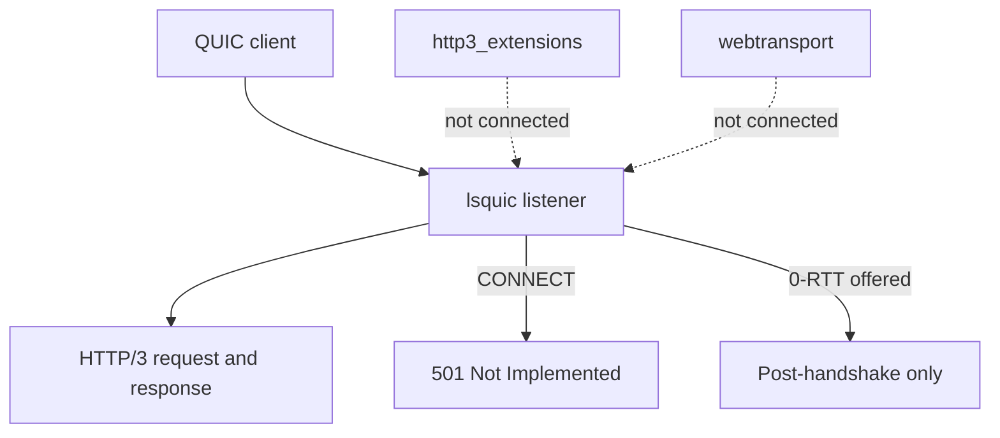

HTTP/3 runs over QUIC with a separate TLS context. The live listener keeps a
narrower surface than the protocol allows: no 0-RTT, strict header validation, and
no extended CONNECT or WebTransport session. This page separates what is live from
what only exists as a bounded helper. Transport setup is on
[QUIC transport](/docs/http3/quic-transport).

## Live and gated surfaces

| Capability                | Live behavior                                     |
| ------------------------- | ------------------------------------------------- |
| Request and response      | Supported                                         |
| TLS 0-RTT                 | Disabled; the request waits for the handshake     |
| Extended CONNECT          | Rejected with `501 Not Implemented`               |
| WebTransport session      | Not advertised and not reachable                  |
| Server push               | Not implemented                                   |
| HTTP/3 cluster            | Not supported; cluster listeners are TCP/TLS only |
| Raw QUIC engine callbacks | Internal, not a consumer interface                |

`uz.http3_extensions` and `uz.webtransport` provide bounded validators and wire
helpers for a future backend. They are not connected to the live listener, so
their presence is not a deployed feature. Do not build a security decision on a
module that the network path never calls.

## 0-RTT

The QUIC context passes early data disabled, and lsquic is told to retain zero
delayed 0-RTT packets. A client that offers early data completes a normal
handshake before its request reaches a handler.

The policy helpers in `uz.http3_extensions` can classify a request as
`reject`, `defer_until_confirmed`, or `allow_replay_safe`, but the live listener
does not expose per-request early-data state. Treat 0-RTT as absent, not as
"safe methods only". TCP behavior differs; see
[early data policy](/docs/http3/early-data).

Replay is the reason for the strict choice. A 0-RTT request is replayable by a
network attacker, and the server cannot distinguish the replay from a second
legitimate request.

## Header validation

| Rule                                     | Result                    |
| ---------------------------------------- | ------------------------- |
| Duplicate pseudo-field                   | Stream `H3_MESSAGE_ERROR` |
| Pseudo-field after a regular field       | Stream `H3_MESSAGE_ERROR` |
| Uppercase or invalid field name          | Stream `H3_MESSAGE_ERROR` |
| Connection-specific field                | Stream `H3_MESSAGE_ERROR` |
| `:protocol` on a request without CONNECT | Malformed                 |
| `QUERY` without a valid `Content-Type`   | `400 Bad Request`         |
| Body disagrees with `content-length`     | `400 Bad Request`         |

The stream-scoped error matters: a malformed request closes its own stream
without aborting healthy sibling streams on the same connection. The
cross-implementation gate mixes malformed and healthy streams deliberately to
prove that property.

## Engine and request bounds

| Limit                   | Default           | Source                         |
| ----------------------- | ----------------- | ------------------------------ |
| Connection capacity     | `max_connections` | Engine pools                   |
| Header list size        | `max_header_size` | `es_max_header_list_size`      |
| Header sets outstanding | 1                 | `es_max_header_sets`           |
| QPACK decoder table     | 0 bytes           | `es_qpack_dec_max_size`        |
| Blocked QPACK streams   | 0                 | `es_qpack_dec_max_blocked`     |
| Request body            | 16 KiB            | `max_h3_body_size`             |
| Response header storage | 4 KiB             | `max_h3_response_header_size`  |
| Response fields         | 64                | `max_h3_response_header_count` |
| UDP receive payload     | 2,048 bytes       | Packet slot                    |

A zero QPACK decoder table means the server does not retain a dynamic decoding
dictionary between streams. That removes a shared decoding structure from the
boundary, and it also gives up dynamic-table compression. A header list above
`max_header_size` is rejected before dispatch.

`max_header_size` above 65,535 remains valid for HTTP/1.1 and HTTP/2, but
`listen_udp` rejects it because lsxpack field lengths are 16-bit. That is a
startup error, not a runtime one.

## Cluster boundary

HTTP/3 clustering is not supported. `init_http3` and `listen_udp` are
single-application APIs, and a cluster listener is TCP/TLS only. A deployment
that needs more than one QUIC worker terminates QUIC elsewhere or accepts a
single process; it does not get per-worker QUIC state from this framework.

Raw QUIC engine, stream, packet, and QPACK callbacks under `src/quic` are
internal. They are not a supported consumer interface, and an application that
reaches into them takes on a boundary the security policy does not cover.

## Related

- [QUIC transport](/docs/http3/quic-transport) covers listener setup and
  congestion behavior.
- [HTTP/3 limits](/docs/http3/limits) lists every engine and adapter bound.
- [WebTransport status](/docs/http3/webtransport) explains the capability gate.
