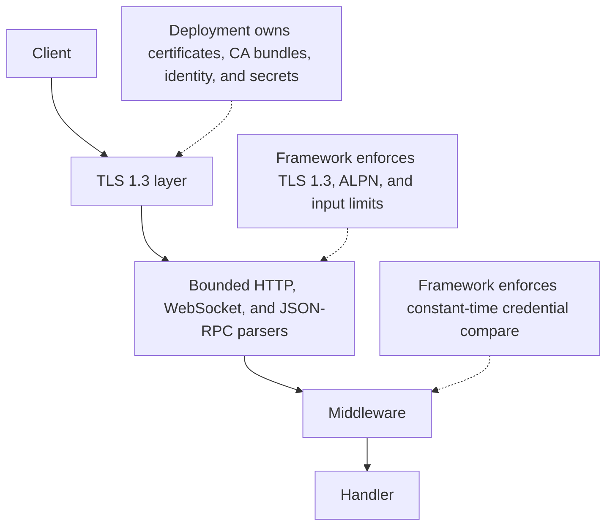

µWebZockets bounds network input and fails closed on malformed protocol data.
Certificate trust, identity, secret storage, and capacity sizing stay with your
deployment. This section covers the TLS surface, its operational limits, and the
controls that sit next to it. The [HTTPS server example](/examples/https-server)
and [TLS cluster example](/examples/tls-cluster) show the two credential paths.

## Trust boundaries

| Boundary       | Framework enforces                                                                 | Deployment owns                                     |
| -------------- | ---------------------------------------------------------------------------------- | --------------------------------------------------- |
| TLS            | TLS 1.3 only, ALPN policy, client-certificate verification when mTLS is configured | Certificate issuance, CA bundles, rotation, pinning |
| HTTP parsing   | Fixed buffers, strict framing, structured rejection                                | Capacity sizing and OS resource limits              |
| Authentication | Constant-time compare and fail-closed middleware                                   | User store, token issuance, per-route authorization |
| Rate limiting  | Fixed token buckets and per-worker tables                                          | Key choice, thresholds, shared-state policy         |
| C ABI          | Opaque handles, explicit destroy, nonzero error codes                              | Handle lifetime and copying borrowed slices         |

## Choose a credential path

| Situation                | Entry point                      | Credentials                                 |
| ------------------------ | -------------------------------- | ------------------------------------------- |
| Local HTTPS              | `init_https_ephemeral`           | Generated in memory at startup              |
| Local HTTP/3             | `init_http3_ephemeral`           | Generated in memory at startup              |
| Production HTTPS         | `init_https`                     | PEM chain and key you provide               |
| Production HTTP/3        | `init_http3`                     | PEM files loaded into TCP and QUIC contexts |
| Mutual TLS               | `init_https_mtls`                | Server PEM files plus a client CA bundle    |
| TLS cluster, production  | `Cluster.enable_https`           | PEM files loaded once per worker            |
| TLS cluster, development | `Cluster.enable_https_ephemeral` | A distinct generated certificate per worker |
| C ABI, local             | `uwz_app_create_tls_ephemeral`   | Generated in memory at startup              |

The generated certificate is self-signed and not exportable. Use it for local
tests only; a client needs `curl -k` or an equivalent verification bypass.

## Security surface map

<CardGroup cols={2}>
  <Card title="TLS 1.3 and ALPN" href="/docs/security/tls" icon="shield-check">
    Read the fixed protocol policy, the ALPN selection rule, and the context entry points.
  </Card>
  <Card
    title="Ephemeral certificates"
    href="/docs/security/ephemeral-certificates"
    icon="key-round"
  >
    Generate a local certificate in memory, customize its names, and read what it contains.
  </Card>
  <Card title="Production certificates" href="/docs/security/production-certificates" icon="lock">
    Load a PEM chain and key, fail fast on a mismatch, and follow the startup checklist.
  </Card>
  <Card title="Mutual TLS" href="/docs/security/mtls" icon="handshake">
    Verify client chains against a CA bundle and understand the early-data interaction.
  </Card>
  <Card title="TLS clusters" href="/docs/security/tls-clusters" icon="network">
    Enable TLS per worker, keep the lifecycle order, and read the resumption boundary.
  </Card>
  <Card title="Early data and 0-RTT" href="/docs/security/early-data" icon="clock">
    See which methods pass before the handshake confirms and why the rest get 425.
  </Card>
  <Card title="Certificate rotation" href="/docs/security/certificate-rotation" icon="activity">
    Rotate by rolling restart, drain the old process, and verify the new handshake.
  </Card>
</CardGroup>

## Application controls

<CardGroup cols={2}>
  <Card title="Authentication" href="/docs/security/authentication" icon="key-round">
    Place the credential check at the middleware boundary and read its failure modes.
  </Card>
  <Card title="Rate limiting" href="/docs/security/rate-limiting" icon="gauge">
    Choose a server-derived key and size the per-worker token bucket table.
  </Card>
  <Card title="CORS and security headers" href="/docs/security/cors-and-headers" icon="globe">
    Apply exact origin matching, preflight policy, and deliberate response headers.
  </Card>
  <Card title="Input hardening" href="/docs/security/input-hardening" icon="filter">
    Read the parser bounds and framing rules that reject malformed input early.
  </Card>
  <Card title="WebSocket security" href="/docs/security/websocket-security" icon="messages-square">
    Treat the upgrade as an authenticated request and bound the connection after it.
  </Card>
  <Card title="HTTP/3 security" href="/docs/security/http3-security" icon="radio">
    Read the QUIC listener policy and the extension modules outside the live path.
  </Card>
</CardGroup>

## Assurance

<CardGroup cols={2}>
  <Card title="Threat model" href="/docs/security/threat-model" icon="shield-alert">
    Name the assets, attacker capabilities, and non-goals that this section assumes.
  </Card>
  <Card title="Report a vulnerability" href="/docs/security/reporting" icon="circle-help">
    Use the private channel and include the evidence maintainers need.
  </Card>
</CardGroup>

## Concepts

| Concept                  | Page                                                        |
| ------------------------ | ----------------------------------------------------------- |
| Full trust model         | [Security model](/docs/concepts/security-model)             |
| ALPN and protocol choice | [Protocol negotiation](/docs/concepts/protocol-negotiation) |
| Capacity and idle limits | [Capacity model](/docs/concepts/capacity-model)             |

## What the framework does not provide

- Certificate issuance, ACME automation, or a public CA relationship.
- A user directory, session store, or authorization model above the credential
  match.
- Secret storage, key management, or log redaction for application fields.
- Certificate revocation enforcement. CRLs are loaded, but revocation is not
  checked during a handshake.
- Hot certificate reload. Rotation is a rolling restart.
- HTTP/3 clustering or a live WebTransport path.
- A web application firewall, DDoS protection, or operating-system hardening.

Capacity, idle timeouts, and OS limits are deployment decisions described in
[Capacity model](/docs/concepts/capacity-model).

## Report a vulnerability

Security fixes apply to the current development revision and the latest released
minor line. Do not open a public issue for an undisclosed vulnerability. Send a
private report with the affected revision, platform, reproducer, expected and
observed behavior, impact, and logs with secrets removed. The full policy and
contact addresses are in
[SECURITY.md](https://github.com/farbenbuilds/uWebZockets/blob/main/SECURITY.md).
The private-report checklist is on
[Report a vulnerability](/docs/security/reporting).

## Related

- [TLS 1.3 and ALPN](/docs/security/tls) is the protocol baseline for every page
  in this section.
- [Production certificates](/docs/security/production-certificates) is the
  first operational step before a public launch.
- [Security model](/docs/concepts/security-model) places these controls in the
  wider framework threat model.
