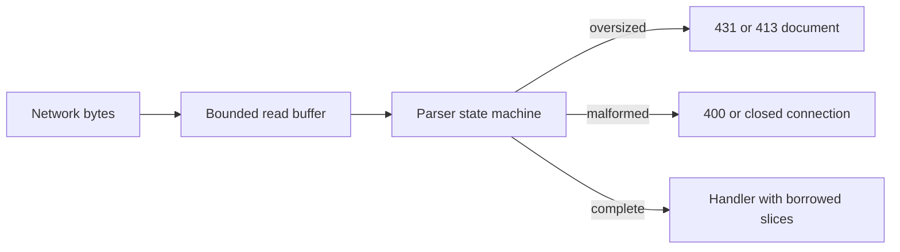

Every network input has a fixed ceiling, and malformed input is rejected before
dispatch. This page collects the bounds that matter for security, the shape of a
rejection, and the framing rules that prevent request smuggling. The full
configuration reference is on [HTTP limits](/docs/http/limits).

## Bounded pipeline



## Runtime limits

| Input            | Default   | On overflow                                        |
| ---------------- | --------- | -------------------------------------------------- |
| Request line     | 8 KiB     | `431` with a JSON document                         |
| Header block     | 16 KiB    | `431` with a JSON document                         |
| Header count     | 64 inline | Spills into slab storage, then `431`               |
| Request body     | 16 KiB    | `413` with a JSON document                         |
| Query pairs      | 32        | `error.TooManyQueryParameters` from `query_params` |
| Cookie pairs     | 32        | Extra pairs are ignored                            |
| Header read time | 30 s      | Connection closed                                  |
| Idle timeout     | 120 s     | Connection closed                                  |

`max_header_count` cannot go below 64 because the inline `Request` arrays cannot
shrink. A larger value carves one name/value pair per extra header into the
per-connection slab, so the ceiling is still finite.

The difference between query and cookie overflow is deliberate but easy to miss.
A query view fails closed with an error; a cookie jar silently drops pairs past
its capacity. Do not build an authorization decision on cookie pair index
without checking the count.

## Startup bounds

| Bound              | Default   | Failure when exceeded                 |
| ------------------ | --------- | ------------------------------------- |
| Route nodes        | 256       | `error.RouteCapacityReached`          |
| Route captures     | 16 inline | `error.RouteParameterCapacityReached` |
| Middleware entries | 32        | `error.MiddlewareCapacityReached`     |
| Connections        | 1,024     | New TCP connection closed             |
| Write queue        | 64 KiB    | `error.WouldBlock` from the sender    |

These are registration and capacity limits, not per-request parsing limits. A
route table that exceeds them fails at startup instead of accepting traffic it
cannot route.

## Structured rejections

An oversized body or header block produces a bounded JSON document. The body
case reports the configured limit:

```json
{
  "error": {
    "code": "payload_too_large",
    "message": "Request body exceeded the 16KB limit. Consider increasing 'max_body_size' in ServerConfig.",
    "limit_bytes": 16384
  }
}
```

Oversized headers use the same shape with `headers_too_large`. An oversized
request line or header count also returns `431`; that document reports
`max_header_size`, because the transport renders one header-rejection policy.
The documents are capped at 384 bytes and are written from fixed storage, so the
rejection path never allocates and never reaches a handler.

The rejection names the limit instead of dropping the connection. A client can
distinguish "too large" from a network failure, and an operator can see which
configuration value to change.

## Framing and smuggling

Conflicting framing is the classic request-smuggling primitive: two hops
disagree about where one request ends and the next begins. The parser rejects
each ambiguity instead of choosing a winner:

| Condition                                         | Result            |
| ------------------------------------------------- | ----------------- |
| Duplicate `Host` field                            | Malformed request |
| Missing or empty `Host`                           | Malformed request |
| Duplicate `Content-Length`                        | Malformed request |
| Duplicate `Transfer-Encoding`                     | Malformed request |
| `Transfer-Encoding` value other than chunked      | Malformed request |
| `Content-Length` and `Transfer-Encoding` together | Malformed request |
| Invalid `Content-Length` digits                   | Malformed request |
| Control character in a field value                | Malformed request |
| Authority-form, fragment, or userinfo target      | Malformed request |

`Transfer-Encoding` must be exactly `chunked`; a list, a different coding, or an
obfuscated spelling is rejected rather than normalized. The `Content-Length` and
`Transfer-Encoding` conflict wins over the body-size check, so the request is
invalid even when the declared length is under the limit.

Accepting only origin-form, absolute-form for `http` and `https`, and
asterisk-form for server-wide `OPTIONS` removes a second smuggling surface:
every hop agrees on what the target means.

Responses apply the same discipline. The response writer validates
control-character injection and ambiguous `Content-Length` or
`Transfer-Encoding` before writing, so a handler cannot emit a response that a
proxy will frame differently.

## Timeouts are part of the bound

A byte limit alone does not stop a client that sends slowly. The 30-second
header read deadline closes an incomplete HTTP/1 request, and the 120-second idle
deadline closes a quiet connection. Setting either to zero disables the deadline;
do that only when a proxy in front enforces its own and you have measured the
resource it holds open.

HTTP/2 uses its header block limit and the idle deadline instead of the header
read timer. HTTP/3 bounds decoded headers, bodies, packet buffers, connections,
and active streams through engine limits.

## Related

- [HTTP limits](/docs/http/limits) lists every builder override and shared value.
- [Threat model](/docs/security/threat-model) shows where the parser sits between
  the network and the handler.
- [HTTP/3 security](/docs/security/http3-security) covers the QUIC-specific
  bounds.
