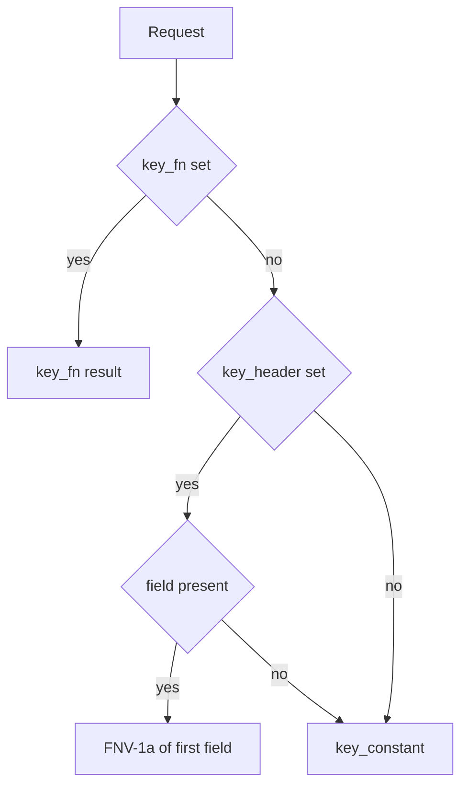

A rate limiter is only as good as its key. µWebZockets charges caller-owned token
buckets, and the default header path trusts whatever value is in that header. This
page covers the trust boundary, the eviction behavior, and the sizing decision.
The API walkthrough lives on [HTTP rate limiting](/docs/http/rate-limiting).

## Key derivation

`RateLimitOptions` resolves a key in a fixed order:



| Source         | Type              | Precedence | Note                                         |
| -------------- | ----------------- | ---------- | -------------------------------------------- |
| `key_fn`       | `?RateLimitKeyFn` | First      | Used exactly as returned, including `0`      |
| `key_header`   | `?[]const u8`     | Second     | Hashed with FNV-1a; missing field falls back |
| `key_constant` | `u64`             | Last       | One shared budget for every keyless request  |

`key_header` is safe only when a trusted layer writes the value. `x-forwarded-for`
from an untrusted client, or any header the client can choose, lets one client
rotate keys. Every rotation inserts a new bucket, and a full table evicts the
oldest one, so the attacker cannot refill its own budget but can push other
clients out of the table.

Two details belong in the deployment note:

- The built-in header path reads the first matching field with `Request.get_header`.
  A trusted proxy must strip client-supplied copies before forwarding.
- Hashing a credential, such as `Authorization`, turns token rotation into budget
  reset. Key on a stable identity derived by the server instead.

A server-derived key through `key_fn` avoids both problems:

```zig
fn trusted_proxy_key(request: *const uz.Request) u64 {
    const forwarded = request.get_unique_header("x-forwarded-for") orelse return 0;
    return uz.middleware.fnv1a_64(forwarded);
}
```

`get_unique_header` returns `null` on a duplicate, so an ambiguous proxy chain
shares the fallback bucket instead of selecting one value.

## Bucket behavior

| Property      | Behavior                                                              |
| ------------- | --------------------------------------------------------------------- |
| Refill        | Continuous from `std.Io.Clock.now(.awake)`, not a fixed window        |
| Capacity      | `burst`, or `rate_per_second` with a one-token minimum when zero      |
| Idle time     | Not banked; tokens are clamped to the capacity on every step          |
| New key       | Full bucket on a free slot, zero tokens after an eviction             |
| Zero rate     | No refill, so the middleware omits `Retry-After`                      |
| Testable core | `rate_limit_step` is a pure function of rate, burst, tokens, and time |

Continuous refill means a limiter that allowed a burst does not also hand out a
second burst at a window boundary. The trade-off is that a rejected client waits
for one token, not for a reset.

## Fixed table and eviction

`rate_limit_indexed` builds an open-addressed index and an intrusive LRU over
caller-owned arrays:

| Array     | Constraint                 | Failure                      |
| --------- | -------------------------- | ---------------------------- |
| `buckets` | One slot per distinct key  | Empty table returns `429`    |
| `slots`   | At least `2 * buckets.len` | `error.InvalidIndexCapacity` |
| `links`   | Exactly `buckets.len`      | `error.InvalidIndexCapacity` |

A hit and a free-slot insert are O(1) expected. A full-table miss evicts the head
of the LRU, the bucket the table has gone longest without using; buckets with the
same last use keep the lowest bucket index first. An evicted key starts with zero
tokens, so it cannot reset a budget by churning the table. A free slot starts
full, so ordinary table growth does not punish a new client.

Tombstones trigger a rebuild once they exceed a quarter of `slots`, which keeps
probe chains short. The rebuild preserves LRU order.

## Fail-closed cases

| Condition                           | Result                                                     |
| ----------------------------------- | ---------------------------------------------------------- |
| Bucket array empty                  | `429` on every request                                     |
| Table lookup returns no slot        | `429`                                                      |
| Tokens exhausted                    | `429` with `Retry-After` when the rate is nonzero          |
| `rate_per_second` is zero           | No refill, and no `Retry-After` field                      |
| Duplicate key in pre-seeded buckets | `error.DuplicateRateLimitKey` from the indexed constructor |

An empty table is a deliberate fail-closed state, not a "disabled" mode. If you
want no limit, do not register the middleware.

## Sizing

| Decision      | Guidance                                                                  |
| ------------- | ------------------------------------------------------------------------- |
| `buckets.len` | Distinct keys active per worker, plus headroom for churn                  |
| `slots.len`   | At least twice the bucket count; the ratio bounds the load factor at 0.5  |
| `links.len`   | Equal to the bucket count; there is no default                            |
| `burst`       | Short-term tolerance; zero derives the rate with a one-token minimum      |
| `rate`        | Sustained rate per key; zero disables refill                              |
| Hostile churn | Size for more keys than the honest peak, or a rotating client evicts them |

The table stores keys, not identities. A key that changes with every request
consumes a slot on every miss. Size the table for the peak number of distinct
keys you are willing to track, and keep `key_fn` stable.

## Per worker

One table belongs to one event loop and is mutable without a lock. Do not share it
across workers.

| Topology     | Effect                                                                                  |
| ------------ | --------------------------------------------------------------------------------------- |
| One worker   | The budget is exactly the configured rate                                               |
| N workers    | A client that reaches N workers can spend the per-worker budget once on each            |
| Cluster mode | Build one limiter per worker; global accounting needs an external store and its latency |
| Restart      | Token state is lost; a restart grants a fresh burst                                     |

`Retry-After` is one second for any nonzero integer rate, because the header's
resolution is one second. A zero rate never refills, so the middleware omits the
field rather than promising a delay that will not arrive.

## Related

- [HTTP rate limiting](/docs/http/rate-limiting) documents the token-bucket
  arithmetic and constructors.
- [Authentication](/docs/security/authentication) decides whether a request may
  consume a token at all.
- [Shared-nothing workers](/docs/concepts/shared-nothing) explains why the table
  cannot be shared.
