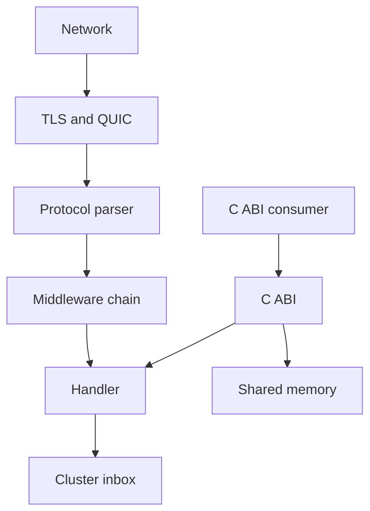

µWebZockets bounds network input and owns several protocol boundaries. It is not
a security program. This page states what the framework protects, what the
application must protect, and which attacker is out of scope, so a review can
disagree with a specific claim instead of the whole design.

## Assets

| Asset                          | Lives in                                | Primary risk                         |
| ------------------------------ | --------------------------------------- | ------------------------------------ |
| Credentials and tokens         | Application storage and options         | Disclosure, replay, brute force      |
| TLS private keys and CA bundle | Deployment files and per-worker context | Impersonation, forged peers          |
| Request and response content   | Borrowed connection buffers             | Cross-tenant read, log leakage       |
| Connection and worker capacity | Fixed slab and queues                   | Exhaustion, eviction of honest peers |
| Cluster messages               | Per-worker bounded inbox                | Forgery, loss, cross-worker abuse    |
| Application state              | Handler-owned storage                   | Unauthorized mutation                |
| Availability                   | Event loop and OS resources             | Slow peers, oversized work           |

## Trust boundaries

| Boundary      | Framework control                                              | Residual risk                                     |
| ------------- | -------------------------------------------------------------- | ------------------------------------------------- |
| Network       | Bounded reads, connection capacity, idle and header deadlines  | Volume attacks and OS exhaustion stay outside     |
| TLS and QUIC  | TLS 1.3 only, ALPN policy, QUIC 0-RTT off, mTLS modes          | Certificate trust, rotation, and CRL enforcement  |
| Parser        | Length bounds, framing rejection, control-character validation | A parser defect remains possible                  |
| Middleware    | Credential comparison, CORS matching, token buckets            | Key choice, thresholds, and policy                |
| Handler       | Borrowed slices with a defined lifetime                        | Application logic, authorization, and data access |
| Cluster inbox | Bounded per-worker inbox, publish report                       | Cross-worker trust and message meaning            |
| C ABI         | Opaque handles, explicit destroy, nonzero errors               | Handle lifetime and copying borrowed slices       |
| Shared memory | Fixed blocks, generation-checked handles, atomic state         | Host-side validation of block contents            |

Each boundary has a different failure mode. Oversized input is a `431` or `413`;
malformed input is a `400` or a closed connection; non-safe early data is a `425
Too Early`. A capacity failure is a refused connection or a startup error, and a
handler defect is application behavior the framework cannot see.

## Attacker capabilities

| Attacker                           | Capability                                      | Control that must hold                           |
| ---------------------------------- | ----------------------------------------------- | ------------------------------------------------ |
| Unauthenticated network client     | Arbitrary bytes, slow requests, oversized input | Parser bounds, deadlines, rejection documents    |
| Authenticated low-privilege caller | A valid credential and forged optional fields   | Authorization in the handler, unique-field reads |
| Browser page on another origin     | Cookies on the handshake, cross-origin reads    | Origin allow list, CORS, `Vary: Origin`          |
| On-path observer without TLS       | Read and modify plaintext                       | TLS 1.3, HSTS, no cleartext credentials          |
| Peer sharing one QUIC connection   | Malformed streams beside healthy ones           | Stream-scoped `H3_MESSAGE_ERROR`, header limits  |
| Local process with shared memory   | Read and write mapped blocks                    | Host validation, generation-checked handles      |
| Operator with deployment access    | Read files, change configuration, read logs     | Secret storage, redaction, least privilege       |

The framework assumes the attacker controls bytes on the wire and, in the
browser case, the page that opens the connection. It does not assume the attacker
controls the process.

## Non-goals

| Non-goal                                      | Why it stays outside                                          |
| --------------------------------------------- | ------------------------------------------------------------- |
| Web application firewall                      | Payload semantics belong to the application                   |
| DDoS absorption                               | Capacity is finite; upstream scrubbing is a deployment choice |
| Identity provider                             | No user store, session, or token issuance                     |
| Secret manager                                | Credentials are borrowed values supplied by the caller        |
| Cryptographic review replacement              | TLS and crypto dependencies need their own review             |
| Operating-system hardening                    | File permissions, limits, and sandboxing are deployment work  |
| Protection from a malicious handler           | Handler code runs with the worker's authority                 |
| Protection from same-address-space attackers  | A process that can read memory already has the secrets        |
| Live WebTransport or HTTP/3 extension surface | The modules are not connected to the listener                 |

A feature can be correct and still be the wrong control for a threat. Constant-time
credential comparison does not stop phishing; exact CORS matching does not stop a
native client; a token bucket does not stop a distributed attack with many keys.

## What the framework does not protect against

- A weak or reused credential. High-entropy tokens are an application decision.
- A credential leaked through logs, error bodies, or a crash dump.
- Authorization mistakes after a valid credential is accepted.
- A compromised dependency or a malicious build input.
- Traffic that stays under every byte limit but exhausts worker time.
- A revoked certificate when the CA bundle carries a CRL; revocation is loaded
  but not enforced by the TLS layer.
- A client certificate on HTTP/3; client authentication is not wired through the
  QUIC transport.
- HTTP/3 clustering; the listener is single-application.

Bounded buffers, sanitizers, fuzzing, and protocol compliance suites are evidence
that a class of defect is less likely. They are not a proof of correctness, and
they do not replace a review of your own workload.

## Evidence

- [Security model](/docs/concepts/security-model) maps the same boundaries to the
  shipped controls.
- [Input hardening](/docs/security/input-hardening) lists the parser bounds and
  framing rules.
- [Report a vulnerability](/docs/security/reporting) is the path for a defect that
  crosses a boundary.
