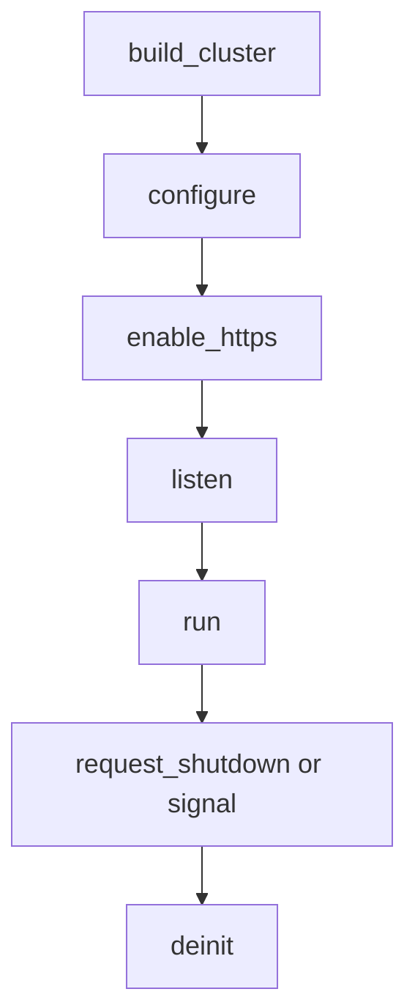

A TCP cluster terminates TLS with one BoringSSL context per worker. Call
`Cluster.enable_https` with PEM files, or `Cluster.enable_https_ephemeral` for
local development, after `configure` and before `listen`. No credential,
session-cache, handshake, or ticket state is shared between loops.

## Lifecycle order



The supported order is `build_cluster` -> `configure` -> `enable_https` (or
`enable_https_ephemeral`) -> `listen` -> `run` -> `request_shutdown` or a
shutdown signal -> `deinit`. TLS setup is startup work: `listen` locks routes
and starts accepting, so the enable call must not move after it.

## Enable TLS

```zig src/main.zig
const std = @import("std");
const uz = @import("uWebZockets");

fn hello(_: *uz.Request, response: *uz.Response) void {
    response.text("hello from a TLS worker") catch |err| {
        std.log.err("response failed: {}", .{err});
    };
}

pub fn main(init: std.process.Init) !void {
    var cluster = try uz.Server.builder(init.io)
        .with_max_clients(128)
        .build_cluster(std.heap.page_allocator, 4, .{});
    defer cluster.deinit();

    const Group = @TypeOf(cluster);
    try cluster.configure(struct {
        fn routes(worker: *Group.Worker, index: usize) !void {
            _ = index;
            _ = try worker.get("/", hello);
        }
    }.routes);

    try cluster.enable_https("certs/fullchain.pem", "certs/privkey.pem");
    try cluster.listen("0.0.0.0", 8443);
    try cluster.run();
}
```

The `4` passed to `build_cluster` is the compiled capacity. Use
`build_cluster_from_environment` to resolve `UWEBZOCKETS_WORKERS` or default to
the platform CPU count; `ClusterOptions.worker_count` selects an explicit
smaller count. Only active workers create TLS contexts, slabs, and threads.

## One context per worker

Each worker creates and owns one `SSL_CTX` at enable time, before any listener
exists. Every accepted connection creates its own `SSL` from its worker's
context. The certificate and key files are read once per worker at startup. No
lock or allocation is added to the request path, and `Cluster.deinit` releases
each context with its worker.

## Cross-worker resumption

Per-worker ticket keys mean same-worker resumption works and cross-worker
resumption does not. A reconnect that the kernel distributes to a different
worker pays a full handshake. This is an accepted boundary for the target HTTP
workload, not a defect, and it is recorded in
[ADR 0003](https://github.com/farbenbuilds/uWebZockets/blob/main/docs/adr/0003-tls-cluster-operational-boundaries.md).
Sharing ticket keys would require a cross-loop key manager, a rotation policy,
and a measured TLS-state cost.

## Rolling restart

Rotating credentials requires a rolling restart because each worker reads the
PEM files once at enable time. This applies to production PEM files and to
generated certificates. There is no hot reload. See
[Certificate rotation](/docs/security/certificate-rotation) for the procedure.

## Errors

| Error                         | Cause                                                |
| ----------------------------- | ---------------------------------------------------- |
| `ClusterDeinitialized`        | A lifecycle-sensitive call was made after `deinit`   |
| `ClusterRunning`              | A configuration call was made while `run` was active |
| `ClusterStopped`              | A call was made after `run` returned                 |
| `AlreadyListening`            | `enable_https` was called after `listen` started     |
| `TlsAlreadyEnabled`           | `enable_https` was called more than once             |
| `CertificateLoadFailed`       | The PEM chain could not be read or parsed            |
| `PrivateKeyLoadFailed`        | The PEM key could not be read or parsed              |
| `KeyMismatch`                 | Defensive check; BoringSSL rejects the key at load   |
| `TlsContextCreationFailed`    | BoringSSL could not allocate a context               |
| `ProtocolConfigurationFailed` | TLS 1.3 bounds could not be applied                  |
| `ApplicationUnavailable`      | A worker was already shutting down or deinitialized  |

A failed credential load or context creation releases exactly the contexts that
call created and can be retried once the cause is fixed. It never rewrites or
releases a context installed by an earlier successful call.

## Boundaries

- `enable_https` does not configure client certificates. Use single-application
  `init_https_mtls` when mTLS is required.
- `enable_https_ephemeral` generates a distinct self-signed certificate per
  worker, takes no custom names, and is development-only. Because each worker
  presents a different certificate, it is unsuitable for certificate pinning.
- HTTP/3 and QUIC clustering are not supported. `init_http3` and `listen_udp`
  remain single-application APIs, and a cluster listener is TCP/TLS only.
- Cluster TLS keeps the single-application policy: TLS 1.3 only, ALPN `h2` then
  `http/1.1`, and safe-method 0-RTT with non-safe early data answered `425 Too
Early`.

## Verify

```sh
zig build run
curl -sk https://127.0.0.1:8443/
```

With the PEM files from the example, the response body is
`hello from a TLS worker`. Use `curl -v` when the certificate is trusted, or
`-k` when you test with a self-signed pair. To try the generated path, replace
the enable call with `enable_https_ephemeral` and restart the group.

## Related

- [Certificate rotation](/docs/security/certificate-rotation) covers the rolling
  restart that replaces per-worker credentials.
- [Shared-nothing workers](/docs/concepts/shared-nothing) explains why each
  worker owns a TLS context.
- [Your first cluster](/docs/examples/first-cluster) starts the plaintext worker
  group this page extends.
